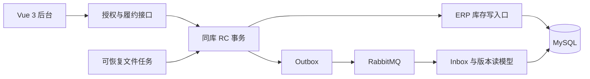

# B2B 订单与多仓履约系统

基于芋道 ERP 的 Java 后端二次开发项目，围绕企业销售订单，完成多仓预占、部分发货、取消、退货、库存核对、可靠消息与可恢复文件任务。

**技术栈：** Java 17 · Spring Boot 3.5 · MyBatis-Plus · MySQL · Redis · RabbitMQ · Flyway · Vue 3 · TypeScript。

## 项目入口

| 目录 | 内容 |
| --- | --- |
| [项目代码](项目代码/README.md) | 前后端源码、构建、部署、数据库迁移、集成验收脚本 |
| [学习资料](学习资料/README.md) | 完整学习教程、192 道专题问答、40 道综合追问、设计决策与验收证据 |

源码与资料按两个主文件夹整理；本机依赖、数据库数据、运行日志、私有上传文件和个人配置不作为源码发布。

## 核心能力

- **多仓履约**：源单绑定、分仓预占、部分发货、取消和到期释放。
- **统一库存保护**：ERP 唯一修改实物库存，履约协调占用；兼容旧出库、调拨、盘点和采购退货入口。
- **退货与核对**：按原发货控制退货额度，原仓入库；只读一致性快照核对库存与履约事实。
- **可靠消息**：同事务 Outbox、RabbitMQ 确认与失败恢复、Inbox 幂等、版本读模型。
- **可恢复文件任务**：CSV 导入、逐行事务、租约与 fencing、取消重试、游标 XLSX 导出和私有文件下载。
- **授权与交付**：仓库 READ/OPERATE、审计、数据库 V1—V8、独立运行包与固定演示流程。

## 业务示例

西安仓 6 件、上海仓 8 件，订单订购 10 件：预占 6+4 → 西安发 4 → 取消剩余 6 → 签收 → 原仓退回 2。

最终西安 H=4/R=0，上海 H=8/R=0；订单 shipped=4、cancelled=6、returned=2。库存满足 **H≥R≥0，A=H−R**，退货不会倒减累计发货。

## 架构



## 运行与学习

运行命令以 **项目代码** 为工作目录。Windows 本机依赖准备、构建、启动与首次初始化步骤见[代码运行说明](项目代码/README.md)。首次建库会拒绝覆盖已有数据库，已有库应按迁移说明操作。

```powershell
cd 项目代码
# 已完成本机依赖安装和数据库初始化时：
./scripts/Start-Local.ps1
```

启动后前端 `http://127.0.0.1:15173`，后端 `http://127.0.0.1:48080`。这些地址需要在自己的电脑上启动服务，本仓库不提供在线托管演示。

学习建议：[事实与贡献边界](学习资料/01-系统学习教程/00-完成度与事实边界.md) → [学习路线](学习资料/01-系统学习教程/01-学习路线与每日任务.md) → [源码导航](学习资料/01-系统学习教程/19-真实代码导航.md) → [面试题索引](学习资料/02-面试问答/16-题目总索引.md)。

## 验证证据与范围

M0—M7 主线及 V8 已完成。历史归档包括 60 个指定 JUnit 用例、T01—T30 场景、1152 次查询与 512 次库存计时请求；它们是本机历史验收与合成实验，发布本仓库不代表重新执行这些检查，也不代表生产容量、集群 HA 或跨机部署验证。

入口：[项目状态](学习资料/09-项目规范与进度/PROJECT_STATUS.md)、[M7 总报告](学习资料/10-验收证据/M7-验收报告.md)、[最终矩阵](学习资料/10-验收证据/M7.2-验收报告.md)、[性能报告](学习资料/10-验收证据/M7.3-性能报告.md)。

一份 M4.2 子报告曾被后续测试覆盖，原字节未恢复，见[历史证据例外](学习资料/10-验收证据/M7-evidence-exception.json)。发布资料中的历史绝对路径是当时机器上的记录，当前位置见整理清单。发布包不附带本机恢复备份及依赖，引用这些本地附件的历史链接仅用于原工作区溯源。

## 来源、许可证与个人贡献

登录、租户、产品、客户、采购销售和 ERP 基础出入库复用芋道；履约、统一库存守卫、核对、消息、任务与仓库授权为本项目二次开发内容。项目使用 AI 辅助开发，不能把完整 ERP 写成个人从零实现，个人独立掌握程度需通过实际讲解与推演证明。

- 后端固定上游提交：`7c397bbfae3e768b26e3ee962c5aa7064e8d7c96`。
- 前端固定上游提交：`0af03a93b6b6300f878e28add69b1c7a9f09ec34`。
- [来源锁定](项目代码/docs/baseline.lock.json)、[真实源码差异](学习资料/10-验收证据/M7-source-diff.json)。
- 保留上游 [后端 MIT](项目代码/backend/LICENSE) 和 [前端 MIT](项目代码/frontend/LICENSE)；各组件及第三方依赖继续遵守原许可证。

本项目面向学习、代码审阅和面试展示，未接入真实物流、资金退款或生产业务数据。示例配置中的本地演示凭据和上游公开测试值不得用于生产部署。
