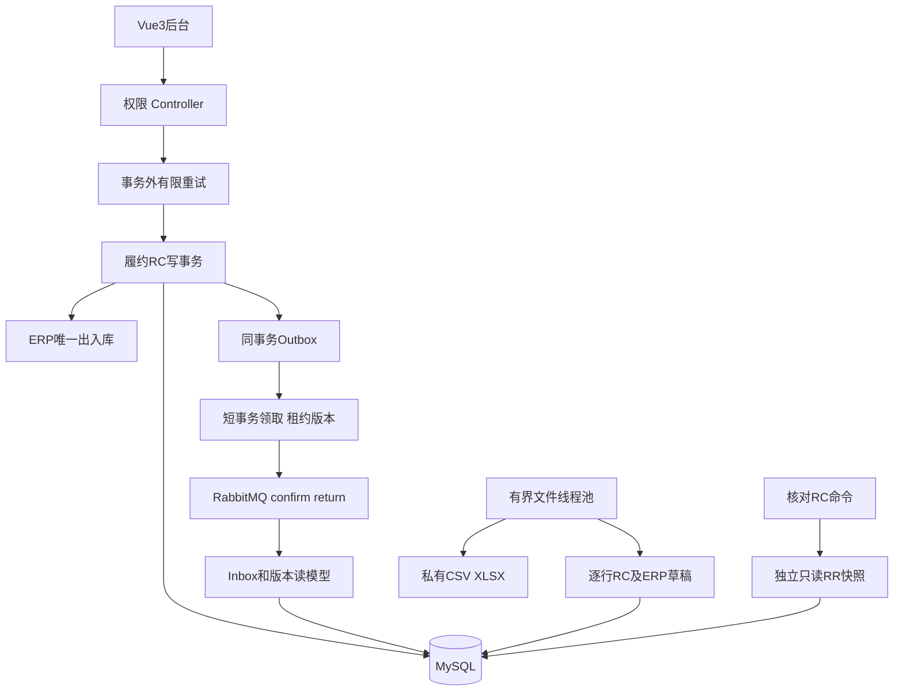

# 03 完整架构与技术职责

Spring Boot模块化单体，共同MySQL负责事实，Redis提供基座登录/单号，RabbitMQ投递事件，后台线程处理到期与文件。

ERP唯一改H；履约协调R/执行量/命令/事件；消费者只更新读模型，不再出库；文件导入只建未审核草稿；核对只读业务，不自动修复。

server→fulfillment→ERP保持依赖。ERP声明Policy/Port，履约实现托管策略；端口是同进程能力，能加入同库事务，不是RPC。

Java17/Boot3.5.15处理Web和代理，MyBatis-Plus常规映射，Mapper/JdbcTemplate明确锁/游标；MySQL8.4.6维护约束和MVCC，FlywayV1—V8。RabbitMQ持久化/confirm/return/ACK覆盖不同窗口。ThreadPoolExecutor有界池限制资源，持久化任务/租约承担恢复。Vue3/TS/Element Plus提供履约/核对/消息/文件/仓库页面。

三类读取区分：核心RC写事务用当前读和锁；核对独立REQUIRES_NEW只读RR统一观察17表、外层RC存报告；导出游标分批不是整体RR快照。前者维护原子性，后两者分别权衡一致性和资源。

热点行会排队，核对占两连接并有上限，Outbox允许重投，私有文件发布要fence，索引有维护成本。多JVM正确性与单JVM性能不混称分布式微服务或HA。
