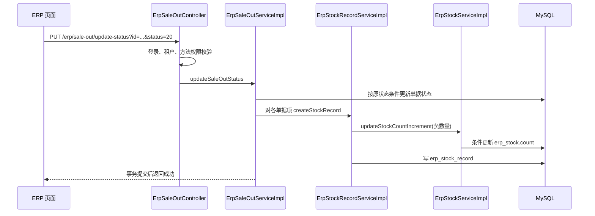

# M0 讲解：基座怎样运行，库存什么时候改变

> 阅读语境：以下正文记录该阶段当时的实现和取舍，早期“后续待做”仅为历史状态。当前M0—M7已经完成，请结合[现行总目录](../README.md)与系统教程。工程验收原件未改。

## 1. 这次交付的边界

这一阶段将锁定的芋道 ERP 基座落地，补齐运行配置、缺失的 33 张 ERP 表、启动脚本与真实接口验收。产品、采购、销售、角色权限和页面属于上游已有能力；本阶段新增成果是工程落地、DDL、配置收敛、兼容修复和可重复验证。

预占、自动分仓、部分履约、Outbox 还没有实现。不能把“有多个仓库的 ERP”写成“已经实现多仓自动履约”。

## 2. 先用一个业务例子理解

公司采购 100.123456 件纸，销售给客户 30.12 件，盘点发现少了 1 件。

| 动作 | 实物库存 H | 为什么 |
| --- | --- | --- |
| 创建、审核采购订单 | 0 | 订单表达采购约定，货物尚未入库 |
| 保存采购入库单 | 0 | 草稿还没有审核 |
| 审核采购入库单 | 100.123456 | 审核执行入库，产生实物流水 |
| 保存销售出库单 | 100.123456 | 保存草稿不扣实物库存 |
| 审核销售出库单 | 70.003456 | 扣除 30.12，并写出库流水 |
| 审核盘亏 1 件 | 69.003456 | 盘亏也走同一库存变更入口 |
| 反审核盘点 | 70.003456 | 产生反向库存变动与流水 |
| 再次审核盘点 | 69.003456 | 重新执行盘亏 |

这正是 `tests/m0_smoke.py` 实际执行的案例。测试额外验证重复审核被拒绝、超出现货库存的出库审核失败，且失败后的单据状态、库存和流水保持一致。

注意上游的两个不同口径：**实物库存只在出入库审核时改变；销售订单的 outCount 汇总在保存出库草稿时就会更新。** 因此后续绑定履约必须检查关联出库单据，不能只凭一个“已出库数量”字段推断是否有实际出库。

## 3. 一个请求怎样走到数据库

以审核销售出库为例：

真实阅读入口：

1. [出库 Controller](../../项目代码/backend/yudao-module-erp/src/main/java/cn/iocoder/yudao/module/erp/controller/admin/sale/ErpSaleOutController.java)：查看路由、参数、`@PreAuthorize`，不要从框架源码开始读。
2. [出库 Service](../../项目代码/backend/yudao-module-erp/src/main/java/cn/iocoder/yudao/module/erp/service/sale/ErpSaleOutServiceImpl.java)：看 `createSaleOut` 和 `updateSaleOutStatus`，区分保存和审核。
3. [库存流水 Service](../../项目代码/backend/yudao-module-erp/src/main/java/cn/iocoder/yudao/module/erp/service/stock/ErpStockRecordServiceImpl.java)：先变库存，再写流水；位于事务中。
4. [库存 Service](../../项目代码/backend/yudao-module-erp/src/main/java/cn/iocoder/yudao/module/erp/service/stock/ErpStockServiceImpl.java)：查询库存、校验数量、调用 Mapper。
5. [库存 Mapper](../../项目代码/backend/yudao-module-erp/src/main/java/cn/iocoder/yudao/module/erp/dal/mysql/stock/ErpStockMapper.java)：SQL 减库存同时带余额条件，并检查受影响行数。
6. [本次实际测试](../../项目代码/tests/m0_smoke.py)：对照业务步骤和数据库断言阅读。

## 4. Spring 事务在这里保证什么

审核方法有 `@Transactional(rollbackFor = Exception.class)`。经 Spring 代理进入 Service 后，单据状态、库存和流水在同一个数据库事务中提交。库存不足抛异常时，前面已经执行的单据审核状态修改也回滚。

本阶段已实测这个顺序场景，但还没有完成并发正确性验证。**事务不能自动让“先读旧余额再返回新余额”的代码在并发下正确。** 上游库存 Service 返回 `读到的 count + delta`；M2 要改为持有行锁的当前读，并覆盖所有旧库存入口，才能保证并发下流水余额也准确。

## 5. 为什么要补表，怎样避免漏字段

上游主 SQL 提供 48 张 system/infra 表、ERP 菜单与字典，未提供 ERP 业务表 DDL。我们从 33 个 `@TableName` 实体提取列，补上 BaseDO 公共字段，并逐表与真实 MySQL 的 `information_schema.COLUMNS` 比较。

- `Long` 对应 BIGINT，自增 ID 由 MySQL 生成。
- 数量和金额使用 DECIMAL(24,6)，Java 使用 BigDecimal；本次六位小数库存检查通过。
- 可选关联 ID 缺省 NULL，不能用 0 代替“没选择”。
- 所有 ERP 表都有 `tenant_id`，虽然实体继承 BaseDO：租户拦截器仍会加这一条件。
- 库存以 `(tenant_id, product_id, warehouse_id)` 唯一定位。
- 这份 DDL 是我们根据公开代码补齐的实现，不能称为芋道官方 ERP SQL。

参见 [完整实体清单](../10-验收证据/M0-erp-schema.md)、[DDL](../../项目代码/deploy/sql/010-erp.sql)、[生成和漂移检查脚本](../../项目代码/scripts/erp_schema.py)。

现有页面数量通常显示三位小数，金额显示两位；数据库保存精度与页面格式化精度不同。本阶段的精度结论来自数据库断言；M2/M3 新增履约页面要按规格明确数量展示与传输。

## 6. 登录、角色与菜单怎样联动

1. 前端提交租户和账号密码，服务端验证密码，返回登录 Token。
2. 后续请求携带 Authorization 和 tenant-id。登录状态由基座 Redis 能力支持。
3. 后端权限接口返回菜单与权限标识；前端生成可访问路由和按钮。
4. Controller 方法上的 `@PreAuthorize` 执行服务端功能权限校验；隐藏按钮本身不构成权限保护。
5. MyBatis 租户拦截器为业务表追加租户条件；任务线程、对象级仓库权限等仍需后续实现与专门测试。

本阶段验证了匿名请求被拒绝、真实密码登录和管理员读取菜单。仓库人员越权、跨租户、异步任务上下文是后续验收内容，不能用本轮结果代替。

## 7. 环境与排障中学到什么

| 现象 | 原因和处理 |
| --- | --- |
| Maven 不在 PATH | 加入官方 Maven Wrapper，固定 3.9.16 及下载 SHA256 |
| 系统已有 MySQL 8.0 | 使用独立 MySQL 8.4.6 数据目录与 33306 端口，保留原服务 |
| MySQL 在中文可执行路径下启动异常 | 项目 `.local` 通过英文目录 Junction 访问；不移动用户源码 |
| pnpm 11 拒绝镜像 URL，后续下载也报错 | 将锁文件 159 个 npmmirror URL 改为 npm 官方地址，保留版本与 integrity，固定 pnpm 9.15.9 后冻结安装成功 |
| 未启用的 OA 页面导致生产构建失败 | 限定动态路由扫描并移除非本项目静态路由；保留源码供参考 |
| 微信 SDK 阻止基础服务启动 | system 社交服务依赖 SDK Bean，提供本地占位参数，关闭实际社交集成 |
| Windows 构建时不能替换正在运行的 Jar | 启动脚本运行 `.local/backend-run.jar` 副本，构建产物与运行副本分开 |
| Redis 持久化切换时缺失单号序列 | 数据库唯一键拒绝重复号；从已存在 SQL 单据号最大值向上恢复 Redis 计数器，再验证 AOF 和正常重启；恢复脚本不修改业务表 |
| 出库测试漏传结算账户 | 虽然请求 VO 未声明必填，上游 Service 仍无条件校验；按页面契约传入有效账户 |

前端普通首页的项目数、天气等是上游静态演示内容，不是本项目业务指标；演示时使用 ERP 首页、库存和流水页面。

## 8. 面试时这一阶段怎么说

“我基于芋道 ERP 二次开发，先固定前后端版本并建立可复现运行环境。公开基座缺少 ERP 业务 DDL，我根据实体、查询与租户拦截规则补齐 33 张表，并用真实 MySQL 和 HTTP 测试验证采购入库、销售出库、盘点及失败回滚。这些基础业务复用了开源能力，后续个人改造重点是履约和库存一致性。”

此时不能说自己已经完成高并发防超卖或可靠消息。它们分别要等 M2、M5 的实现和故障实验通过。

## 9. 建议你花 30—45 分钟完成的阅读

1. 启动系统，找到某个 M0 测试商品的库存及出入库流水。
2. 沿第 3 节六个文件，找到“创建”和“审核”的区别。
3. 看测试脚本的 `balances`：它同时检查了什么，为什么只看接口成功还不够？
4. 思考：如果两条请求都先读到库存 100，一条加 10，一条减 20，条件 SQL 和事务能否保证各自写入的流水余额都准确？这个问题将在 M2 解决。

下一阶段：M1 建立独立履约模块、迁移历史、源订单绑定与冻结规则，不先做消息队列。
