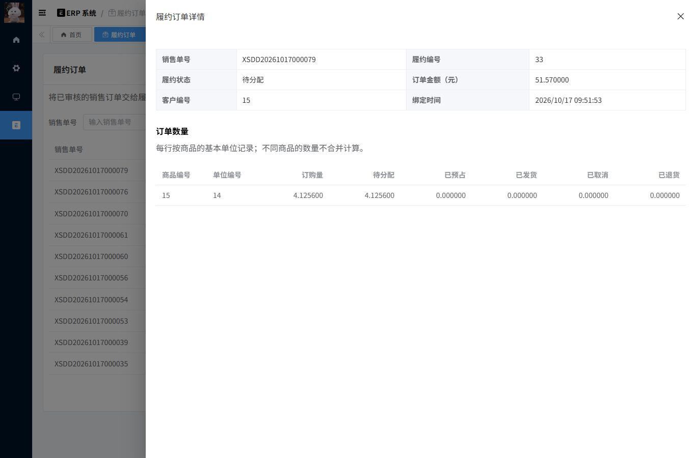

# M1：订单接管、幂等与并发保护

> 阅读语境：以下正文记录该阶段当时的实现和取舍，早期“后续待做”仅为历史状态。当前M0—M7已经完成，请结合[现行总目录](../README.md)与系统教程。工程验收原件未改。

日期：2026-10-17。配套 [验收报告](../10-验收证据/M1-验收报告.md)、[设计决策 ADR-010](../05-设计决策与复盘/ADR-010-M1-绑定与迁移边界.md)。

## 1. 先用一笔真实订单理解

浏览器演示的销售单是 `XSDD20261017000079`，ERP 记录编号 `90`，绑定后的履约编号 `33`。订购数量是 `4.125600`，订单金额快照是 `51.570000` 元。

客户下单只说明“买什么、买多少、多少钱”。履约需要继续回答“还剩多少没分配、占了哪些仓、发出了多少、取消了多少”。因此保留 ERP 销售单，新增一张一对一的执行单。

绑定后的初始状态：

| 数量 | 值 | 含义 |
| --- | --- | --- |
| ordered | 4.125600 | 客户订购量快照 |
| open | 4.125600 | 尚未分配的量 |
| reserved | 0.000000 | 当前没有预占 |
| shipped | 0.000000 | 当前没有发货 |
| cancelled | 0.000000 | 当前没有取消 |
| returned | 0.000000 | 当前没有退货 |

这一步没有入库或出库，商品没有产生 ERP 库存流水。绑定只建立执行快照。分仓、预占和发货属于 M2/M3。



## 2. 本阶段哪些是自己的代码

| 范围 | 来源 / 本次工作 |
| --- | --- |
| 登录、租户、角色菜单、ERP 产品与销售单 | 复用固定版本芋道基座 |
| `yudao-module-fulfillment` | 本项目新增的履约模块 |
| 履约表、数量约束、快照、绑定命令 | 本项目新增 |
| ERP 托管策略接口、行锁守卫、旧入口接入 | 在基座上改造 |
| 履约列表、绑定侧栏、详情 | 复用现有 Vue/Element Plus 组件，新写业务页面 |
| 库存预占、发货适配器、RabbitMQ、Outbox | 尚未实现 |

面试时要能准确说：“基于芋道 ERP 二次开发，我负责履约扩展和旧业务入口的一致性保护。”

## 3. 一次绑定请求实际怎样执行

入口：`backend/yudao-module-fulfillment/src/main/java/cn/iocoder/yudao/module/fulfillment/controller/admin/FulOrderController.java`。

核心：同目录模块中的 `service/FulOrderService.java`，方法 `bind`。

```text
校验登录与 fulfillment:order:bind 功能权限
  → 从服务端取得 tenant 和 actor
  → 校验 Idempotency-Key 和源单 ID
  → 创建 / 锁定本次命令记录
  → 比较规范化请求的 SHA-256
  → FOR UPDATE 锁住 ERP 销售单
  → 检查对象归属范围
  → 已成功处理过则验证当前访问范围后返回原结果
  → 不同命令键但源单已绑定，则返回已有履约单
  → 检查源单已审核且没有任何出库、退货历史
  → 锁源单明细，校验租户内关联对象
  → 插入履约单和逐行数量、价格快照
  → 保存本次命令响应
  → 一起提交
```

这些步骤在一个本地数据库事务内。若第二条明细数量不合法，第一条明细和履约单头即使已经插入，也必须随命令记录一起回滚。验收确实构造了这个场景。

## 4. 为什么“先查是否绑定，再插入”不够

两个请求可能同时查到“未绑定”。因此有两层约束：

- 源单行锁：同一张销售单的接管与旧 ERP 写入排队执行。
- 唯一索引：`tenant_id + erp_order_id` 最终约束一张源单只能对应一张履约单。

幂等键解决的是“同一个命令重复到达”。业务唯一键解决的是“不同命令想接管同一张源单”。不能用其中一个代替另一个。

验收中 8 个不同键同时绑定同一源单，返回同一个履约编号；另有 6 个相同键并发请求，只产生一条命令记录。这里只说明这些并发用例通过，没有测吞吐量。

## 5. 幂等记录为什么要带操作者和请求摘要

命令唯一范围是 `tenant + actor + command_type + key`。

- 同一键、同一请求：返回持久化的成功响应。
- 同一键、不同源单：拒绝，不能把上一笔结果错配给下一笔。
- 上一次事务失败：命令记录也回滚；修正业务条件后可以重试。
- 权限后来被撤销：即便原来成功过，也不能通过重放绕过当前权限。

`request_hash` 来自规范化后的 `BIND:v1:<源单数字ID>`；不直接对原始 JSON 文本做摘要，因此无关字段顺序不会决定业务身份。当前绑定命令只支持一个源单字段。

前端在同一次表单重试中保留键，不在每次点击时换键；修改源单后才更换。即便关闭重开表单产生新键，源单唯一约束仍会阻止重复接管。

## 6. 为什么必须改旧 ERP 入口

如果只把履约页面按钮禁用，调用原来的销售单修改、反审核、出库接口，仍可能改变执行依据。

ERP 模块因此新增 `ErpManagedOrderPolicy` 扩展点，履约模块提供策略实现。依赖方向保持：

```text
server → fulfillment → ERP → system
                     ERP 声明接口，fulfillment 实现接口
```

ERP 不需要依赖履约模块。源单修改、状态变更、删除、关联出库/退货写入及数量回填都通过守卫。绑定后返回明确的 `MANAGED_ORDER_FROZEN`。

M1 还没有内部发货适配器，因此所有旧手工出库/退货都拒绝，不存在请求参数或线程标记可以绕过。M3 再增加受控内部端口。

### 6.1 关联单据改挂订单时的细节

一张旧出库单可能从订单 A 改挂到 B。必须先按 ID 升序锁 A、B，再锁出库单。锁等待结束后，重新读取出库单的当前关联订单。

若另一条请求已把它改挂到 C，本次请求应拒绝并要求重读，不能拿着 A、B 的锁去修改属于 C 的单据。

`tests/m1_locking.py` 确实让两条请求先读到同一旧关联，再等待锁：最终一条成功，另一条收到 `SOURCE_ORDER_CHANGED`，旧订单出库计数恢复为 0，只有一个新订单计数为 1。

## 7. 本次实际发现的一次死锁

最初只显式给绑定事务配置 RC，旧 ERP 事务仍使用 MySQL 默认 RR。

旧事务锁订单 A，并查询“A 尚无履约记录”。RR 下这个锁定读可能持有唯一索引的间隙锁。另一条事务锁订单 B，准备插入 B 的履约记录；若 B 落在该间隙，插入就会等待旧事务。旧事务此时又等待 B 的源单行锁，形成循环：

```text
旧事务持有：A 的源单锁 + 履约索引间隙锁
旧事务等待：B 的源单锁
绑定事务持有：B 的源单锁
绑定事务等待：向旧事务锁住的间隙插入
```

MySQL 检测死锁并回滚一个事务，数据没有出现半提交，但接口返回 500，体验和命令语义都不好。

本项目 profile 改为统一 READ COMMITTED，并在启动时读取真实业务连接校验隔离级别。这个缺失记录查询在 RC 下不再保留上述间隙锁；仍保留源单行锁、当前读、唯一索引和完整业务事务。

修改后重跑同一受控交错：绑定成功，等待中的旧修改看到新托管记录并被拒绝，原出库单没有被改挂。这是可复现的正确性证据。不要说“RC 完全没有间隙锁”或“改成 RC 就不会死锁”；外键、唯一性检查和其他锁顺序仍可能产生锁等待或死锁。M2 将设计完整写命令的有界重试。

## 8. 数量状态怎样计算

源码：`domain/OrderQuantities.java`、`domain/OrderStatusCalculator.java`。

每行必须满足：

```text
ordered = open + reserved + shipped + cancelled
0 <= returned <= shipped
所有数量非负，ordered > 0，最多六位小数
```

同样的主要约束也写进 MySQL CHECK。这样错误写入不能只依赖 Java 自觉。

| 情况 | 状态 |
| --- | --- |
| 未分配，仍有 open | NEW |
| 已尝试分配，仍有 open，无发货 | WAIT_STOCK |
| open 为 0，仍有预占，无发货 | RESERVED |
| 已发出一部分，尚未全部结束 | PARTIALLY_SHIPPED |
| 全部发出，无取消 | FULFILLED |
| 全部取消，无发货 | CANCELLED |
| 一部分发出、一部分取消，全部结束 | PARTIALLY_CLOSED |

计算器按每行条件归纳状态，不把“3 箱纸”和“5 台电脑”相加。退货不会倒减历史累计发货量，全部发出再退回的订单也不会因此重新变成待发货。

目前只有 NEW 会由绑定写入；其余状态的计算规则已通过单测，实际预占、发货、取消命令尚待后续实现。

## 9. 数据库迁移为什么要显式接管

ERP 基座原来靠初始化 SQL 建库，不存在本项目的 Flyway 历史。自动 baseline 容易把错误库当成正确基座。

所以首次接管分三步：

1. 验证 M0 的 81 张表名与字段集合、ERP decimal 精度。
2. 用户明确运行 baseline，记录版本 0。
3. migrate 执行 V1，新增九张 P0 表和两个菜单。

后续启动只执行 validate/migrate。专用历史表是 `ful_flyway_schema_history`；不自动 baseline，不支持 clean。改动已经执行的 V1 会触发校验失败，后续应新增 V2。

九张表里目前只有订单、明细和命令记录被业务使用。其余预占、发货、流水、回调、仓库授权表只是后续基础，不能据建表宣称功能已经完成。

## 10. 权限、精度与时间

- 登录、RBAC、租户拦截复用基座；新接口增加独立权限符号。
- tenant 与 actor 均从服务端上下文读取，客户端伪造字段不能改变归属。
- 当前租户的超级管理员 / 租户管理员可访问租户内订单；其他用户仅能绑定、查看自己创建的销售单对应履约单。
- 新接口 ID 为字符串，数量和金额为十进制字符串，避免浏览器浮点误差。
- 履约审计时间按 UTC 写入，接口返回带偏移的 ISO 时间字符串，页面按本地时间显示；上游 DTO 不改。
- 部门和仓库范围授权尚未实现，属于 M6。

## 11. 推荐的代码阅读顺序

1. `FulOrderController`：三个接口、权限、幂等键校验。
2. `OrderContracts`：新接口对 ID、数量、时间的约定。
3. `FulOrderService.bind`：事务内命令执行顺序。
4. `FulCommandRecordMapper`：唯一键、重复插入等待、持久化响应。
5. `ErpManagedOrderGuard` 和 `FulfillmentManagedOrderPolicy`：跨模块冻结规则。
6. `ErpSaleOutServiceImpl.lockMutableDocument`：关联变化重检。
7. V1 SQL：唯一键、复合租户外键、数量 CHECK。
8. `tests/m1_acceptance.py` 与 `tests/m1_locking.py`：错误输入、权限、竞争和回滚怎样验证。

## 12. 当前可以怎样讲给面试官

> 我复用 ERP 的商业销售单，设计了一对一的履约扩展。接管命令在本地事务内完成幂等记录、源单锁、业务校验和快照保存，并把原 ERP 写入口接入托管策略。除了唯一索引和重复请求测试，我还用真实 MySQL 控制请求交错，发现 RR 空记录锁定读的间隙锁与源单锁形成死锁，调整本项目隔离级别并重跑用例验证。预占和分仓发货还在下一阶段实现。

先能解释一张销售单从绑定到冻结的完整路径，再讨论锁和隔离级别。M1 还不足以宣称“完成工业级多仓履约平台”，也没有 QPS、P99、消息可靠性或库存高并发成果。

下一阶段 M2 的核心是：在保留 ERP 实物库存 H 的前提下，引入预占 R，保证可用库存 A=H−R，并让旧出库、调拨、盘点、采购退货等入口遵守同一个可用库存边界。
