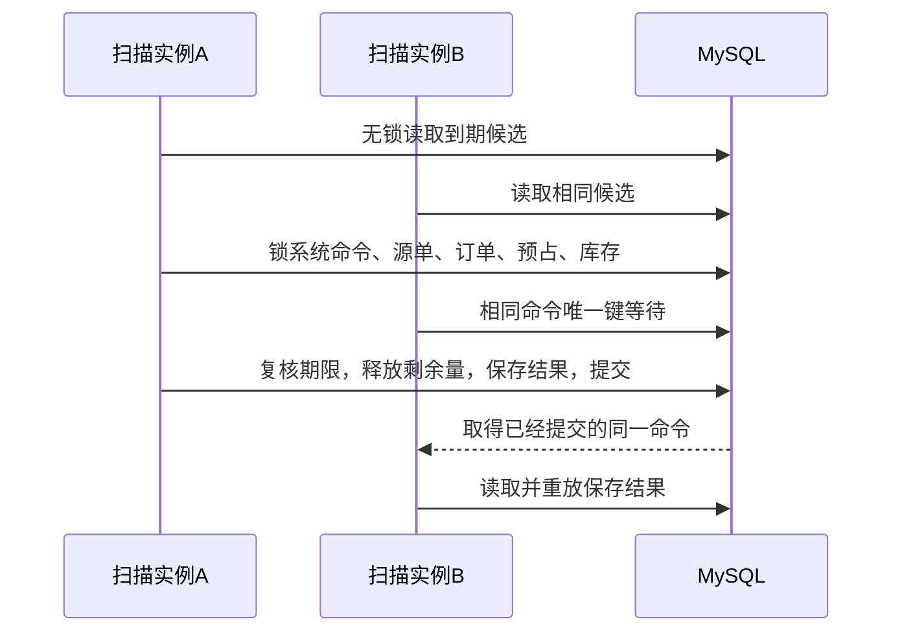

# M4.1：自动到期释放与重复任务

> 阅读语境：以下正文记录该阶段当时的实现和取舍，早期“后续待做”仅为历史状态。当前M0—M7已经完成，请结合[现行总目录](../README.md)与系统教程。工程验收原件未改。

日期：2026-10-19。当前验收结果以 [进度](../09-项目规范与进度/PROJECT_STATUS.md) 和 [执行记录](../10-验收证据/M4.1-expiry-acceptance.json) 为准。本部分是二次开发，Spring 调度、MyBatis、租户工具属于基座或框架能力。

## 1. 先用一张订单理解业务

订购 3.123456 件，库存 H=5。预占后 R=3.123456。先发 1.123456，再手动释放 0.111111，此时：

| 数据 | 到期前 | 到期后 |
| --- | ---: | ---: |
| 实物 H | 3.876544 | 3.876544 |
| 预占 R | 1.888889 | 0 |
| 待分配 open | 0.111111 | 2 |
| 累计发货 shipped | 1.123456 | 1.123456 |
| 累计取消 cancelled | 0 | 0 |

到期的是“剩余库存承诺”，货没有回来，原订单也没有取消。释放后人工重新分配，会产生一条新的预占记录；旧预占的历史不能复活。

这个精度案例会用真实60秒期限执行；其他锁竞争和积压场景只修改测试预占的截止时间来安排交错，不直接修改库存或业务数量。两种验证在执行记录里明确区分。

## 2. 实际调用链

1. [ExpirySchedulingConfiguration](../../项目代码/backend/yudao-module-fulfillment/src/main/java/cn/iocoder/yudao/module/fulfillment/framework/ExpirySchedulingConfiguration.java) 创建独立单线程调度器。当前本机没有启用 Quartz，取舍见 [ADR-013](../05-设计决策与复盘/ADR-013-M4.1-到期任务与系统命令.md)。
2. [FulExpiryScanner.scan](../../项目代码/backend/yudao-module-fulfillment/src/main/java/cn/iocoder/yudao/module/fulfillment/framework/FulExpiryScanner.java) 无锁读取到期候选，逐条切换到候选租户，验证租户有效。
3. `DatabaseCommandRetry.run` 在事务外调用 [FulExpiryService.expire](../../项目代码/backend/yudao-module-fulfillment/src/main/java/cn/iocoder/yudao/module/fulfillment/service/FulExpiryService.java)。只有数据库锁失败重试，最多3次，每次进入一笔新事务。
4. `FulCommandService.claimExpiry` 以 actor0 保存系统命令。幂等键固定为 `reservation:<ID>`，命令类型 EXPIRE，租户参与唯一键。
5. 按源单→履约主单→明细→预占→库存获取锁，当前读重新检查期限和剩余 held。
6. 同一事务修改 R、held/released、订单 reserved/open、派生状态和版本，保存 EXPIRE 流水和命令结果；H和ERP实物流水都不写。

扫描器日志中的 `outcome=EXPIRED` 可以是重放的原结果，不能直接拿日志行数当作释放次数。真正的业务效果以唯一命令、预占事实和流水核对。

## 3. 为什么不能先锁预占，再找订单

发货已经按“订单→预占”获取锁。到期若反过来，会出现：发货持有订单等预占，到期持有预占等订单，两边互相等待。候选扫描只读取ID相关信息；进入事务后始终按既有协议重新锁定和校验。

锁定候选不等于候选仍有效。扫描后可能已部分发货、完全发货、取消或手动释放。只处理最新剩余 held；已经关闭的预占没有第二次库存效果。未来期限候选回滚本次命令，不能保存一个会永久阻止将来到期的“暂时无事可做”。

## 4. 定时器晚到，会不会多发货

发货命令在取得库存锁之后重新取当前UTC时间，发现期限已到就整笔回滚。即使调度器暂停或扫描延迟，发货也不能把过期预占当作有效承诺。

如果发货在期限之前完成校验并合法提交，随后扫描器读取到 consumed/held=0，就不释放已经发出的数量。两者通过数据库锁串行化，不需要 JVM `synchronized` 或 Redis分布式锁。

当前实验是同机双JVM，并未验证跨机器的时钟偏差。截止时间和校验使用应用UTC时钟，部署到多台服务器必须保持时钟同步；不把当前实验说成跨机器生产验证。

## 5. 为什么分页游标也属于可靠性

默认每批50条，一轮最多4批，轮间5秒。它限制一次工作的记录数；每条仍可能等待锁、做三次事务重试，因此一轮不保证在5秒内结束。

若总取最早50条，而第一批总失败，后面的记录可能一直轮不到。当前游标跨轮向后移动，扫到尾部回到起点，失败记录仍留在表里等下一轮。进程重启从头扫也安全，因为数据库事实和持久化命令才决定是否产生效果。

禁用或过期租户会跳过，恢复有效后补扫；错误会写明租户与预占ID。当前没有积压看板、告警或自动修复事实，核对报告属于M4.3。

## 6. 怎么证明异常没有留下半笔操作

专用 `fulfillment-expiry-fault-test` profile 会在修改余额、预占、订单和流水之后、完成命令之前抛错。验证需要看到：R/held/open/版本保持原值，EXPIRE流水不存在，系统命令也不存在。之后启动正常进程，同一系统键可以再次完成。

故障配置不属于主 profile，HTTP接口没有故障开关。线程处理候选租户时通过 `TenantUtils.execute` 的 finally 恢复上下文，不设置假管理员登录。

## 7. 复现与证据入口

- 构建和指定单测：见验收报告中的 Maven 命令；扫描器测试覆盖有界遍历、失败回绕和租户上下文恢复。
- [m4_expiry_acceptance.py](../../项目代码/tests/m4_expiry_acceptance.py)：独立新库、Redis DB4、真实48082/48083进程、HTTP创建业务、SQL读断言与标记过的截止时间注入。结束只停止自己创建的进程，保留测试库。
- 测试包括：自然到期、部分发货/释放后的精度、双实例观察同一命令、故障回滚、首行锁超时不饿死后页、发货等锁跨过期限、先发完、取消/释放竞争、多租户及新JVM补扫。
- 不把断言数当作独立场景数、QPS或性能结论；本部分没有新增DDL，也没有执行前端重构。

## 8. 面试时怎么讲

> 我在基于芋道ERP的履约扩展里实现了预占到期释放。扫描只是读取候选，业务处理仍走持久化幂等命令和既有订单、预占、库存锁顺序。每次只释放最新剩余held，R转回open，H不变。发货在等待库存锁之后重新校验期限，所以定时器延迟不会允许过期发货。我用同机两个JVM验证重复扫描，并在全部业务写入后注入异常，确认事务回滚及重启补扫。

两个自测问题：

1. 一张订单发了4、仍占6，到期后为什么 shipped 仍是4，open增加6，而 cancelled不变？
2. 为什么单线程定时器仍需要数据库幂等？为什么“扫到候选”不能直接视为“已经处理”？

下一部分为 M4.2：退货申请、收货与ERP受控入库适配。退货增加H和returned，不回退累计shipped、不恢复发货额度，也不代表资金退款。
