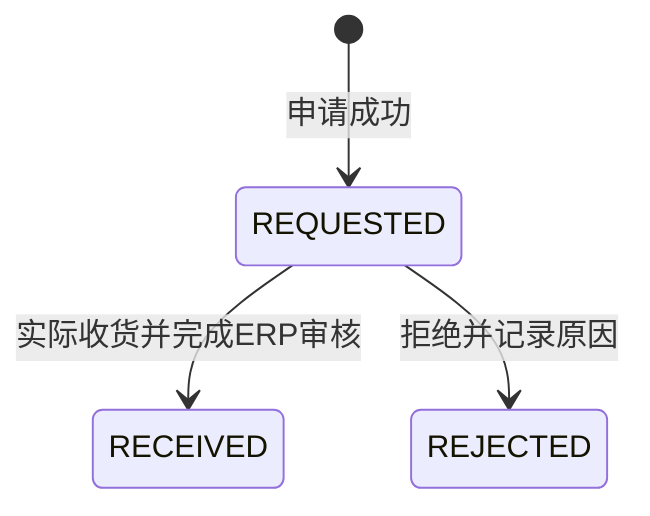
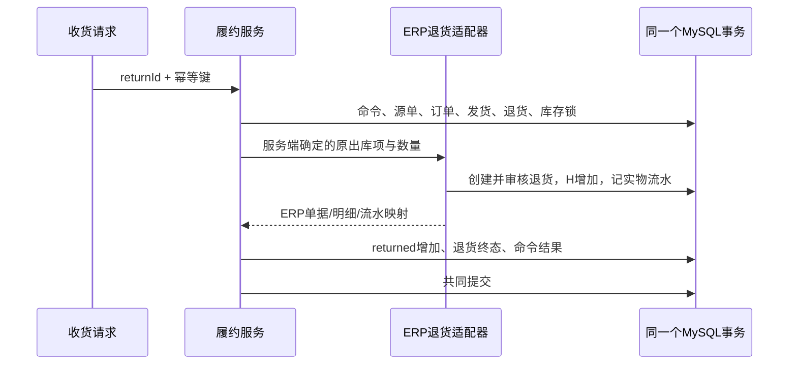

# M4.2：退货额度、收货与ERP入库

> 阅读语境：以下正文记录该阶段当时的实现和取舍，早期“后续待做”仅为历史状态。当前M0—M7已经完成，请结合[现行总目录](../README.md)与系统教程。工程验收原件未改。

日期：2026-10-19。已完成范围为M4.2；核对报告、消息和异步文件任务仍在后续部分。基座原有ERP退货单、金额计算和库存流水属于复用能力，新增的是履约退货建模、额度保护、命令幂等、受控适配、页面和验证。

## 1. 用这次真实演示理解业务

主库销售单 `XSDD20261019000010` → 履约228 → 发货29，商品182，原仓库60。初始库存20，订单10；发6、取消4后，H=14、R=0，订单为PARTIALLY_CLOSED。

| 步骤 | 原仓实物H | 当前预占R | 已发货 | 已退货 | 已取消 | 剩余可退 |
| --- | ---: | ---: | ---: | ---: | ---: | ---: |
| 已发6、取消4 | 14 | 0 | 6 | 0 | 4 | 6 |
| 申请退2 | 14 | 0 | 6 | 0 | 4 | 4 |
| 确认实际收货2 | 16 | 0 | 6 | 2 | 4 | 4 |
| 再申请退1 | 16 | 0 | 6 | 2 | 4 | 3 |
| 拒绝后一个申请 | 16 | 0 | 6 | 2 | 4 | 4 |

注意：申请会占用“可退额度”，却不会增加库存。只有货实际收到才入库。拒绝一份尚未收货的申请，会释放它占用的额度。演示的申请、收货和拒绝均通过真实浏览器完成；库存和关联事实由SQL逐步核对，见 [验收报告](../10-验收证据/M4.2-验收报告.md)。

## 2. 为什么要算申请中数量

发货6，已经收货退回2，还有一份申请中3件，这时最多只能再申请1。如果只检查“已经退回的2”，两个人可能各自再申请3，等收货时才发现超量。

```text
可退量 = 原发货项数量 - 所有关联的 REQUESTED 和 RECEIVED 数量
本次申请量 > 0
本次申请量 <= 最新可退量
```

计量单位始终是这条商品的基本单位，不把不同商品的数量相加解释成一个业务总量。

[FulReturnService.create](../../项目代码/backend/yudao-module-fulfillment/src/main/java/cn/iocoder/yudao/module/fulfillment/service/FulReturnService.java) 先锁源单和履约订单，再锁发货及明细，然后计算额度并保存申请。同一订单的其他申请、收货、拒绝也必须先拿同一把订单锁，因此校验和保存之间不会被另一个合法写入口插入一份超量申请。数据库唯一键负责幂等和关联身份，跨表累计上限由事务与锁保护。

页面的可退量只是当前参考，读取时不锁住库存或承诺后续成功。真正提交仍按锁内最新事实重算。前端隐藏按钮、Java synchronized和一份先读后写的SQL都不能替代这个跨实例协议。

## 3. 两套状态，各自表达不同事实



RECEIVED和REJECTED互斥，当前没有撤销终态或删除退货接口。一份申请按其明细一次性收齐；需要分次退货时提交多份申请。

订单本身仍记录累计shipped，而不是把退货当成“没发过货”。演示中始终满足：

```text
订购10 = open0 + reserved0 + shipped6 + cancelled4
returned2 <= shipped6
净出库 = shipped6 - returned2 = 4
```

因此收货退回2后，订单仍为PARTIALLY_CLOSED，open仍是0，不能自动再发2。需要补发、换货或退款，应明确建另一段业务，当前没有把它们混进货物退回。

## 4. 收货请求怎样落到数据库

1. [FulReturnController](../../项目代码/backend/yudao-module-fulfillment/src/main/java/cn/iocoder/yudao/module/fulfillment/controller/admin/FulReturnController.java) 校验功能权限和请求格式，在事务外通过 `DatabaseCommandRetry` 调用业务代理。
2. `FulReturnService.receive` 领取RETURN_RECEIVE命令，重新校验当前权限及订单归属，然后锁订单项、原发货、退货主/明细和有序库存。
3. 调用ERP侧 [ErpManagedSaleReturnPort](../../项目代码/backend/yudao-module-erp/src/main/java/cn/iocoder/yudao/module/erp/service/sale/managed/ErpManagedSaleReturnPort.java)，从原已审核出库项读取商品、仓库、源订单项、单价、税率和单位。客户端不能指定退到其他仓，也不能修改退货价格。
4. [ErpSaleReturnServiceImpl](../../项目代码/backend/yudao-module-erp/src/main/java/cn/iocoder/yudao/module/erp/service/sale/ErpSaleReturnServiceImpl.java) 复用原创建、金额计算、审核和库存流水。H只在ERP库存服务中增加一次。
5. 保存ERP退货单/明细/实物流水ID，增加履约returned，更新终态、审计、订单版本和命令结果，一起提交。



这里是同库模块化单体内的Java调用，没有跨库RPC。ERP内部端口使用MANDATORY：调用者必须已有事务。它没有用REQUIRES_NEW，也没有让ERP先提交。原ERP公共创建、修改、反审核、删除等入口仍受托管冻结保护。

ERP原生销售退货会在创建时更新源单退货数量。本项目保留这段汇总逻辑，托管路径把创建、审核、入库和履约收货放在同一事务，因此外部不会看到一份单独提交的托管退货草稿。

## 5. 为什么不用两条库存流水表示同一次退货

`ful_stock_ledger`专门记录预占R的变化。退货没有改变R，便不额外记一条“预占入库”来重复表示H。实物变化只有 `erp_stock_record`；履约退货项保存ERP流水ID，便于之后核对。

演示中退货1号 → ERP退货单13 → ERP退货项13 → 实物流水380，数量都是2，仓库都是60。退货2号被拒绝，没有ERP入库关联。页面可展开记录查看这些关系。

## 6. 重复调用与异常分别怎么处理

- **同key、同请求：** 锁命令后重放原响应。申请原来返回REQUESTED，即使后来收货，再重放申请仍返回原先保存的REQUESTED响应，查询接口才反映当前状态。
- **同key、不同请求：** 摘要冲突，拒绝修改。
- **不同key、再次收同一份已收货申请：** 返回已有收货结果，不再次调用ERP。
- **收已拒绝申请/拒已收货申请：** 互斥终态冲突。
- **异常：** 命令和全部业务事实共同回滚。测试profile分别在ERP库存批次内部，以及ERP审核返回后抛错，两处均没有留下H、ERP单据、履约returned或命令残留。
- **进程重启：** 扫描进度、JVM内存和浏览器状态都不是幂等事实来源。完整重启后，原申请、收货和拒绝键仍能返回原结果，不新增库存效果。

Redis单号序列不参加MySQL回滚，故障可能留下空号；不能把“单号连续”当成事务正确性要求。

## 7. 这次的证据能说明什么

核心71项断言覆盖双JVM申请/收货、额度竞争、精度、互斥终态、权限、租户和两处ERP故障。补充最终产物22项API验证，包含只读可退查询和再收货；ERP原有流程110项、新库绑定/权限68项、升级25项、浏览器SQL21项、完整重启和重放12项通过。指定单测37项和前端定向检查/生产构建通过。数量是断言数，不是QPS或独立场景数。

精度测试发6.000001，收货2.000001后H从13.999999变16，最终全部退回后H恢复20；gross shipped仍6.000001，cancelled仍4，订单没有重新打开。重复SKU的两条原发货项分别记录，不混用退货额度。

当前功能权限、租户与订单归属已验证；仓库细粒度角色仍由M6完成。货物退款、跨仓退回、分次收同一申请、核对报告、消息和压测没有在本部分实现。

## 8. 面试可以怎样表达

> 我基于开源ERP做了履约退货扩展。申请和收货分开，申请中与已收货数量共同占用原发货项的可退额度，在源单和订单锁内校验，避免并发超退。收货通过MANDATORY的ERP内部适配端口，在同库事务里完成审核、唯一实物入库、returned和幂等结果。累计shipped保持不变，不自动恢复发货额度。我用同机两个JVM验证重复收货和超量申请，并在ERP审核内部及返回后注入异常，验证共同回滚和完整重启后的重放。

两个自测问题：

1. 已发6、已收货退回2、还有申请中3，为什么只能再申请1？拒绝3件的申请以后呢？
2. 为什么ERP单据已经“审核成功”，外层抛异常仍然要把H和单据一起回滚？换成REQUIRES_NEW会怎样？

下一部分是M4.3：相互核对余额、预占、订单汇总和ERP关联，把差异存成可追溯报告，不自动改写事实。
