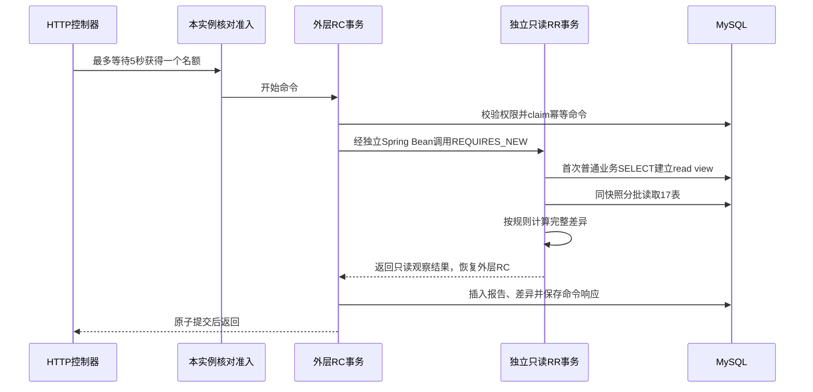

# M4.3：一致性快照与差异核对

> 阅读语境：以下正文记录该阶段当时的实现和取舍，早期“后续待做”仅为历史状态。当前M0—M7已经完成，请结合[现行总目录](../README.md)与系统教程。工程验收原件未改。

本部分的目标：业务系统写完数据后，能用另一套只读规则发现余额、流水、履约事实之间的差异，并保存可追溯报告。实际完成状态和执行次数以 [阶段报告](../10-验收证据/M4.3-验收报告.md) 为准。

## 1. 为什么有事务还需要核对

前面的事务保证正常入口中的一组更新一起提交。人为改库、历史错误、未来开发漏更新一个投影，都可能破坏已有数据。核对提供独立观察手段，帮助定位“哪一张账与哪一类事实对不上”。

例子：商品A在仓库W，ERP流水合计16，库存H却是17。系统保存一条STOCK_H_LEDGER差异：对象erp_stock及其ID、商品/仓库ID、expected=16、actual=17、核对规则版本、所属报告。不会把17自动覆盖成16，因为此时还没证明究竟哪份事实有误。

## 2. 核对哪些账

| 规则组 | 计算依据 | 主要定位对象 |
| --- | --- | --- |
| 实物库存 | H=ERP全部正负库存流水和；逐笔totalCount正确 | 商品+仓库、库存行、实物流水 |
| 预占库存 | R=held总和=预占流水heldDelta总和；逐笔reservedAfter正确 | 商品+仓库、预占及流水 |
| 预占自身 | allocated=held+consumed+released；consumed=发货项和；active与held一致 | reservationId |
| 订单数量 | reserved/shipped/cancelled/returned分别等于对应事实和 | orderItemId |
| 订单状态 | 使用原有逐项状态计算器重新计算，避免混加不同商品单位 | orderId |
| ERP源单 | 审核状态、原项/商品/单位/冻结数量单价、outCount/returnCount投影 | ERP销售单/明细 |
| 发货与实物 | 原订单/预占/仓库、ERP已审核出库/明细、唯一负流水 | shipment/item/ERP IDs |
| 退货与实物 | 原发货项身份、申请中+已收货额度、ERP已审核退货与正流水 | return/item/ERP IDs |
| 反向关联 | 托管源单的已审核ERP单据/明细也必须映射回履约，检查额外/撤销流水 | ERP单据/实物流水 |
| 缺失汇总 | 从库存、ERP流水、预占和预占流水的身份并集发现缺失库存行 | 商品+仓库 |

实物流水包含撤销产生的反向记录；发货与退货的实物数量只从ERP计算，预占流水不重复加入H。已拒绝退货不计returned，也不占用可退额度。到期时间已过但仍held的预占，需要由到期任务释放，核对不能仅因“过了时间”直接认定余额错误。

每个规则有独立ruleCode；一次根因可能导致多条差异。例如R从0被改成1，会同时与held、预占流水不符。差异数量不是根因数量，也不是测试场景数量。

## 3. 为什么读取也要设计事务

假设库存在退货前是14，退货后是16：

1. 核对读取库存，看到14。
2. 别的请求完成退货，提交库存16和入库流水。
3. 核对读取流水，看到合计16。

若各次读取使用不同快照，就会报告不存在的差异。因此所有17张业务表使用同一个RR一致性read view。它们都是普通SELECT，业务发货/退货仍能提交；扫描看到当次快照里的旧版本。

本实现的边界：

**为什么拆成两个Bean？** 权限检查本身可能访问数据库；等待另一个同key命令也可能很久。独立只读事务保证事实快照从业务扫描开始建立。Spring代理才能应用REQUIRES_NEW，不能通过同类自调用期待事务切换。

**为什么这里可以REQUIRES_NEW？** 内层只读取业务事实，不写库存或单据；读取完成后，外层一起保存报告和命令。它没有把ERP库存副作用独立提交。外层若失败，报告/差异/命令都回滚，业务事实从未被扫描器改写。

一次扫描占用两条连接。HTTP事务外的Semaphore把每个JVM同时扫描数限制为1，最多等5秒；超时返回1080000052，客户端保留原key重试。它用于控制扫描资源，跨JVM幂等仍依赖数据库唯一键，不把这个信号量描述成分布式锁。测试中暂停一次扫描，另一次被明确拒绝，普通业务写入仍可完成。

snapshotAt是首次业务读取前的数据库UTC标记，界面显示“读取起始标记”。它不是精确的提交时间边界。没有按create_time过滤来伪造历史快照；并发提交后的事实由下一次新扫描观察。

## 4. 如何限制扫描成本

- 表名与索引名使用后端固定白名单，不接受HTTP拼接SQL。
- 每张表按tenant_id/id复合索引、id游标递增读取，每批最多200。
- 普通表每表最多2000，ERP/预占流水每表最多10000，差异最多2000。
- 多读1行发现超限，返回1080000051，整份报告和命令回滚。
- 只读快照事务15秒、外层命令事务20秒；失败不返回部分“无差异”。

这些是当前同步全租户实现的边界，不能据此声称支持任意大数据量。规则计算把有界数据放内存，目前部分聚合会重复遍历；没有压测数字。后续扩展到更大规模时，需要重新设计范围、快照与持久化作业，而非简单跨事务翻页后声称仍是同一快照。

## 5. 报告与人工说明

- `ful_reconcile_run`：发起人、租户、规则版本、范围、时间标记、扫描行数/分表行数、差异数。
- `ful_reconcile_item`：规则、对象与关联ID、期望/实际值、说明、OPEN或ACKNOWLEDGED。
- `ful_reconcile_review`：不可通过本次API删除的追加说明，保存操作者和UTC时间。

人工确认表示“已经查看并记录”。它不表示已修复，不改变原始差异值，不写库存。事实恢复后重新扫描，会产生新报告；旧报告继续保留发现问题时的证据。

相同run key返回同一旧报告；新key才重新观察。相同review key与同说明只落一条记录，改说明仍用旧key会冲突。失败命令回滚后可用同key恢复。新key可以追加另一条说明，保留处理轨迹。

## 6. 权限边界

run同时要求query/run，人工说明要求query/review。此权限面向全租户审计人员，能观察全租户库存和订单事实，不自动授给普通订单所有者。查看/筛选/说明都要求报告属于当前租户、当前操作者。报告ID和客户端附加的tenant/actor参数不能改变这个范围。

仓库细粒度授权仍待M6。当前界面没有把“只看本人报告”说成“报告只包含本人订单”。

## 7. 阅读代码的顺序

1. `ReconcileContracts`和`FulReconcileController`：六条接口及权限/参数上限。
2. `ReconcileAdmission`：在事务连接之外限制同时扫描数。
3. `FulReconcileService.run`：命令幂等、权限、完整报告持久化。
4. `FulReconcileSnapshotReader.read`：RR独立Bean、索引游标、上限。
5. `ReconcileEngine.check`：纯规则，按stocks/orders/reservations/shipments/returns阅读。
6. `FulReconcileService.review`：持久化说明和状态，原差异不覆盖。
7. `ReconcileTestConfiguration`和`tests/m4_reconcile_acceptance.py`：仅测试profile的屏障/异常、受控污染/恢复、真实并发观察。

均位于`backend/yudao-module-fulfillment`，页面为`frontend/src/views/erp/reconciliation/index.vue`。上游登录/权限框架、ERP基础库存模型和原订单状态计算器属于复用；本部分新增核对规则、快照协议、报告/说明、准入和验证。

## 8. 面试短答与追问

**你怎样发现账不一致？** 用独立规则在同一RR快照里核对H、R、流水、预占、订单执行量和ERP双向映射。差异保存对象ID及期望/实际，人工说明追加留痕。扫描只读业务事实，报告失败不会留下部分成功。

**为什么不直接把库存改成流水和？** 需要先确认哪个事实出错。自动覆盖可能掩盖丢失流水、重复出库或错误源单关联。当前只报告并记录排查说明。

**运行期间有人发货怎么办？** 普通业务写入保持RC；内层RR普通读使用MVCC看到一致旧版本，不加业务行锁。下一次新key看到新提交。

**跨实例怎么保证一次报告？** 幂等命令唯一身份含tenant、actor、type、key。相同命令竞争由MySQL处理，报告与命令响应一起提交；本实例Semaphore只控制资源。

**限制在哪里？** 同步全租户、有行数/差异数/超时上限、每次两条连接、每JVM一个扫描。没有大规模压测或跨机实验。仓库细粒度授权与异步任务仍是后续工作。

## 9. 两道自测

1. 扫描A读完库存后，退货B提交，然后A继续读流水。A应看到哪一份流水？下一次扫描C能看到什么？
2. 一份旧报告有2条差异。人工确认后修正了独立测试事实，再用原key核对，为什么仍看到旧报告？要怎样获得新的观察？

参考：A看到本次read view中的旧流水，C看到新提交；原key代表同一命令与旧报告，新key新建报告。确认说明不等于修复，也不改变旧证据。
