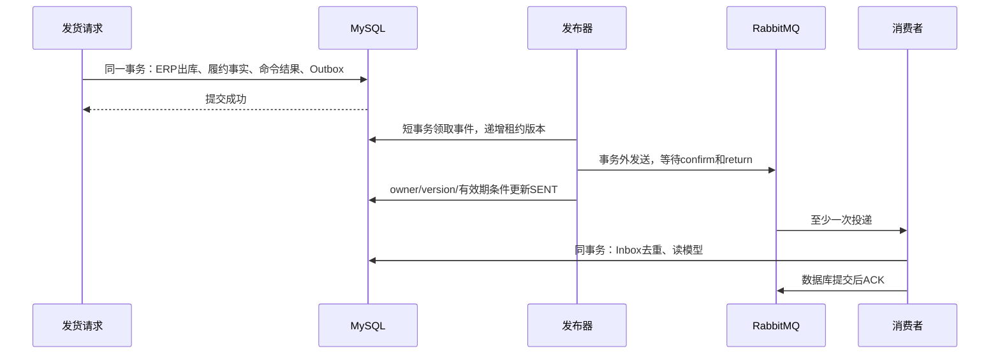

# M5：可靠消息、故障恢复与面试讲解

> 阅读语境：以下正文记录该阶段当时的实现和取舍，早期“后续待做”仅为历史状态。当前M0—M7已经完成，请结合[现行总目录](../README.md)与系统教程。工程验收原件未改。

本篇覆盖M5.1—M5.4。最终执行结果见[验收报告](../10-验收证据/M5-验收报告.md)，当前交付状态见[项目进度](../09-项目规范与进度/PROJECT_STATUS.md)。上游提供ERP、认证和租户框架；本阶段的Outbox、租约发布器、Inbox、读模型和重放审计是项目扩展。没有压测数字，也没有跨机高可用结论。

## 1. 先理解一个具体场景

仓库有20件，订单3件。预占3，实际发1，取消剩余2，再实际退回1：

| 时点 | 实物H | 预占R | 累计发货 | 累计退回 | 消息 |
| --- | --- | --- | --- | --- | --- |
| 绑定订单 | 20 | 0 | 0 | 0 | ORDER_BOUND |
| 预占成功 | 20 | 3 | 0 | 0 | STOCK_RESERVED |
| 发出1件 | 19 | 2 | 1 | 0 | SHIPMENT_CONFIRMED |
| 取消剩余2件 | 19 | 0 | 1 | 0 | ORDER_CANCELLED |
| 实际收回1件 | 20 | 0 | 1 | 1 | RETURN_RECEIVED |

这是教学算术；实际演示的订单编号和数量以验收报告为准。消息只是描述已经提交的事实。收到十次SHIPMENT_CONFIRMED，都不能再执行一次ERP出库。消费者只更新履约执行读模型。

## 2. 为什么不能在发货事务里直接发RabbitMQ

先提交数据库再发消息：进程可能在两步之间退出，业务成功但消息丢失。先发消息再提交数据库：数据库可能回滚，消费者却已收到不存在的发货。网络发送放在长事务里还会延长行锁持有时间。

本项目采用同库Outbox。ERP出库、履约数量/流水、命令结果和待发事件在原RC事务中一起提交，失败一起回滚。发货成功不要求Broker在线。独立后台把已经保存的事件发送出去。

源码从`FulExecutionService`的发货事务读到`FulOutboxService.append`。后者使用MANDATORY，要求调用者已有事务，不偷偷新开一个独立提交事件的事务。故障profile在插入Outbox后抛异常，验证ERP实物H、预占R、履约事实和事件一起回滚。失败命令不保留，健康实例可用原key重新执行。

## 3. 一个事件究竟是什么

事件身份eventId是UUID，内容不可经管理API编辑。一次业务事件有多次投递尝试，投递尝试不是新业务事件。人工重新发布也保留eventId。

- tenantId、aggregateId、aggregateVersion和数量均用字符串传输，避免JavaScript整数精度和小数二进制误差。
- aggregateVersion是订单事实版本，控制新旧顺序；payloadVersion=1是消息格式版本，控制能否解析，两者用途不同。
- data是当时的执行数量快照，含orderNo、状态和逐项ordered/open/reserved/shipped/cancelled/returned；不含客户姓名、电话、金额和价格。
- traceId是本阶段生成的事件追踪UUID，可串联事件与投递日志；没有宣称已接入分布式链路平台。
- 最多1000明细、正文256KiB，超限整体业务回滚并报1080000060，不静默截断。

八类实际事件为绑定、预占、分配尝试、释放、发货、取消、到期和退货收货。分配不足也可能改变订单版本/状态，因此发ALLOCATION_ATTEMPTED，避免读模型一直落后。已经收货后换新key再调用、已经绑定源单后换key查询，不新增虚假变化。退货申请/拒绝、物流配送信息不在当前执行数量投影内，没有承诺每个HTTP接口都发消息。

## 4. 发布器为什么需要租约和版本

看`FulMessageStore.claim/finish`，再看`FulMessageWorker.publishTick`。

领取使用短RC事务和`FOR UPDATE SKIP LOCKED`，选一条到期NEW/RETRY_WAIT或租约过期IN_FLIGHT。记录工作者UUID、到期时间、递增leaseVersion，并插入独立投递尝试，立即提交。多个JVM可竞争同一队列，跳过正在被锁定的行。

事务外执行网络发送。结束时必须同时匹配数据库ID、tenant、owner、leaseVersion、IN_FLIGHT以及租约仍有效。租约仅代表一段时间内的处理资格。

假设A拿版本7后卡住，租约过期；B拿版本8并完成。A迟到返回时不能把B的成功改成失败。A只能把自己的尝试记录为LATE。测试用两个真实JVM和数据库命名锁屏障触发这个窗口；屏障只存在测试profile，没有生产HTTP故障参数。

## 5. confirm成功是否就够了

不够。confirm解决发布端与Broker的确认，mandatory/return解决消息不能路由到队列的情况。无匹配路由时，消息可能被退回，同时仍收到confirm；不能据此记SENT。

`FulRabbitTransport`使用持久化消息、durable direct exchange/classic queue、确认和退回处理。发送超时/断连/退回记录失败，指数退避加有界抖动，默认单轮最多5次、退避上限60秒，达到上限DEAD。人工重试重置本轮次数，累计次数保留。

Broker确认后、数据库记SENT前进程退出：Outbox仍IN_FLIGHT，租约过期后重发，所以消费者必须能去重。这里不承诺端到端exactly once。官方解释见[RabbitMQ确认机制](https://www.rabbitmq.com/docs/confirms)和[可靠性指南](https://www.rabbitmq.com/docs/reliability)。

## 6. 消费者如何做到本地效果不重复

看`FulMessageConsumerService.deliver`：Inbox以tenantId+consumerName+eventId唯一，Inbox状态和读模型在同一RC事务中提交，正常提交后才ACK。没有把出库动作放进消息消费者。

若投影写入后抛异常，投影和这次消费进度一起回滚。若已提交但ACK前JVM退出，Broker重新投递；消费者读到PROCESSED，只增加重复计数，不再改投影。测试实际用Runtime.halt(72)退出验证这个窗口，而不是只模拟一次重复HTTP调用。

### 失败时为什么也可能ACK

这是本项目必须讲清楚的设计：

1. 正常处理失败，原投影事务回滚。
2. 新事务把失败次数、原因、下次时间可靠写入Inbox RETRY_WAIT或DEAD。
3. 这份持久化重试责任提交后，ACK Broker原投递。
4. 本地扫描任务负责重试；仍受唯一键、行锁、期限和version复核保护。

因此ACK可以表示“本地副作用已完成”，也可以表示“失败已被本地持久化机制接管”。页面必须分开显示Broker已确认、消费处理中/失败、PROCESSED。达到DEAD并不意味着已处理成功。

若数据库连失败记录也写不下，则不ACK，关闭通道让未确认消息重投，并暂停Broker轮询5秒，避免立即NACK/requeue热循环。此选择相对最初简单失败NACK规格，记录在[ADR-016](../05-设计决策与复盘/ADR-016-M5-可靠事件与消息恢复.md)。本地重试只做数据库内投影，没有跨网络发送副作用。

## 7. 乱序为什么不会覆盖新状态

投影保存observedVersion。版本9先到，版本7后到：7可以记为已处理，但不能把读模型降到7。重复和旧版本事件的Inbox会保留applied=false，便于解释“处理过”与“改过投影”的区别。

这里使用完整执行快照，不要求前一个版本一定先处理。若采用增量事件，直接跳过旧版本可能丢业务增量，不能照搬本方案。

读模型可以删除/损坏后从当前业务事实重建，但必须受权、写原因和审计。独立只读RR事务读取一致快照，业务写事务仍RC；更新时不能覆盖更高版本。重建允许修复相同版本的损坏快照。重建不是修复库存，也不补造旧业务历史事件。

## 8. 租户、毒消息与运维权限

消息里的tenantId不能直接当成可信身份。当前同库消费者要求eventId在本环境Outbox存在，原始正文SHA256与持久化正文完全一致，信封身份也一致，之后才切换并校验租户上下文。隔离测试库各有独立RabbitMQ vhost，双JVM同库共享vhost。

坏JSON、不支持格式版本、伪造租户等拒绝到持久化DLQ；日志记录摘要，不把完整敏感正文写进异常。没有有效租户身份的DLQ由本地Broker运维查看，没有开放跨租户HTTP原文浏览器。

管理查询需要`fulfillment:message:query`，重新发布/重试需要`:replay`，重建需要`:rebuild`，并复用订单本人/管理员归属规则。知道其他订单eventId不能绕过归属。撤权后的旧key重放仍检查权限。

七条实际接口统一前缀`/admin-api/fulfillment/message`：GET page/get/deliveries/actions/projection；POST replay/rebuild。写操作必须Idempotency-Key、reason；改原因复用原key冲突1080000005。重放两种意图REPUBLISH、RETRY_CONSUME分开记录。查询页上限50，后台有界批次和网络等待。

## 9. 面试回答与追问

| 问题 | 应答要点 | 继续读哪里 |
| --- | --- | --- |
| 如何保证发货后不会漏发消息？ | 本地事务原子保存Outbox，后台恢复；成功命令重放不新建事件 | FulOutboxService、发货事务 |
| 为什么允许重复消息？ | confirm到SENT、提交到ACK都存在崩溃窗口；靠业务去重保证本地效果 | FulMessageWorker |
| 只用Redis SETNX可以吗？ | 与本地投影不能同事务提交；锁过期也不是消费完成证据 | V6 Inbox唯一键 |
| SKIP LOCKED是否保证只有一次发送？ | 它只解决短事务领取竞争；超期重投仍可能重复 | claim/finish |
| 旧JVM恢复如何防止覆盖？ | owner+租约版本+有效期条件更新，迟到仅记自身尝试 | finish、双JVM屏障测试 |
| 消费者报错为何ACK？ | 原副作用回滚后，持久化Inbox接管重试才ACK；存不下则不ACK | failed/consumeTick |
| 顺序错乱如何处理？ | 完整快照+订单版本单调推进；不是按时间字符串排序 | writeProjection |
| DEAD如何恢复？ | 独立权限、明确重放意图、保留原eventId、同key结果持久化、原因审计 | FulMessageAdminService |
| 如何证明没有再次扣库存？ | 消费/重放前后17张业务表事实比对，最终核对0差异 | 验收脚本facts |
| 是否工业级高可用？ | 有可解释的可靠性机制和本地故障证据；单Broker/单机classic队列未验证HA | 本篇边界 |

一分钟口述：我基于芋道ERP扩展多仓履约。在原RC事务内同步保存Outbox，发布端用SKIP LOCKED和租约版本处理多实例竞争，事务外做持久化AMQP发送并同时处理confirm/return。消费者通过Inbox唯一键和同事务读模型保证本地效果去重，按订单版本抵抗乱序。运维支持保留原事件的重放和独立审计。我用实际进程退出验证两处崩溃窗口，也做了两个JVM旧租约迟到验证；消费者不参与再次扣库存。测试结论限于本地环境，没有虚构吞吐或高可用数据。

## 10. 建议的学习顺序

1. 手算第1节数量，并解释H/R与消息的关系。
2. 找到发货写Outbox的一行，解释为何必须同事务。
3. 阅读claim/finish，手推A版本7、B版本8竞争。
4. 阅读正常deliver、失败failed和ACK所在位置，分别画提交边界。
5. 工作台观察一个原事件、多个投递尝试、一个Inbox和两条人工审计。
6. 对照验收报告找真实exit71/72日志、两个JVM owner、LATE结果和DLQ记录。
7. 练习上表追问，明确本地effect去重与外部系统exactly once的区别。

## 11. 当前边界与下一阶段

消息正文保存在同一MySQL库，受1000明细/256KiB上限；消费者只维护一个可重建执行视图。当前没有外部邮件/SMS/支付调用、跨库事务、清理归档策略、Broker集群故障切换、跨机部署或压测。真实生产还需容量规划、监控告警、备份、权限和运维策略。M6.1接下来实现持久化文件任务、有界线程池、租约与取消；不把尚未实施内容写成现有成果。
