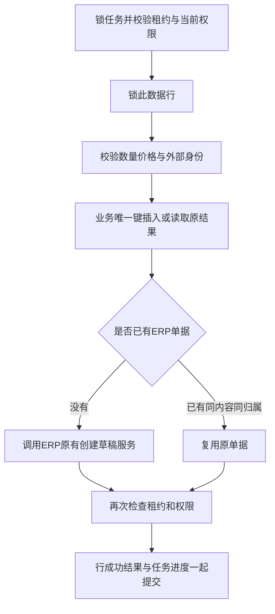

# M6：可恢复导入、流式导出与仓库授权

> 阅读语境：以下正文记录该阶段当时的实现和取舍，早期“后续待做”仅为历史状态。当前M0—M7已经完成，请结合[现行总目录](../README.md)与系统教程。工程验收原件未改。

本篇对应M6.1—M6.4；完成状态和实际测试结果以[项目进度](../09-项目规范与进度/PROJECT_STATUS.md)与[M6验收](../10-验收证据/M6-验收报告.md)为准。设计取舍见[ADR-017](../05-设计决策与复盘/ADR-017-M6-持久化文件任务与数据授权.md)。ERP草稿校验/创建、登录和角色权限来自上游；持久化任务、行级恢复、跨任务身份、私有文件和仓库范围是本阶段扩展。

## 1. 为什么这部分值得在面试中讲

导入接口接收文件后，不能只new一个线程然后立即返回成功。线程可能被进程重启丢掉，调用者也不知道第几行真的写进数据库。导出同样不能查全表放进List后再生成Excel，否则数据规模直接变成堆内存压力。

这里有三个不同问题：任务是否被可靠保存、业务是否重复、资源是否有界。数据库任务表、行业务唯一键、有界线程池分别解决一部分，不能只展示一个线程池配置就宣称支持断点恢复。

## 2. 用三行文件手算一遍

第一行数量1.000001，第二行数量2，第三行数量0。前两行合法，第三行失败：

| 操作 | 任务结果 | ERP订单 | 库存H/R |
| --- | --- | --- | --- |
| 首次导入 | 成功2、失败1、PARTIAL_FAILED | 两张未审核草稿 | 不变 |
| 同内容重新上传，新建任务 | 两行复用原草稿，一行仍失败 | 仍两张 | 不变 |
| 修复主数据后重试原任务 | 跳过成功行，重试失败/待处理行 | 已成功草稿不重复 | 不变 |
| 修改文件中的非法数量，再新建任务 | 修正行可创建；旧成功行按业务键复用 | 只新增此前未成功的行 | 不变 |

同一外部订单已成功后，改数量仍用原外部单号，会得到内容冲突，不会偷偷修改旧草稿。真正的业务变更应通过ERP已有流程或明确的新业务身份处理。导入没有自动审核、绑定、预占或发货。

## 3. 当前文件契约

- 输入：UTF-8 CSV，可带BOM，允许带引号的逗号/换行和双引号转义；每条数据是一张单商品ERP销售草稿。数据行号按CSV逻辑记录计，不是简单的物理文本行。
- 固定v1表头：externalOrderNo、customerCode、productCode、quantity、unitPrice。
- 上游客户没有独立业务code，customerCode明确填写本租户客户内部ID；productCode填写本租户启用商品条码，找不到或不唯一均报行错，不按名称猜。
- 数量大于0，价格不小于0，最多18位整数/6位小数，不接收科学计数法；全过程BigDecimal，传输和Excel标识按字符串。
- 输入默认10MiB/10000数据行，字段缓冲最多256字符，外部单号最多128字符。逐行解析和有界批次保存，不把全部文件读成对象列表。
- 输出：FastExcel流式XLSX；错误明细CSV。当前没有Excel导入承诺。XLSX中ID、数量和文本按文本单元格输出；错误CSV对公式前缀做转义。

先完成文件格式/行数检查和持久化行准备，再开始创建草稿。因此第10001行被拒绝时，不会已经创建前10000张草稿。格式准备本身可以中断恢复，行表和parse_cursor都在数据库。

## 4. 新增数据分别负责什么

| 表 | 职责 |
| --- | --- |
| ful_job_gate | 全环境准入及租户运行配额的数据库门闩行 |
| ful_private_file | 不可变文件的归属、UUID、摘要、大小和私有存储键 |
| ful_file_job | 状态、冻结范围、计数、游标、租约、尝试与文件引用 |
| ful_file_job_row | 每条CSV记录、成功/失败、ERP草稿关联和安全错误码 |
| ful_import_identity | tenant+sourceSystem+externalOrderNo跨任务唯一 |
| ful_operation_audit | 人工操作和后台阶段的状态摘要、原因、操作者与请求标识 |
| ful_warehouse_grant | V1已有的预留表；M6开始实际启用READ/OPERATE范围 |

V7只新增或启用这些结构，已执行V1—V7不能修改。建了授权表不等于已经接入权限，本阶段必须结合业务入口检查和越权证据说明。

## 5. 数据库准入与线程池上限

默认固定2个工作线程、4个内存排队槽，每租户最多2个同时运行任务、20个未结束任务，全环境100个未结束任务。参数有验证和外置配置。

提交在短RC事务内锁准入行再检查未结束数，超过上限明确拒绝并回滚命令。多个JVM共享数据库配额。执行器使用ArrayBlockingQueue和AbortPolicy：内存队列拒绝时不先claim数据库任务，任务继续PENDING，下一轮再试；没有无限队列或CallerRuns。

线程池的active/queued是本JVM指标，不是整个集群的吞吐或总并发。实际M6.1使用小配额验证拒绝/取消释放槽，再以真实配置和执行记录说明测试覆盖；不是压测成绩。

## 6. 租约为什么还需要fencing

每次领取保存owner、leaseUntil和递增leaseVersion。旧进程卡住超过租期后，新进程可以接手。旧者醒来不能用“我之前拿到过任务”继续覆盖新结果。

每一块/每一行修改之前锁任务并检查身份、版本、状态和有效期；业务写入后、进度提交前再次检查期限。ERP创建与该行结果同事务，失去资格则一起回滚。续租失败不再领取下一块。

导出还存在文件系统副作用：旧工作者可能已经写好一份Excel。因此每个租约生成独立UUID私有文件，最后数据库完成事务验证有效租约后才发布文件引用。旧文件不能覆盖新文件，未引用的临时文件没有公开下载入口。测试用两个真实JVM暂停旧者发布、让新者完成，再验证旧结果被忽略。

## 7. 导入一行的事务边界

阅读`FulDraftImport.process`与`FulJobStore.lock`：

ERP已有REQUIRED事务加入行业务RC事务；异常经过代理退出后整笔回滚。业务校验错误在另一个短事务记录为行失败，不在已经rollback-only的原事务里勉强保存错误。

`tenant+sourceSystem+externalOrderNo`唯一键阻止跨文件、跨任务重复。相同内容同归属复用；不同内容冲突；不同用户不能借猜到外部单号获得别人的ERP编号。请求幂等key只保证一次提交/取消/重试命令稳定，不能替代跨任务业务唯一键。

## 8. 中断、重试和取消各意味着什么

- 领取后退出：数据库保留RUNNING和到期租约，新实例以更高版本回收。
- 行提交后退出：已经SUCCEEDED的行跳过，PENDING行继续。不要用内存行号假装恢复。
- 暂时基础设施失败：RETRY_WAIT及有限退避，达到上限FAILED；人工恢复需要独立权限、原因和幂等命令。
- 行级失败：PARTIAL_FAILED表示完整处理后存在错误行（也可能全部行失败），成功/失败/未处理统计明确，错误文件可下载。重试只重置失败行，不删除已成功草稿。
- 运行中取消：先CANCEL_REQUESTED，在处理边界变成CANCELLED。已经提交的草稿保留，未处理行不会被标成成功。取消不是全文件回滚，也不能把取消任务按失败任务直接恢复。

测试profile的exit80/81/82和命名锁屏障仅用于本地验收，没有生产HTTP故障按钮。

## 9. 导出如何限制内存和一致性范围

`FulJobExport`每批通过`id > cursor AND id <= initialMaxId`读取，写入FastExcel流式工作簿。单批受batch-size限制，默认100；默认最多50000行/50MiB，超限不发布部分文件。没有深OFFSET导出，也不先查全表List。

提交时冻结数据集、筛选、仓库/本人范围及初始最大ID。新插入记录不进入这份旧任务；已有行在导出期间可能变化，文件“生成说明”写明开始/结束时间、最大ID和范围，明确不是严格时点快照。没有维持数分钟的长RR事务。

进程重启后不直接append到旧XLSX，这可能破坏ZIP结构；新租约重新生成独立文件，该轮游标和行数从0开始，冻结筛选及最大ID保持。重新生成允许读到生成窗口内较新的原记录值，不能宣传为恢复了原时点快照。

## 10. 私有文件与下载授权

文件按数据库目录隔离，存储键由服务器UUID生成，拒绝客户端路径和符号链接，不经过公开静态URL。原文件保存SHA256/大小/模板版本/归属，执行和下载时校验。

下载通过任务ID及INPUT/RESULT/ERROR类别取得服务器关联文件，不接受任意fileId或路径。要同时检查租户、本人/有权本租户管理员、当前功能权限、冻结数据范围，以及原任务主体当前仍有权限。管理员不会仅因能查任务状态就绕过数据集权限。审核通过才流式返回并保存下载审计，响应no-store/nosniff。

授权检查发生在执行/发布/下载边界；已经发送给客户端的字节不能收回，不承诺撤权与正在传输的每个字节线性一致。

## 11. 仓库人员为什么不能复用整单DTO

整单包含售价、税额、客户编号和其他仓库的执行事实。仓库岗位只需要本仓商品、预占、发货数量及物流作业状态。

因此新增专用warehouse接口，明确选择字段；范围筛选进入SQL分页前，不能把全量记录查出来再在前端隐藏。仓库只读角色不授上游ERP全量客户/价格查询或全租户审计权限。

READ只允许查看，OPERATE包含查看，并让库存业务入口的仓库检查通过；还需要对应功能权限和订单归属。管理员全量也限定本租户。部门树授权、本次未统一改造的上游ERP全部数据接口仍需明确说明边界。

## 12. 旧入口与旧key也要检查

M6不是只给新页面加一个WHERE。预览、仓库下拉、库存读取、预占列表、分配、发货、释放、取消、退货与作业查询都要结合范围。拒绝显式指定的无权仓库，不能偷偷换仓。

命令重放先验证当前范围，再返回原结果。例如发货已经成功，后来撤掉OPERATE授权，再带原key请求也必须拒绝。历史预占关联用于释放/取消范围检查，因此已释放/已取消之后也不能靠旧key绕过撤权。取消涉及历史关联仓库时采用保守的全关联范围要求。

M4核对仍是明确授权的全租户审计视图；不把它伪装成仓库人员只能看本仓的报表。

## 13. 为什么下载时还要重查权限

员工在A仓授权有效时提交导出，任务结束前权限可能被撤销。若文件公开或只在提交时鉴权，就仍能下载旧文件。

本项目冻结旧范围，再检查当前权限是否仍覆盖它：新增B仓授权不会扩大旧A仓文件；撤销A仓授权则拒绝整个旧文件。用户可以基于当前新范围提交新任务。ORDER导出还有本人/管理员范围和整单查询功能权限，仓库角色不能借导出获得价格。

## 14. 后台用户身份与线程复用

HTTP线程的身份不能随意当成线程池全局状态。后台读取数据库保存的tenant/actor，验证用户启用、租户有效与当前权限后，才建立不带提权authorities的最小原用户上下文。ERP因此记录原操作者，不伪装成管理员或system actor。

每个边界重新验证权限；finally恢复SecurityContext与TenantContext。真实单线程工作池连续处理两个租户，同一source/external身份可以各创建本租户一份，ERP creator正确，清理日志中的tenant/actor都回到null。被禁用的主体即使已有任务也不再创建草稿。

## 15. 审计记录与访问日志的区别

访问日志回答“哪个HTTP接口何时被请求”。业务审计回答“谁基于什么原因，把哪个任务/授权从什么状态变成了什么状态”。

任务提交、领取、完成/失败、重试、取消、下载和仓库授权写独立审计。人工变更带reason与幂等key，后台记录租约/owner摘要。行结果保存数据行和ERP关联；不把完整文件、Token或回调密钥塞进审计。

## 16. 面试追问

| 追问 | 应答 |
| --- | --- |
| 为什么线程池任务还要落数据库？ | 线程和队列不能承受JVM退出；数据库任务是恢复事实 |
| 有界队列满时任务会丢吗？ | 不在enqueue前claim，拒绝后数据库仍PENDING；不是CallerRuns |
| 两个实例如何限制租户运行数？ | 数据库门闩行串行化配额检查和领取 |
| 定时器和唯一键是否够了？ | 不够；旧租约迟到要fencing，业务键保护重复副作用 |
| 一行成功后宕机怎么恢复？ | 成功行/业务身份/ERP草稿同事务；重启跳过成功行 |
| 重传同文件换key为何不会重复订单？ | 请求key只保提交；跨任务身份唯一键才保业务去重 |
| 错误行怎么保存才不被回滚？ | 原行事务退出回滚后另事务记录失败 |
| 取消为何不删除成功草稿？ | 行级提交已经生效，取消只停止后续工作；需要补偿另建业务流程 |
| Excel导出重启怎么续写？ | 不追加旧ZIP，冻结范围不变，新租约从头生成独立私有文件 |
| 导出是否全局一致快照？ | 不是；初始最大ID限制新增，已有数据可能在生成窗口变化 |
| 撤权后旧文件/旧key还能用吗？ | 当前权限复核；下载和成功命令重放都不能绕过 |
| 仓库字段脱敏能靠前端隐藏吗？ | 不能；专用DTO/SQL投影不返回价格和客户数据 |
| 是否有集群性能数字？ | 本机真实恢复/权限验证；跨机共享存储、压测和容量规划仍待后续 |

## 17. 阅读与练习顺序

1. 读FileJobContracts和V7，区分请求幂等、行业务身份、任务租约三个编号。
2. 从FulFileJobAdmin.submitImport追到任务PENDING，解释准入拒绝为什么不保留命令。
3. 读FileJobConfiguration.JobWorker与FulJobStore.claim/lock，手推旧版本1和新版本2竞争。
4. 读FulDraftImport.process，画出ERP草稿与行结果的提交边界。
5. 对照真实exit81日志，找第一行成功及恢复后的EXISTING/跳过行为。
6. 读FulJobExport的游标SQL与流式writer，解释文件生成窗口和重新生成。
7. 用仓库账号演示授权/撤权前后scope、任务下载与整单价格接口的差别。
8. 对照验收JSON逐项复盘，区分真正执行的故障、代码边界和未压测部分。

## 18. 当前边界

单机私有目录由同机JVM共享，未实现跨机对象存储、文件清理归档、病毒扫描或断电恢复。失败/迟到生成但未被引用的私有文件不会公开，清理策略尚待后续。导出/输入均有硬上限，但没有基于压测宣称生产容量。没有部门树权限、Excel导入、复杂多行合单、自动审核或全文件回滚。上游ERP全量权限仍按上游规则，仓库岗位必须使用受限功能角色；不把此次履约仓库ACL描述为整个ERP已统一改造。M7继续整理部署、性能和面试演示证据。
