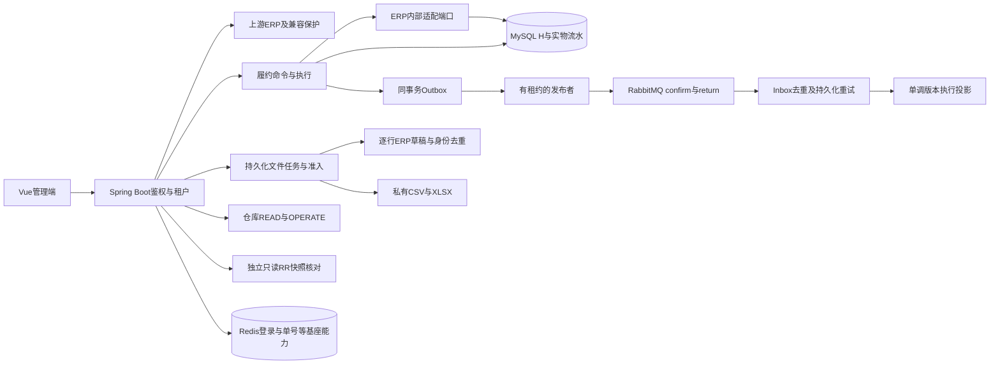

# 架构、实现与贡献边界

## 1. 一句话和业务范围

基于芋道ERP二次开发的B2B订单与多仓履约系统。销售单审核后绑定履约单，计算分仓、预占库存，再部分发货、取消、到期释放和原仓退货；后台处理可靠事件、CSV草稿导入和XLSX导出，仓库人员通过专用投影访问授权范围。

它是模块化单体。多JVM测试验证同库并发与工作者恢复，不等于已经拆成微服务或形成跨机集群。

## 2. 三类成果必须分开

| 类别 | 内容 | 面试表达 |
| --- | --- | --- |
| 上游复用 | 登录、菜单、角色、租户框架、基础CRUD、ERP采购销售库存、通用技术组件、管理端壳 | “采用固定提交的芋道ERP作为基座” |
| 项目二次开发 | 补齐本地ERP DDL、履约模型、库存统一写保护、绑定/分仓/发货/退货、核对、Outbox/Inbox、任务恢复、仓库授权、交付与实验 | “围绕履约扩展，并改造旧库存入口保证约束闭合” |
| 个人掌握 | 你能当场推演、定位源码、解释测试、独立完成的小改动 | 只陈述已掌握的部分，不把AI生成量当个人熟练程度 |

后端固定提交`7c397bbfae3e768b26e3ee962c5aa7064e8d7c96`；前端`0af03a93b6b6300f878e28add69b1c7a9f09ec34`。MIT与来源保留在两个源码目录和交付包。改造清单是显式文件哈希清单；没有凭空宣称已提交Git或创建PR。

另提供[固定上游到当前源码的实际diff](06-实际源码差异.md)：重新取得固定提交ZIP并校验与baseline.lock一致的归档SHA，逐文件比较当前源码，列出新增、修改和缺失，生成统一文本patch。该证据独立于Git工作区是否提交，不能等同于个人独立完成证明。

## 3. 库存和数量如何建模

H是ERP实物库存，R是待履约的有效占用，A=H−R。分仓只改R；发货通过ERP适配端口减少H，同时消耗R；取消/到期只释放R；收货通过ERP原仓退货增加H。不能由消费者再次扣库存。

每个订单项：`ordered = open + reserved + grossShipped + cancelled`，`0 <= returned <= grossShipped`。退回不把grossShipped减掉，不自动恢复open；退款和补发属于未实现的其他业务。

同仓同商品要同时满足：`0 <= R <= H`、`R = SUM(held_qty) = SUM(held_delta)`、`H = SUM(实物流水count)`。这些关系在旧ERP出库、调拨、盘亏和采购退货入口也要守住；只保护新allocate接口是不完整的。

数量使用decimal(24,6)/BigDecimal，HTTP的履约ID与数量用字符串，前端定点运算保持精度。不同商品单位不能混加“件数总量”。

## 4. 事务、锁和幂等

业务写事务是RC。命令唯一键先界定同一租户/操作者/命令类型/key，再比较规范化请求摘要；同key同参数返回持久化结果，不同参数冲突。一个key不是所有用户可共享的授权凭证，重放也要复核当前权限。

发货沿命令→ERP源单→履约订单/明细→预占→有序库存等顺序执行；退货还锁原发货及退货事实。库存批次按确定顺序锁定，避免多个商品反向取锁。死锁和锁超时在最外层有界重试整笔命令，不能捕获异常后继续提交半笔业务。

ERP适配端口要求MANDATORY，必须加入发货/退货现有事务。同步成功时，ERP单据、实物流水、履约事实、R和Outbox要共同提交；中途异常共同回滚。不能为了“保留流水”给库存写入加REQUIRES_NEW。

核对采用另一种事务：外层RC保存命令与报告，独立Bean REQUIRES_NEW只读RR建立事实快照。目的是一次扫描的视图一致，不能据此把库存写事务也改成RR。核对有扫描上限和每JVM准入，一次可能占两条连接，超限不提交半份报告。

## 5. 消息可靠性

同步业务事务先写Outbox。发布者短事务领取租约，事务外发送；confirm说明Broker接受，mandatory/return用于发现无路由。Broker确认后进程退出但还没写SENT，会再次发送同eventId。

消费者用Inbox唯一身份去重，投影和成功Inbox同事务提交后ACK。若投影失败，先回滚，再持久化RETRY_WAIT/DEAD后ACK，表示本地重试已接管；连失败状态都不能落库时不能ACK。不要把ACK讲成所有业务副作用已经完成。

投影只接受更高aggregateVersion；重复或旧版本不回退新状态。租约还包含owner/version，旧工作者迟到结果CAS不匹配，不能覆盖新进度。它提供可恢复的至少一次传输与本地幂等效果，不宣称端到端exactly once。

## 6. 文件任务和权限

任务先持久化，数据库准入限制全局/租户待办与并发；内存线程池与队列也有界。CSV准备定位错误行，每行生成一张单商品未审核ERP草稿。跨任务唯一身份`tenant+sourceSystem+externalNo`及内容摘要让相同内容复用，冲突拒绝。行提交后崩溃，重启跳过已提交行；取消保留已经成功的草稿。

导出冻结授权范围、起始最大ID与筛选条件，用游标分批写XLSX，文件按租约生成，完成发布时再CAS。旧工作者可能留下私有孤儿文件，当前没有自动清理。它不是严格时点快照，运行期间已有记录可能变化。

提交、执行、控制和下载均复核相应权限；文件只有受权HTTP下载，没有静态目录暴露。仓库READ/OPERATE与功能权限共同生效，专用投影隐藏价格和客户隐私。线程finally恢复租户/操作者上下文，不能让线程池复用导致串租户。

## 7. 从哪个文件开始读

下面均位于`backend/yudao-module-fulfillment/src/main/java/cn/iocoder/yudao/module/fulfillment/`，类名与仓库实际一致。

| 问题 | 入口 | 配套实验 |
| --- | --- | --- |
| 一笔命令怎么只生效一次 | `service/FulCommandService.java`、`FulOrderService.java` | M7.2 core-binding/core-m2 |
| 分仓计算和有锁写入如何分开 | `domain/AllocationPlanner.java`、`service/FulAllocationService.java` | M7.2 core-m2 |
| 发货/取消何时调用ERP | `service/FulExecutionService.java` | M7.2 core-m3/core-erp-fault |
| 到期候选为什么要重查 | `framework/FulExpiryScanner.java`、`service/FulExpiryService.java` | M7.2 expiry |
| 退货为什么不冲减gross shipped | `service/FulReturnService.java` | M7.2 returns |
| 快照与报告为什么两层事务 | `FulReconcileService.java`、`FulReconcileSnapshotReader.java` | M7.2 reconcile |
| 发送与本地结果如何隔离 | `FulMessageStore.java`、`FulRabbitTransport.java`、`FulMessageWorker.java` | M7.2 message |
| ACK、Inbox、版本比较 | `FulMessageConsumerService.java`、`FulMessageSnapshots.java` | M7.2 message |
| 领取、续租、发布fencing | `FulJobStore.java`、`FulJobProcessor.java` | M7.2 filefoundation/file |
| 身份去重和游标导出 | `FulDraftImport.java`、`FulJobExport.java` | M7.2 file与M7.3 export |
| 仓库与下载复核 | `FulWarehouseAccess.java`、`FulJobAuthorization.java`、`FulPrivateFiles.java` | M7.2 file |
| 索引为什么这样加 | `src/main/resources/db/fulfillment/V8__order_status_pagination_index.sql` | M7.3 query、ADR019 |

表中最后一行路径相对模块根目录；其余Service简写仍在service目录。ERP统一库存保护和内部端口在`backend/yudao-module-erp`，ERP不反向依赖履约模块。

## 8. 工业实践与未覆盖范围

可讲的工程方法：不可变迁移、数据库约束、有界重试、真实退出故障、双JVM租约屏障、权限撤销、文件哈希、正常依赖重启、交付manifest与许可证。不能据此声称生产投产、支付资金正确性、HA、异地容灾、断电恢复、Linux/Docker安装、真实物流或百万QPS。此项目的目标是形成能解释和验证的综合后端作品。
