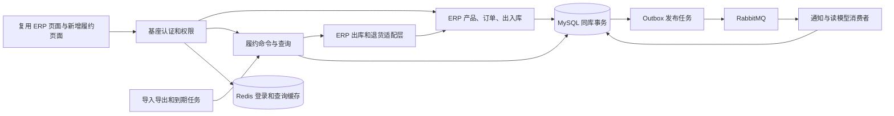

# B2B 订单与多仓履约系统：AI 实施技术规范

| 属性 | 内容 |
| --- | --- |
| 文档版本 | 2.0（完整M7交付同步） |
| 编写日期 | 初稿 2026-10-16；更新 2026-10-20，Asia/Shanghai |
| 主要读者 | 负责二次开发、测试、排障与交接的 AI / 开发者 |
| 关联文档 | [学习与面试手册](../00-项目总学习手册.md)、[进度记录](PROJECT_STATUS.md) |
| 当前代码学习材料 | [统一学习总目录](../README.md)、[系统教程](../01-系统学习教程/README.md)、[面试问答](../02-面试问答/README.md)；2026-10-20按最终M0—M7/V8逐章整合，历史阶段记录保留当时语境 |
| 当前交付 | M0—M7主线完成；最终V8产物回归、性能实验、独立交付与学习材料见M7报告，最终文件核对见M7-final-qa.json |
| 项目目标 | 基于现成基座，形成可运行、较综合、可解释且有个人改造成果的 Java 后端项目 |
| 实施原则 | 先运行基座，再闭合核心业务，最后增加异步能力、性能证据与面试材料 |

本文使用三个事实标签：**已核对**表示本次读取了上游源码或配置；**设计决定**表示本项目未来实现要求；**待验证**表示必须在实际运行时确认。接口、SQL 示例、类名和未来脚本均属于规格，不表示目前已有对应代码。

“必须”是验收要求；“建议”允许以证据说明取舍；“可选”属于完成主线后的扩展。

## 当前目录位置（2026-10-20）

根目录分为“项目代码”和“学习资料”。本文旧目录示例中的backend/frontend/scripts/tests/deploy/.local都位于项目代码内；操作命令以项目代码为工作目录。资料正文位于学习资料，原docs/evidence迁至10-验收证据、decisions迁至05-设计决策与复盘。历史JSON路径按整理清单定位；后续新增资料不创建重复副本。

## 目录

1. [目标、边界与完成标准](#ai-01)
2. [基座选择、提交锁定与核对结果](#ai-02)
3. [技术栈、部署与工程布局](#ai-03)
4. [功能范围与优先级](#ai-04)
5. [架构与模块职责](#ai-05)
6. [业务规则、数量恒等式与状态](#ai-06)
7. [ERP 集成与所有库存入口的兼容](#ai-07)
8. [数据模型、约束与迁移](#ai-08)
9. [事务、锁顺序与命令幂等](#ai-09)
10. [分仓、发货、取消、到期与退货算法](#ai-10)
11. [接口与错误契约](#ai-11)
12. [可靠事件与消息恢复](#ai-12)
13. [异步导入导出与任务恢复](#ai-13)
14. [权限、审计与可观测性](#ai-14)
15. [测试矩阵、故障注入与性能验证](#ai-15)
16. [M0—M7 持续推进任务书](#ai-16)
17. [AI 每轮操作与交接规范](#ai-17)
18. [二次开发亮点与面试证据](#ai-18)
19. [风险、降级范围与待验证事项](#ai-19)
20. [来源与设计决策记录](#ai-20)

<a id="ai-01"></a>
## 1. 目标、边界与完成标准

### 1.1 项目定位

为一家向企业销售办公耗材的供应商构建后台系统。供应商在多个仓库保存商品，销售人员创建订单，履约人员分配库存，仓库人员确认发货，系统处理取消、物流通知和退货，并提供权限、查询、报表与审计。

项目用于秋招学习和展示。基础业务复用芋道 ERP；个人成果集中在履约模块、库存兼容改造、可靠异步流程与性能验证。工程质量以可复现的行为和测试为依据。

### 1.2 总体完成标准

- 从干净数据库可按仓库内说明启动；依赖版本、初始化过程和演示数据可追溯。
- 具备产品、客户、仓库、销售订单、库存、出入库、履约及查询页面。
- 能演示多仓预占、部分发货、取消剩余数量、物流通知、到期释放和退货入库。
- 数量恒等式在并发、重试、进程中断和旧 ERP 入口操作后仍成立。
- 能说明每项基座能力、每项二开代码的所在位置和验证方法。
- 每个阶段附有面向用户的原理讲解、代码阅读入口和面试追问。
- 测试、演示和压测结果均实际执行；没有数据时保留“待测”，不填写推测值。

### 1.3 范围限制

采用同库模块化单体。首版不引入独立支付、真实物流下单、跨库事务、复杂税务、制造管理、波次拣货或运筹优化。物流服务使用本地模拟适配器；退货代表货物退回与实物入库，资金退款保留基座展示或列为后续功能，不声称完成资金清结算。

<a id="ai-02"></a>
## 2. 基座选择、提交锁定与核对结果

### 2.1 固定来源

| 对象 | 仓库与分支 | 固定提交 |
| --- | --- | --- |
| 后端 | `YunaiV/ruoyi-vue-pro` / `master-jdk17` | `7c397bbfae3e768b26e3ee962c5aa7064e8d7c96` |
| 前端 | `yudaocode/yudao-ui-admin-vue3` / `master` | `0af03a93b6b6300f878e28add69b1c7a9f09ec34` |

后端提交时间为 2026-10-09。两份源码必须分别固定提交，并在 M0 联调确认兼容性；分别锁定不能替代前后端兼容验证。后续版本调整记录原因、旧新 SHA、迁移及回归结果。

### 2.2 已核对事实

| 编号 | 核对结果 | 对实施的影响 |
| --- | --- | --- |
| B01 | 后端父 POM 的 Java 为 17，Spring Boot 为 3.5.15，revision 为 `2026.09-SNAPSHOT` | 初期跟随基座；不为追新而整体升级依赖 |
| B02 | 根 POM 与 `yudao-server/pom.xml` 均默认注释 ERP | 必须同时启用模块参与构建与运行依赖 |
| B03 | ERP 有产品、采购、销售、库存、调拨、盘点、财务等服务 | 可复用业务与页面，按需隐藏不相关菜单 |
| B04 | 库存实体含商品、仓库及 `count`；库存 Mapper 已有条件减库存 | 不把基座已有的事务和库存条件更新算作新增亮点 |
| B05 | 出库审核、盘点审核通过库存流水服务更新实物库存 | 新预占必须兼容这些旧路径 |
| B06 | ERP 模块 `src` 目前仅有 `main` | 本项目需要建立真实集成测试；不沿用 README 的笼统测试保证 |
| B07 | 主 MySQL SQL 含 48 条建表语句，未发现 ERP 业务表 DDL | M0 必须补齐所启用 ERP 表、字段、索引与菜单权限数据 |
| B08 | ERP resources 目录只有两个统计 Mapper XML | 不能假定该目录附带 ERP 初始化脚本 |
| B09 | 前端已有 `src/views/erp`，含产品、采购、销售、库存、财务页面 | 优先复用前端；新增履约页面按现有交互规范开发 |
| B10 | 前端要求 Node >=20.19.0、pnpm >=8.6.0 | 固定实际工具版本并验证 lockfile，不能凭经验运行旧版 Node |
| B11 | 多租户拦截器涉及 DO 元数据、忽略表与上下文 | 自定义 SQL、任务线程与新表均需单独验证租户隔离 |

### 2.3 初始化缺口的处理决定

M0 从固定提交收集所有启用 ERP 模块的 `@TableName`、DO、Mapper、XML 查询和业务枚举，建立实体—表—字段清单。补齐公开源码可推导的业务 DDL，并明确记录推导过程。

必须确认数据库列类型、BigDecimal 精度、主键生成方式、逻辑删除、审计字段、`tenant_id`、唯一键及字典菜单关联。不能只建立当前页面碰巧访问到的表。无法确定的字段通过源码调用链和真实用例确认；资料不完整时记录具体缺口，不伪称已拿到官方业务 SQL。

主 SQL 中已有 ERP 菜单或字典信息不代表业务表存在。先完成采购入库、销售出库和盘点的最小回归，再开发预占。

### 2.4 基座保留与新增

| 类别 | 模块 |
| --- | --- |
| 必须保留 | `yudao-dependencies`、所需 `yudao-framework`、`yudao-server`、`yudao-module-system`、`yudao-module-infra`、`yudao-module-erp` |
| 新增 | `yudao-module-fulfillment`，包名 `cn.iocoder.yudao.module.fulfillment` |
| 暂不启用 | Mall、AI、IoT、WMS、CRM、MES、BPM、独立支付等非主线模块 |
| 裁剪方式 | 先控制 Maven 模块、运行依赖和菜单；确认依赖后再清理不需要的代码 |

完整 WMS 模块即使存在，也不与本项目同时接管库存。源于其他模块的设计参考需记录，避免两套库存逻辑共同写同一事实。

<a id="ai-03"></a>
## 3. 技术栈、部署与工程布局

### 3.1 技术选择

| 层次 | 决定 | 版本与验证要求 |
| --- | --- | --- |
| Java | JDK 17 | 与固定基座一致；记录实际发行版和补丁 |
| 服务框架 | Spring Boot 3.5.15、Spring MVC | 先使用基座版本；修复兼容性或明确问题时再升级 |
| ORM | MyBatis-Plus，沿用基座封装 | 继承依赖管理；避免另设冲突版本 |
| 主数据库 | MySQL 8.4 LTS / InnoDB | M0 固定补丁及镜像摘要，实测原始 SQL 兼容性 |
| 缓存 | Redis | 复用登录与热点查询；补丁版本在 M0 锁定 |
| 消息 | RabbitMQ，Spring AMQP | M5 引入；固定镜像与 BOM 兼容版本 |
| 定时任务 | M4.1 使用 Spring 独立单线程到期扫描 | 本机未启用 Quartz，调整见 ADR-013；后续异步任务另按任务书实施 |
| 数据迁移 | Flyway，履约专用历史表 | 由 M1 接入，使用 Boot 兼容版本 |
| 前端 | 现有 Vue3、TypeScript、Element Plus | M0 固定 Node、pnpm 和现有锁文件 |
| 文件 | 复用 infra 文件服务与现有 Excel 工具 | 导入导出先用流式处理，不先引入额外批处理平台 |
| 观察 | 基座访问日志、Actuator、结构化日志、JFR | M7 需要时增加 Micrometer/Prometheus，按证据决定 |
| 测试 | JUnit、Spring 集成测试、真实 MySQL/Redis/RabbitMQ | 可用 Testcontainers；核心并发测试不以 H2 替代 MySQL |
| 部署 | Docker Compose + 本地 Java/Node 开发 | 没有容器环境时验证本机依赖方案，记录差别 |

镜像标签、工具补丁与下载校验写入 M0 新建的版本清单。文档中未固定的补丁不是已验证版本。第一轮本地起服务后即可演示，MQ 和监控按阶段添加。

M0 实施补充：本机实测 MySQL 8.4.6、社区 Windows Redis 7.2.8、Node 24.18.0、pnpm 9.15.9、Maven Wrapper 3.3.4 / Maven 3.9.16。使用独立回环端口 33306/36379/48080/15173；Compose 镜像已锁 digest，但尚未运行。参见 [ADR-009](../05-设计决策与复盘/ADR-009-M0-运行环境与基座收敛.md)、[版本锁](../../项目代码/docs/baseline.lock.json)、[M0 讲解](../03-阶段原理讲解/M0-基座与库存调用链.md)。

### 3.2 未来目录结构

以下为目标目录布局；当前存在的基座、脚本和证据已在 M0 创建，履约模块、迁移和后续能力仍待相应阶段实现：

```text
/
  AGENTS.md
  README.md
  backend/                       # 固定提交的后端源码，无嵌套 .git
    yudao-module-fulfillment/
  frontend/                      # 固定提交的前端源码，无嵌套 .git
  deploy/                        # Compose、环境示例、数据库初始化说明
  scripts/                       # 开发、测试、演示、压测与数据生成入口
  docs/
    AI_IMPLEMENTATION_SPEC.md
    LEARNING_AND_INTERVIEW_GUIDE.md
    PROJECT_STATUS.md
    baseline.lock.json           # M0：来源 SHA、版本和校验值
    decisions/                  # 后续设计变更记录
    evidence/                   # 实际执行结果与环境说明
    lessons/                    # 每阶段讲解与阅读记录
  tests/                         # 跨服务演示与接口验证，必要时创建
```

上游许可证与版权声明保留在各源码目录。归档导入或受控复制均需记录来源，避免把巨大上游历史、嵌套仓库或本机密钥一起纳入当前仓库。

### 3.3 运行角色

默认一个应用进程承载 ERP 与履约业务。M5/M6 可将同一应用以工作角色配置运行第二实例，用于发布事件和处理任务；二者使用相同数据库和明确的任务开关。角色配置和抢占机制必须避免每个实例重复执行定时工作。

不通过拆分数据库来制造分布式事务。异步消息负责通知、读模型或外围任务，库存主状态在 MySQL 本地事务中完成。

<a id="ai-04"></a>
## 4. 功能范围与优先级

| 优先级 | 功能 | 来源 / 交付 |
| --- | --- | --- |
| P0 | 登录、用户角色、菜单、部门、基础审计 | 基座复用；必须跑通 |
| P0 | 产品、客户、供应商、仓库、销售单、基本出入库 | ERP 复用与必要修复 |
| P0 | ERP 订单绑定履约、数量快照、预占与释放 | 新增核心模块 |
| P0 | 确定性分仓、部分发货、取消、物流通知 | 新增核心模块 |
| P0 | 原有库存入口兼容、多租户与仓库权限基础 | 新增与集成改造 |
| P0 | 业务回滚、重复请求、并发竞争验证 | 新增实际测试 |
| P1 | 预占到期、退货入库、数量核对 | M4 |
| P1 | Outbox、消息确认、消费幂等和重试工作台 | M5 |
| P1 | 异步导入导出、可恢复任务、权限与审计完善 | M6 |
| P1 | 性能对比、部署、演示、学习和面试证据 | M7 |
| P2 | 更复杂分仓成本、批次效期、补货建议、全文检索 | 主线结束后评估 |

P0 是可运行核心闭环；P1 是本项目完整目标。只有明确缩小目标后才能删去 P1，不得因时间不足直接把未做部分写成已完成。

<a id="ai-05"></a>
## 5. 架构与模块职责



### 5.1 模块依赖

履约模块依赖 ERP 的应用服务/明确端口，以及 system/infra 的公开能力。ERP 不反向依赖履约 Maven 模块。需要旧 ERP 调用履约规则时，在 ERP 定义小型扩展接口，由履约提供实现；无循环依赖。

履约包按现有规范划分 `controller/admin`、`controller/app`、`service`、`dal/dataobject`、`dal/mysql`、`convert`、`enums`、`job`、`event`、`integration`。复杂事务在命令服务内聚合；查询使用独立查询服务，减少庞大 Service。

### 5.2 权威数据与投影

| 数据 | 权威来源 | 可重建来源 |
| --- | --- | --- |
| 产品、仓库、客户 | ERP 主数据 | 缓存、页面展示 |
| 原销售单数量与价格 | ERP 审核单据，绑定时形成不可变履约快照 | 履约展示快照 |
| 实物库存 | `erp_stock.count` | ERP 实物流水和初始化余额核对 |
| 当前预占总量 | `erp_stock.ful_reserved_count` | 有效预占记录与预占流水 |
| 发货、取消、退货数量 | 履约记录及关联 ERP 单据 | 订单汇总与统计读模型 |
| 物流状态 | 已验证并接收的回调事件 | 页面时间线 |
| 消息发布进度 | Outbox | MQ 不能代替业务数据库 |

库存、权限和发货结果不能以 Redis 或 MQ 中的临时状态作为唯一事实。

<a id="ai-06"></a>
## 6. 业务规则、数量恒等式与状态

### 6.1 数值和时间

- 新增数量统一使用 `BigDecimal`，目标 SQL 类型 `DECIMAL(24,6)`；实现前与补齐后的 ERP 字段对齐，跨层不能缩小精度。
- 首版商品按单一基本单位计量，不实现箱/件换算。示例可用整数，代码不得通过 double 计算数量或金额。
- 金额沿用 ERP 规则和精度；单价快照保留必要小数。舍入时点与方式写入代码和测试。
- 新增接口数量以十进制字符串传输，Long ID 以字符串传输；只针对新增 DTO 配置，避免全局改动破坏基座接口。
- 数据库和任务逻辑采用统一时间基准，新增 API 用带时区的 ISO-8601；前端显示 Asia/Shanghai。ERP 历史日期字段保持其业务含义。

### 6.2 必须始终成立的约束

设仓库商品实物库存为 H，预占为 R，可用为 A：

```text
A = H - R
H >= 0
R >= 0
R <= H
R = 同租户、同仓库、同商品全部预占记录 held_qty 之和
```

每个履约订单项：

```text
ordered_qty = open_qty + reserved_qty + shipped_qty + cancelled_qty
returned_qty <= shipped_qty
全部数量 >= 0
```

`shipped_qty` 是累计出库量，退货后保持不变；净出库可另算 `shipped_qty - returned_qty`。退货不恢复已结束订单的可发货额度。

每笔预占：

```text
allocated_qty = held_qty + consumed_qty + released_qty
全部数量 >= 0
```

数据表约束可表达的内容交给数据库；跨表约束由事务、锁和定期核对共同保证。

### 6.3 销售单与履约单的关系

一个已审核 ERP 销售单最多绑定一个履约主单。绑定前必须没有出库、退货等已发生业务；发现历史单据时拒绝绑定，首版不做历史订单接管。

ERP 销售单提供商业数量、客户和价格；`ful_order` 是执行扩展，不创建第二套可独立编辑的销售订单。履约项保存原销售项 ID 与数量、商品、价格快照。绑定后商品、客户、数量、价格冻结，旧入口不能修改或删除已托管单据。

取消数量留在履约记录，不回写原销售单数量。旧 ERP 的“待出库”展示需要为托管订单展示履约口径，避免把已取消数量继续显示为待发货。

### 6.4 订单状态

| 状态 | 条件和含义 |
| --- | --- |
| NEW | 已绑定，尚未执行分配 |
| WAIT_STOCK | 执行过分配但不足，当前仍有未分配数量且尚未发货 |
| RESERVED | 未发货，所有未取消数量已预占 |
| PARTIALLY_SHIPPED | 已发出部分数量，仍有未结束数量；剩余可为预占或待分配 |
| FULFILLED | 全部订购数量已发货；表示出库履约完成，不表示物流已签收 |
| CANCELLED | 全部数量已取消且没有发货 |
| PARTIALLY_CLOSED | 已发货数量与已取消数量共同覆盖全部订购量 |

状态从数量与是否尝试分配推导，由单一状态计算器产生；不能在多个入口各写一套判断。

### 6.5 发货、回调与退货

- 确认发货命令一次性建立发货记录并审核 ERP 出库单；首版不提供独立拣货草稿状态。
- 发货记录从 SHIPPED 进入 DELIVERED。取消针对未发货数量，不直接撤销已经出库的发货。
- 物流回调不扣实物库存。乱序到达的运输中事件不回退已签收状态。
- 退货状态为 REQUESTED、RECEIVED、REJECTED；只有实际收货入库才增加实物库存和 `returned_qty`。
- 退货请求未结束量与已退货量之和不能超过关联发货项数量。

<a id="ai-07"></a>
## 7. ERP 集成与所有库存入口的兼容

### 7.1 公共库存规则

新增 `erp_stock.ful_reserved_count`，默认零。更新库存必须检查 H 与 R 的关系。

普通出库、调拨出库、盘亏、采购退货、入库撤销等减少实物库存的动作，都只能使用可用库存，更新后保证 H >= R。禁止预占覆盖范围内启用负库存。

M0/M2 搜索所有库存写入，包括 Java Mapper、XML、批量接口与定时任务，建立调用清单。找不到调用路径的直接更新不能默许。数据库增加非负和 H >= R 约束，作为应用遗漏时的最后防线。

公共库存变更服务本身必须在事务内使用当前读取得并锁定库存行，再更新并记录精确的新余额。不能只在履约入口持锁，却让旧入口继续将过期查询值写入流水。多行操作在进入逐项更新前取得所需库存锁。

本次读取的 `ErpStockMapper.selectSumByProductId` 经过 double 转换返回汇总值；涉及履约的数量汇总应改为直接读取 BigDecimal，并添加小数精度用例。改动范围与原因记入二开清单。

### 7.2 发货唯一扣减路径

发货在同一数据源、同一 REQUIRED 事务内完成：

1. 校验租户与仓库操作权限，锁定履约单、预占及库存行。
2. 验证发货量不大于有效 held 数量。
3. 将对应 held 转为 consumed，降低库存表的预占汇总 R。
4. 通过 ERP 适配层创建并审核销售出库单，**由 ERP 原库存流水服务唯一地降低 H**。
5. 建立发货记录、数量汇总、预占流水、审计及事件记录。
6. 提交事务后返回；中途异常回滚全部写入。

不得在履约服务先减一次 H，再让 ERP 审核重复减 H。步骤 3 和 4 的中间状态只存在于持锁事务内，外部读者只能看到提交结果。

### 7.3 旧入口控制

| 原有操作 | 未托管订单 | 已托管订单 |
| --- | --- | --- |
| 商品、价格、数量、客户编辑 | 按 ERP 规则 | 拒绝，说明需建立更正业务 |
| 销售单反审核 / 删除 | 按 ERP 规则 | 拒绝 |
| 手工建立或审核销售出库 | 按 ERP 规则 | 通过履约确认发货入口执行 |
| 手工销售退货 / 出库作废 | 按 ERP 规则 | 通过履约退货入口；首版不开放作废托管出库 |
| 同仓商品其他出库或盘亏 | 按公共库存规则 | 同样检查可用库存，不能消耗已有预占 |
| 入库增加库存 | 正常执行 | 正常执行；不自动重复分配等待订单 |

推荐在 ERP 中定义 `ErpManagedOrderPolicy` 扩展接口；履约实现业务托管检查。ERP 提供明确的内部出库/退货适配端口，复用原逻辑。内部来源枚举由 Java 服务设置，不作为请求 DTO 字段；控制器不能通过客户端参数打开绕过通道。

扩展接口、方法签名属于设计名，实施时按基座实际代码命名。验收必须证明 Maven 依赖无环、旧入口无绕过、内部调用仍受租户和仓库业务校验。

<a id="ai-08"></a>
## 8. 数据模型、约束与迁移

### 8.1 表设计通则

- 新表使用 `ful_` 前缀，包含 `id`、`tenant_id`、审计人和创建/更新时间。
- 核心记录使用 bigint 主键，与基座的主键生成模式统一；ID 对外按字符串输出。
- 已发生的发货、预占流水、回调和审计不物理删除；更正使用反向记录或显式业务动作。
- 核心关系的新表可使用 `(tenant_id,id)` 复合唯一键及同租户复合外键，避免跨租户关联；不对全部上游表补加外键，不使用级联删除。
- SQL CHECK 至少覆盖数量非负及同行恒等式；跨表聚合约束依赖事务与核对任务。
- 唯一键包含租户。幂等键、业务编号、回调编号使用明确大小写规则的字符集/排序规则，避免意外大小写合并。

### 8.2 ERP 库存扩展

`erp_stock` 增加 `ful_reserved_count DECIMAL(24,6) NOT NULL DEFAULT 0`，与 count 精度保持一致。新初始化脚本保证 `(tenant_id,product_id,warehouse_id)` 唯一，并禁止删除后重建同一库存行。

迁移前检查同租户商品仓库重复行和负库存。遇到脏数据停止并输出清单，不擅自合并或删除。首版基于新建演示数据库，历史生产数据迁移不在范围内。

### 8.3 核心表 P0

| 表 | 关键字段 | 唯一键 / 主要索引 |
| --- | --- | --- |
| `ful_order` | erp_order_id、order_no、customer_id、owner_user_id、status、allocation_attempted、allocation_strategy、strategy_version、version | 唯一 tenant+erp_order_id、tenant+order_no；tenant+status+create_time+id |
| `ful_order_item` | order_id、erp_order_item_id、product_id、unit_id、price_snapshot、ordered/open/reserved/shipped/cancelled/returned_qty | 唯一 tenant+erp_order_item_id；tenant+order_id+id |
| `ful_reservation` | reservation_no、order/item/product/warehouse_id、allocation_round、allocated/held/consumed/released_qty、active_flag、expire_at、version | 唯一 tenant+reservation_no；tenant+order_id+id；active_flag+expire_at+id 到期扫描索引 |
| `ful_shipment` | shipment_no、order_id、warehouse_id、erp_sale_out_id、status、carrier_code、tracking_no、shipped_at、delivered_at | 唯一 tenant+shipment_no、tenant+erp_sale_out_id；tenant+warehouse_id+create_time+id |
| `ful_shipment_item` | shipment_id、order_item_id、reservation_id、quantity、erp_sale_out_item_id | 唯一 tenant+shipment_id+reservation_id；tenant+order_item_id |
| `ful_command_record` | actor_id、command_type、idempotency_key、request_hash、response_code、response_json、created_at | 唯一 tenant+actor+command_type+key；created_at 清理索引 |
| `ful_stock_ledger` | operation_no、line_no、reservation_id、warehouse/product_id、held_delta、reserved_after、event_type、erp_stock_record_id、actor_id | 唯一 tenant+operation_no+line_no；tenant+warehouse+product+id |
| `ful_callback_event` | provider、event_id、shipment_id、payload_hash、result、event_type、occurred_at、received_at、conflict_count、last_conflict_hash | 唯一 tenant+provider+event_id；tenant+shipment_id+id |
| `ful_cancellation`（M3 新增） | operation_no、order/item_id、quantity、reason、actor_id | 唯一 tenant+operation+item；同订单明细外键；quantity>0 |
| `ful_warehouse_grant` | user_id、warehouse_id、permission_type | 唯一 tenant+user+warehouse+permission_type |

`ful_stock_ledger` 专门记录预占变化，实物变化以 `erp_stock_record` 为准。发货/退货可关联 ERP 流水 ID；核对时不得把两份记录相加导致实物变化重复计算。

`allocation_attempted` 用于区分尚未操作的 NEW 与分配失败/释放后的等待状态。`active_flag` 必须与 `held_qty > 0` 保持一致，可采用存储生成列；到期扫描仅查询有效记录，避免历史已完成记录占满扫描批次。

### 8.4 增强表 P1

| 表 | 关键字段 | 约束与用途 |
| --- | --- | --- |
| `ful_outbox_event` | event_id、aggregate_id/version、type、payload_version、payload_json、status、attempts、next_attempt_at、lease_owner/until/version | event_id 唯一；status+next_attempt_at+id；租约与发布记录 |
| `ful_inbox_event` | consumer_name、event_id、processed_at、result | 唯一 tenant+consumer+event_id；消费副作用同事务 |
| `ful_async_job` | type、criteria_json、criteria_hash、file_id/hash、status、total/success/fail_count、cursor、lease 信息、error、result_file_id | 任务与结果归属租户和发起人；幂等键关联 command |
| `ful_async_job_item` | job_id、row_no、source_system、external_business_no、status、erp_order_id、error、attempts | 唯一 tenant+job+row；导入业务号另建跨任务唯一键 |
| `ful_return` | return_no、order_id、shipment_id、warehouse_id、status、erp_sale_return_id、reason、received_at | 唯一 tenant+return_no、tenant+erp_sale_return_id |
| `ful_return_item` | return_id、shipment_item_id、quantity | 唯一 tenant+return+shipment_item；累计量在订单锁内校验 |
| `ful_reconcile_run` | scope、cutoff、status、scanned_count、difference_count、started/finished_at | 核对任务，记录规则版本 |
| `ful_reconcile_item` | run_id、warehouse/product/order_id、difference_type、expected、actual、resolution_status | 保存差异与人工处理结果；不自动覆盖事实表 |

### 8.5 迁移规则

基座初始化与履约版本迁移分开管理。M0 首先只在空数据库导入锁定的通用 SQL、补齐 ERP DDL 和必要演示字典；所有操作有文件和校验记录。

M1 引入专用 Flyway 历史表 `ful_flyway_schema_history`，实际位置 `classpath:db/fulfillment`。接管已有基座库时执行一次显式 baseline version 0，再执行 V1 及后续版本。默认 `baselineOnMigrate=false`、`cleanDisabled=true`、`validateOnMigrate=true`；不以自动 baseline 掩盖数据库不匹配。

新库应能从“基座初始化 + baseline + 所有迁移”重建；已有库按增量升级。已应用迁移不可改写。数据库变更说明包括前置检查、执行结果、应用兼容、恢复方式和数据风险。

<a id="ai-09"></a>
## 9. 事务、锁顺序与命令幂等

### 9.1 事务边界

绑定、分配、发货、取消、释放、退货收货分别是独立事务。新命令默认显式 `READ_COMMITTED`，同数据源内调用 ERP 服务使用 REQUIRED，继承当前事务。不得通过 REQUIRES_NEW 使 ERP 出库先提交。

事务内包括业务状态、数量、相关流水、命令结果及 M5 后的 Outbox。事务内不调用 MQ、物流 HTTP、邮件或文件生成。Spring 事务入口必须通过代理，避免同类自调用导致事务失效。

### 9.2 统一锁顺序

同一命令采用以下顺序；同类多行按 ID 升序：

1. 当前命令的幂等行。
2. 源 ERP 销售单主行。
3. 履约订单主行及订单项。
4. 对应预占记录。
5. 库存行，按 `(product_id,warehouse_id)` 升序。
6. 需要关联的出库/退货业务行。

新履约命令遵循上述顺序。M2 兼容旧 ERP 时保留其源单/单据状态锁在库存之前，并统一所有共享库存键的升序批量锁；双方不共同修改旧的未托管 ERP 出入库单据，因此不把保留的旧流程说成所有表已按上述绝对顺序重排。边界与 M3 再审要求见 ADR-011。旧流程涉及多个库存时先批量锁定，再逐项改动。只锁需要操作的数据；查询页面不持有长事务。

已存在的数据库锁不能防止其他路径采用相反顺序。遇到死锁只在最外层对整个命令做有限重试，最多三次，带短随机退避；不在已回滚的事务对象内继续执行。

### 9.3 库存更新示意

以下为设计伪 SQL，实际类型、字段及租户条件按迁移实现：

```sql
-- 当前读并持有行锁，完整索引定位
SELECT id, count, ful_reserved_count
FROM erp_stock
WHERE tenant_id = :tenant AND product_id = :product
  AND warehouse_id = :warehouse AND deleted = 0
FOR UPDATE;

-- 新预占：受影响行必须恰为 1
UPDATE erp_stock
SET ful_reserved_count = ful_reserved_count + :qty
WHERE id = :id AND tenant_id = :tenant AND deleted = 0
  AND count - ful_reserved_count >= :qty;

-- 旧 ERP 普通实物减少的公共条件
UPDATE erp_stock
SET count = count - :qty
WHERE id = :id AND tenant_id = :tenant AND deleted = 0
  AND count - ful_reserved_count >= :qty;
```

库存行通过商品入库/初始化形成。缺失行在预占时视为零库存；不得依赖锁定不存在行来阻止并发插入。库存创建由唯一键约束，冲突后重读。

### 9.4 命令幂等

所有管理端业务写命令要求 `Idempotency-Key`。唯一范围为 tenant、actor、command_type、key，避免其他用户猜中 key 读取他人的结果。外部物流回调使用 provider+eventId 去重，不要求对方实现管理端命令 key。

请求摘要采用规范化业务 DTO 的 SHA-256：字段顺序稳定、数量规范化、忽略 traceId 等传输字段。相同 key 和相同请求返回已提交结果；相同 key 但请求不同返回 `IDEMPOTENCY_KEY_CONFLICT`。

幂等行与业务变化同事务提交。可用不会忽略其他约束错误的 upsert 建立行，再 `SELECT FOR UPDATE` 取得处理权；不能仅用受影响行数区分插入/更新。已有结果前先重新校验当前调用者的权限与数据范围。

正常的库存不足结果也可持久化：返回 WAIT_STOCK，库存不变；后续补货后重新尝试属于新命令，使用新 key。基础设施异常导致整个事务回滚，key 记录也回滚，允许安全重试。

命令结果建议保留七天，具体按演示与存储预算固定。清理后仍依赖业务状态、发货编号及回调事件唯一键保护业务；不能宣称幂等 key 提供无限期恰好一次执行。

<a id="ai-10"></a>
## 10. 分仓、发货、取消、到期与退货算法

### 10.1 绑定

锁定 ERP 销售单并验证已审核、同租户、操作者有权操作。验证没有销售出库和退货记录。建立一对一履约单与订单项快照，初始 `open=ordered`，其余执行数量为零；记录创建人、策略版本和绑定事件。

同一销售单通过不同 key 重复绑定时，由业务唯一键返回已有绑定或明确冲突，不生成两份执行单。任何关联失败都回滚。

### 10.2 确定性分仓

首版提供两个明确策略：

| 策略 | 规则 |
| --- | --- |
| PRIORITY_SPLIT | 仓库按配置优先级、仓库 ID 排序，逐仓满足需求 |
| SINGLE_FIRST | 优先尝试一个仓库满足整张订单；没有时回退 PRIORITY_SPLIT |

策略仅使用有权参与分配的启用仓库，不以“最近仓”描述没有地理数据的算法。策略是可测试的纯计算接口，输入库存快照与需求，输出分配计划；规则版本记入订单和事件。

执行分配：先锁订单及候选库存，再读取最新 H/R，重新计算全部未分配数量的计划。库存不足时整次不新增预占，记录 WAIT_STOCK 或维持 PARTIALLY_SHIPPED 并记录原因。库存充足才一次性提交所有库存 R、预占记录、订单项数量和流水。

首版采用**本次需求全量满足才分配**。预览计划没有库存承诺，正式命令必须重新校验。相同库存和规则输入必须产生相同结果；不在首版引入复杂成本求解。

### 10.3 确认部分发货

一次发货只针对一个仓库，允许选择该仓库有效预占的部分数量。请求中同一 reservationId 不得重复，数量为正且不大于 held。必须验证预占属于当前订单、当前仓库、当前租户，且未到期。

按第 7.2 节执行 ERP 唯一扣库存路径。ERP 出库单商品、原订单项、价格、税率等均从不可变快照与基座规则生成，不能由前端任意提交。发货 ID、ERP 出库 ID 与明细 ID 建立可核对映射。

超时或异常后，调用者用相同 key 重试得到同一发货结果。ERP 出库审核失败时，R、预占 consumed、履约数量、发货及命令结果全部回滚。

### 10.4 取消未发货数量

允许按订单项取消指定正数量，不能超过 open+reserved。先减少 open，再从尚未消费的预占中释放；选择记录按稳定顺序执行并记录原因。已发货量不通过取消修改。

取消与发货竞争时由同一订单锁串行化，后取得锁的一方按最新数量验证。取消产生 held 的负向流水，H 不变；计算最终订单状态。

### 10.5 预占到期

待发货占用期限是演示业务规则：建议正常配置 24 小时，演示配置可为两分钟；具体值外部配置并写入预占 expire_at，不能依赖 TTL 自动改业务数据库。

任务通过 `active_flag=1 AND expire_at<=当前时间` 的索引分页扫描候选 ID，不先持有预占锁再反向锁订单。逐个进入与前台一致的释放命令，重新判断 held、期限及当前时间；已消费或已释放记录无副作用。释放后 reserved 转回 open，等待人工重新分配，订单不会被默默取消。

多个实例重复扫描依然安全。任务中断后可再次扫描；不假设定时任务只执行一次。

### 10.6 退货

创建退货申请时锁原订单及对应发货项，检查“已收货退货量 + 未结束退货申请量 + 本次数量 <= 原发货量”。申请本身不增加 H。

收货通过适配层建立并审核 ERP 销售退货入库单，增加实物库存、累计 returned、状态及事件。商品和仓库来自发货关联，首版退回原发货仓；换仓退回属于后续范围。

重复收货命令无重复入库。退货收货不回退历史 shipped，不自动重新发货，不把货物退回等同资金退款。

### 10.7 物流回调

演示回调由本地模拟器发出，包含 provider、eventId、shipmentNo、eventType、occurredAt。集成标识在服务端映射租户；不信任请求 body 的 tenantId。

以 HMAC-SHA256 验证原始请求字节，签名内容包含时间戳、eventId 与原始 body。密钥外置，签名时间允许五分钟偏差。重试沿用 eventId，但使用新签名时间戳；事件业务摘要不包含易变的签名头。

验签后以 tenant+provider+eventId 去重；同 ID 不同业务内容报冲突。未知发货单返回可重试错误并保留诊断；不能创建无来源发货单。状态单向演进，已 DELIVERED 时迟到运输中事件仅记录、不回退。物流回调不进入库存扣减逻辑。

<a id="ai-11"></a>
## 11. 接口与错误契约

### 11.1 通用约定

管理接口沿用基座认证、`CommonResult`、分页和权限注解。成功 code 为基座约定的 0；错误符号映射到本项目独立错误码区间，M1 核对现有编码后分配，避免冲突。

HTTP 401/403、参数错误和业务错误的实际映射在 M0 记录。不能在未适配前端全局处理器时，单独要求某个业务错误依赖 HTTP 409。文档和测试同时校验响应包装与业务错误码。

管理接口不得把请求 tenantId 当作权限依据。列表默认 20 条、上限 100 条，导出走任务。写接口支持 Idempotency-Key，traceId 只用于追踪。所有接口记录功能权限及数据范围。

### 11.2 接口清单

| 方法与路径 | 用途 | 主要权限 / 幂等 |
| --- | --- | --- |
| POST `/admin-api/fulfillment/order/bind` | 绑定已审核销售单 | `fulfillment:order:bind`；必须幂等 |
| GET `/admin-api/fulfillment/order/page` | 履约订单分页 | `fulfillment:order:query`；订单数据范围 |
| GET `/admin-api/fulfillment/order/get` | 订单、明细与时间线 | 同上；逐对象校验 |
| POST `/admin-api/fulfillment/order/preview` | 只读分仓预览 | `fulfillment:order:allocate`；无库存承诺 |
| POST `/admin-api/fulfillment/order/allocate` | 正式分配和预占 | 同上；必须幂等 |
| POST `/admin-api/fulfillment/order/release` | 手工按预占记录释放 | `fulfillment:order:release`；必须幂等；M2 |
| GET `/admin-api/fulfillment/order/reservations` | 订单的预占记录 | `fulfillment:order:query`；订单数据范围；M2 |
| GET `/admin-api/fulfillment/stock/get` | 单个商品仓库的 H/R/A | `fulfillment:stock:query`；租户边界；M2 |
| POST `/admin-api/fulfillment/order/cancel` | 取消未发货数量 | `fulfillment:order:cancel`；必须幂等 |
| POST `/admin-api/fulfillment/shipment/confirm` | 确认出库和创建发货记录 | `fulfillment:shipment:confirm`；仓库权限；必须幂等 |
| GET `/admin-api/fulfillment/shipment/page` | M3 按 orderId 分页查询发货 | `fulfillment:shipment:query`；订单归属；M6 再扩展仓库授权 |
| GET `/admin-api/fulfillment/stock/page` | H/R/A 库存视图 | `fulfillment:stock:query`；仓库范围 |
| GET `/admin-api/fulfillment/stock/ledger-page` | 预占与实物流水关联 | `fulfillment:stock:query`；仓库范围 |
| POST `/admin-api/fulfillment/return/create` | 创建退货申请，M4.2 | `fulfillment:return:create`；必须幂等；订单归属 |
| POST `/admin-api/fulfillment/return/receive` | 收货并生成ERP退货入库，M4.2 | `fulfillment:return:receive`；必须幂等；订单归属 |
| POST `/admin-api/fulfillment/return/reject` | 拒绝未收货申请，M4.2 | `fulfillment:return:reject`；必须幂等；订单归属 |
| GET `/admin-api/fulfillment/return/get` | 退货及ERP明细/流水关联，M4.2 | `fulfillment:return:query`；订单归属 |
| GET `/admin-api/fulfillment/return/page` | 按orderId分页，最大100，M4.2 | `fulfillment:return:query`；订单归属 |
| GET `/admin-api/fulfillment/return/allowance` | 按orderId/shipmentId查可退参考，M4.2 | `fulfillment:return:query`；非锁定承诺，正式提交重算 |
| POST `/admin-api/fulfillment/job/import` | 提交批量订单导入 | `fulfillment:job:import`；必须幂等 |
| POST `/admin-api/fulfillment/job/export` | 提交报表导出 | `fulfillment:job:export`；必须幂等 |
| GET `/admin-api/fulfillment/job/get` | 任务状态与结果 | 发起人或有权管理员；下载时复核权限 |
| POST `/admin-api/fulfillment/job/retry` | 恢复失败任务 | 对应权限；必须幂等 |
| POST `/admin-api/fulfillment/job/cancel` | 请求取消未结束任务 | 对应权限；必须幂等 |
| POST `/admin-api/fulfillment/reconcile/run` | 触发库存与履约核对 | `fulfillment:reconcile:run`；必须幂等 |
| GET `/admin-api/fulfillment/reconcile/page` | 查询核对差异 | `fulfillment:reconcile:query`；限定范围 |
| GET `/admin-api/fulfillment/warehouses` | 本租户启用仓库 | `fulfillment:order:query`；M3 |
| GET `/admin-api/fulfillment/order/cancellations` | 最近 100 条取消事实 | 订单查询权限与归属；M3 |
| GET `/admin-api/fulfillment/shipment/get` | 发货明细与最近 100 条物流事件 | `fulfillment:shipment:query`；订单归属；M3 |
| POST `/admin-api/fulfillment/logistics/simulate` | 从管理端发送本地模拟物流 HTTP 通知 | `fulfillment:shipment:simulate`；订单归属；M3 |
| POST `/app-api/fulfillment/logistics/callback/{integrationId}` | 外部格式的模拟物流通知 | 独立签名校验和事件幂等，服务端映射租户，免管理端登录；M3 |

新增管理菜单：履约订单、仓库待发货、库存占用流水、退货、异步任务、核对差异。原 ERP 产品、客户、仓库页面复用。

### 11.3 请求与结果示例

```json
{
  "erpOrderId": "1001001"
}
```

```json
{
  "orderId": "2001001",
  "strategy": "PRIORITY_SPLIT",
  "warehouseIds": ["11", "12"],
  "holdSeconds": 86400
}
```

```json
{
  "orderId": "2001001",
  "warehouseId": "11",
  "items": [{"id": "3001001", "quantity": "6.000000"}],
  "carrierCode": "SIMULATED",
  "trackingNo": "DEMO-001"
}
```

```json
{
  "code": 0,
  "data": {
    "shipmentId": "4001001",
    "shipmentNo": "SHP-00000000-0000-0000-0000-000000000001",
    "erpSaleOutId": "5001001",
    "orderStatus": "PARTIALLY_SHIPPED"
  },
  "msg": ""
}
```

以上分别为绑定请求、预览/分配请求、发货请求及发货成功响应；ID 为演示值。绑定/分配/发货/取消/释放写命令还需 `Idempotency-Key` 请求头；预览不需要。当前数量通过订单详情按明细查询，发货命令返回原操作的持久化结果。

取消请求使用 `orderId`、`items:[{"id":"订单项ID","quantity":"数量"}]` 和 `reason`；发货的 items.id 是预占 ID，取消的 items.id 是订单项 ID，不能混用。释放仍用 M2 的 `reservationId` 字段。不同商品单位不得合并为业务数量。

### 11.4 错误符号

下列为整体规划错误符号，M0—M3 的实际名称和数值以枚举及本节末尾实施补充为准；尚未实现部分不作现有接口承诺：SOURCE_ORDER_NOT_APPROVED、SOURCE_ORDER_ALREADY_USED、MANAGED_ORDER_FROZEN、STOCK_INSUFFICIENT、RESERVATION_EXPIRED、QUANTITY_EXCEEDS_REMAINING、WAREHOUSE_FORBIDDEN、TENANT_SCOPE_MISMATCH、IDEMPOTENCY_KEY_CONFLICT、CALLBACK_SIGNATURE_INVALID、CALLBACK_EVENT_CONFLICT、JOB_CAPACITY_EXCEEDED。

错误消息给出可操作说明，不暴露其他租户对象是否存在。请求错误与基础设施暂时失败分开，避免所有错误都触发无限重试。

<a id="ai-12"></a>
## 12. 可靠事件与消息恢复

### 12.1 事件契约

事件信封包含 eventId、tenantId、aggregateId、aggregateVersion、eventType、payloadVersion、occurredAt、traceId、data。M5实际类型：ORDER_BOUND、STOCK_RESERVED、ALLOCATION_ATTEMPTED、STOCK_RELEASED、SHIPMENT_CONFIRMED、ORDER_CANCELLED、RESERVATION_EXPIRED、RETURN_RECEIVED。

payloadVersion 管理内容格式；aggregateVersion 表达业务版本。消费者处理重复、迟到和乱序，不能把两种版本混用。敏感字段按最小范围进入事件。

### 12.2 Outbox 发布流程

1. 业务事务内写事件，初始 NEW；M5 之前创建的业务不假称已经完成可靠投递。
2. 发布任务通过索引批量选择到期记录，以 `FOR UPDATE SKIP LOCKED` 抢占，更新 IN_FLIGHT、租约截止和 leaseVersion，提交短事务。
3. 事务外向持久化交换机/队列发送持久化消息，开启 publisher confirm 与 mandatory/return 处理。
4. 收到确认且未被退回后，以 ID+tenant+owner+leaseVersion+IN_FLIGHT+租约仍有效做 CAS 标为 SENT；被退回、超时或断线进入退避重试。
5. 超期租约可回收。旧工作者的延迟完成不能覆盖新租约，状态更新必须带 leaseVersion。

进程在“Broker 已收、数据库未记 SENT”时中断会产生重复投递，这是设计允许的恢复结果。

### 12.3 消费与副作用

tenantId+consumerName+eventId 的 Inbox 唯一记录与本地副作用同事务提交，正常完成后 ACK。M5失败恢复采用持久化Inbox接管：投影回滚后，另事务可靠记录RETRY_WAIT/DEAD及次数/时间才ACK；若连失败记录也无法保存则不ACK、关闭通道并暂停Broker轮询5秒。本地扫描负责后续重试，所以ACK不等于所有副作用已经成功；该语义见ADR-016。提交成功但 ACK 前中断，重复投递读取 Inbox 后安全结束。

新增消费者先实现站内事件通知或可重建的订单读模型。库存主状态不得由消费者再修改。乱序读模型更新可比较 aggregateVersion，或按事件 ID 去重后读取业务库最新状态；不能用旧事件覆盖新状态。

第三方发送无法与本地数据库共享事务时，需有独立投递记录与第三方幂等键；不将 Inbox 解释为外部服务恰好执行一次。

### 12.4 重试与故障入口

采用有上限的指数退避与抖动，明确最大次数、DEAD 状态和人工重放接口。参数错误、格式不兼容等进入可诊断失败记录；瞬时网络错误重试。避免消费者立即 NACK/requeue 形成高速死循环。

人工重放保留原业务 eventId 或建立指向原事件的投递尝试；明确希望“重试发送”还是“新业务动作”，不能为绕过去重随意换业务 ID。

<a id="ai-13"></a>
## 13. 异步导入导出与任务恢复

### 13.1 任务模型

状态：PENDING、RUNNING、RETRY_WAIT、SUCCEEDED、PARTIAL_FAILED、FAILED、CANCEL_REQUESTED、CANCELLED。处理进度与结果写数据库；内存线程状态只作为运行状态。

使用有界线程池和有界队列。线程数、队列长度、租户并发任务数外置配置；队列满返回明确错误或保持数据库待处理，不使用无限队列，也不让请求线程承担大文件任务。

任务领取有租约和 fencing version。续租失败时停止领取新分块；每个分块提交进度前检查当前租约，旧工作者不能覆盖新工作者进度。业务唯一键继续保护租约过期后的重复执行。

### 13.2 导入范围

首版 CSV/Excel 的每行代表一个单商品 ERP 销售草稿单，包含 externalOrderNo、customerCode、productCode、quantity、unitPrice；多行合并复杂订单后续扩展。

文件不可变保存，记录 hash、模板版本和原始文件归属。初始上限建议 10 MiB、10,000 行、单租户两个运行任务，实际在 M6 配置并测试。不能把建议值写成已测容量。

每行通过已有 ERP 校验创建草稿，成功结果与该行状态在同一事务提交；失败行独立保存错误。`tenant+sourceSystem+externalOrderNo` 跨任务唯一，重复上传不会生成另一份订单。导入不自动越权审核、预占或发货。

恢复时重读同一文件并跳过已提交成功行，或使用已持久化的分块游标；不能仅用内存行号恢复。提供错误文件及成功/失败/未处理统计，取消发生在分块边界。

### 13.3 导出范围

导出库存 H/R/A、履约订单和发货记录。冻结筛选参数及提交时的数据范围，执行及下载时重新验证操作者权限，禁止借已过期权限下载文件。

按主键游标分批读取，避免深 OFFSET 和全表一次装入内存；复用流式 Excel 写入。文本单元格按文本输出，CSV 对可能触发公式的内容做安全处理。

首版导出是带明确生成时间窗口的分批结果，不宣称严格时点快照。记录起始最大 ID 以界定新增数据范围；若状态在导出过程中变化，应在说明中披露。需要严格时点一致性时另设版本快照方案，不维持数分钟的大事务。

<a id="ai-14"></a>
## 14. 权限、审计与可观测性

### 14.1 权限分层

| 层次 | 要求 |
| --- | --- |
| 身份 | 复用基座登录、Token、禁用状态与会话能力 |
| 租户 | 请求、Mapper、SQL、缓存键、任务和回调全部明确 tenant |
| 功能 | 复用角色权限；读、分配、发货、退货、重试分别授权 |
| 数据 | 销售看自己或部门订单；仓库人员看有权仓库的发货视图 |
| 字段 | 仓库视图只提供作业所需字段，不暴露全部售价、客户隐私或其他仓库明细 |

管理员的全量权限也限定在租户内。平台维护角色的跨租户行为使用专用入口并审计；普通后台接口不接受任意 tenant 切换。

### 14.2 容易遗漏的路径

- 详情、分页、导出、任务查询、文件下载和批量操作都验证对象范围。
- 自定义 SQL 显式 tenant 条件；MyBatis 插件只作为补充，集成测试确认行为。
- 后台任务领取时使用服务端记录的 tenant；线程池执行前设置上下文，finally 清理，测试线程复用不串租户。
- 同一幂等 key 的结果回放先检查当前权限。权限被撤回后不继续返回敏感历史结果。
- 仓库范围由服务器计算并与用户输入取交集，越权指定仓库报错；分配器不能偷偷使用无权仓库。
- 匿名回调只绕开管理端登录校验，必须经过独立签名与租户映射。

### 14.3 审计和日志

关键审计字段：tenant、actor/system actor、operation、businessId、before/after 摘要、reason、requestId、结果和时间。业务审计与访问日志分开；不记录 Token、回调密钥和完整敏感文件内容。

日志关联 orderId、reservationId、shipmentId、ERP 单据 ID、eventId 和 jobId。统一脱敏与异常信息，保留足够排查线索。

### 14.4 观测指标

至少记录分配成功/不足次数、事务耗时、重复命令、库存冲突、到期释放、任务排队与耗时、Outbox 积压和最老消息年龄、重试与 DEAD 数量。M7 依据问题增加数据库锁等待、连接池、线程池和 JVM 指标。

库存核对差异不是仅打印日志：必须记录差异类型与对象，提供查看和处理轨迹。初版只报告，不自动改事实库存。

<a id="ai-15"></a>
## 15. 测试矩阵、故障注入与性能验证

### 15.1 测试层次

纯计算测试覆盖分仓策略、状态计算器、数量计算与请求摘要。集成测试用真实 MySQL 验证锁、唯一键、事务和迁移。接口测试验证认证、权限、错误和对象边界。M5 后增加真实 Broker 恢复测试。

核心集成测试不得标记为“环境没有 Docker 则自动跳过后视为通过”。环境缺失时明确记录未验证，建立可执行替代环境或等待用户提供必要条件。

### 15.2 必测场景

| 编号 | 场景 | 断言 |
| --- | --- | --- |
| T01 | 空库初始化与二次启动 | 表、字典、迁移正确；重启不重复初始化或覆盖数据 |
| T02 | ERP 基础采购入库与销售出库 | 库存与实物流水一致，页面可操作 |
| T03 | 同销售单重复绑定 | 只有一份履约执行单 |
| T04 | 两实例同 key 同请求并发 | 一个业务效果，返回同一已提交结果 |
| T05 | 同 key 不同参数 | 明确冲突，不修改库存 |
| T06 | 多订单争抢有限库存 | 成功预占总量不大于 H，R 非负且不大于 H |
| T07 | 多商品计划中一个商品不足 | 整次分配没有部分预占残留 |
| T08 | 分仓策略稳定与单仓优先 | 同输入同输出；按确定规则回退拆仓 |
| T09 | 部分发货 | H、R、held、consumed、订单项与 ERP 出库共同正确 |
| T10 | ERP 出库审核前后注入异常 | 全事务回滚，无孤立发货或重复扣减 |
| T11 | 发货与取消并发 | 串行化后数量恒等式成立，无负数 |
| T12 | 发货与到期释放竞争 | 有且仅有合法结果；发货时重查是否到期 |
| T13 | 旧出库、调拨、盘亏、采购退货 | 均不能消耗其他订单预占 |
| T14 | 托管源单旧入口编辑、反审核、删除、作废出库 | 被拒绝，数据保持可追溯 |
| T15 | 回调重复、乱序与同 ID 不同内容 | 不重复副作用、不回退签收、冲突有记录 |
| T16 | 伪签名、过期签名与错误租户集成 | 不更新业务；日志不暴露密钥 |
| T17 | 重复退货收货与超量退货申请 | 只入库一次，申请与已退货量受发货量约束 |
| T18 | Broker 故障时完成业务 | 本地事务可完成，事件留 Outbox 待恢复 |
| T19 | 发布确认后、标 SENT 前中断 | 允许重投，消费者效果只有一次 |
| T20 | 消费提交后、ACK 前中断 | Inbox 阻止重复副作用 |
| T21 | Outbox/任务租约到期，旧工作者延迟完成 | fencing CAS 阻止覆盖新进度 |
| T22 | 导入中断重启、重复文件跨任务提交 | 已提交业务不重复；错误行可定位 |
| T23 | 导入非法数量、无效商品及超限文件 | 明确错误，内存和任务队列有界 |
| T24 | 租户 A 使用租户 B 的订单/任务/文件 ID | 查询和写入均不可越权 |
| T25 | 仓库人员请求其他仓库及价格字段 | 数据范围与字段投影正确 |
| T26 | 任务线程先后处理不同租户 | 上下文不泄漏 |
| T27 | 提交导出后权限被撤销 | 下载时拒绝越权结果 |
| T28 | 库存行并发首次建立 | 唯一库存行，无重复余额行 |
| T29 | 数量精度与最大值、不同商品单位 | 不经 double 舍入、不混合单位求和 |
| T30 | 删除或篡改一条预占汇总演示数据 | 核对报告发现差异，不能自动掩盖 |

### 15.3 故障注入规则

使用测试 Bean、测试配置或可关闭的开发故障点，在事务关键位置抛错或终止进程。不得给匿名生产接口添加任意故障控制参数。每个故障实验记录初始数据、注入位置、恢复动作与数据库断言。

### 15.4 性能实验

先建立正确性基线，再选择真实瓶颈优化。至少做两项：

1. 同商品库存竞争：比较锁等待、成功/不足比例、P95/P99 和最终库存恒等式。
2. 订单列表或库存查询：固定数据集，记录 EXPLAIN、扫描行、查询次数和优化前后耗时。

建议数据梯度为 1 万、10 万订单和逐级增加并发。实际规模由本机资源决定；数据集必须包含多租户、多仓、多个状态和明细。

记录 CPU、内存、JDK、数据库配置、应用实例数、连接池、请求比例、热身、测试时长、错误率、吞吐及样本数。读接口成功率和业务“库存不足”单独统计。不要将单机多进程结果描述为跨机生产规模。

导出额外记录峰值堆使用、GC、文件大小和总耗时；优化前后使用相同条件。没有稳定证据时，简历用已实现机制，不写性能提升百分比。

<a id="ai-16"></a>
## 16. M0—M7 持续推进任务书

### 16.1 全局推进规则

每个任务必须有输入、代码/配置输出、可执行验证和用户讲解。一个任务满足验收后更新进度，按授权继续下一个有依赖关系的小任务。不要为了“看起来完整”先生成所有模块再集中联调。

以下工作量是相对复杂度，不是完成时长承诺。用户每周约 15 小时用于理解、演示和面试复盘；AI 承担主要实现。

### M0：基座落地与可运行性验证

**依赖：** 当前文档。**目标：** 证明选定基座能在本机跑通基本 ERP。

| 任务 | 实施内容 | 输出与验收 |
| --- | --- | --- |
| M0.1 | 检查工作区、JDK、Maven、Node、pnpm、数据库与容器环境；导入固定源码 | 来源清单、许可证、实际版本、仓库无嵌套 Git；环境缺口有具体解决路径 |
| M0.2 | 启用 ERP 根模块及运行依赖，裁剪无关菜单/运行配置，加入 Maven Wrapper | 能构建所需模块；锁定第三方工具版本及校验值 |
| M0.3 | 建立 ERP 实体—DDL 清单，补齐表、字典、租户、菜单和初始化脚本 | 全部启用表均有定义；干净数据库可重建，无购买资料依赖 |
| M0.4 | 启动后端与前端，创建商品、仓库、客户、入库和销售出库 | 浏览器/接口均可完成流程；库存与流水一致；前后端版本兼容有记录 |

**阶段门槛：** M0.4 之前不得宣称已有完整基座。若存在与本机不兼容的依赖，先以最小变更修复并记录，不同时重写框架。

**讲解：** 项目如何启动；Controller→Service→Mapper→SQL；用户、角色和菜单如何联动；本次补齐了什么。

### M1：履约模型、迁移与订单绑定

**依赖：** M0。**目标：** 明确主数据与执行数据的所有权。

| 任务 | 实施内容 | 输出与验收 |
| --- | --- | --- |
| M1.1 | 创建履约 Maven 模块、DTO、错误码和状态计算器 | 无反向模块依赖；纯计算测试覆盖数量状态 |
| M1.2 | 显式接管迁移历史，建立 P0 表和索引 | 空库和已有基座库两种安装验证；不自动清库 |
| M1.3 | 实现绑定命令、快照、详情与分页 | T03、T24 基础用例通过；拒绝已发生出库的源单 |
| M1.4 | 增加 ERP 托管规则扩展点与基础菜单 | 源单冻结，旧入口限制可演示；权限符号已登记 |

**讲解：** 为什么不维护两套销售订单；快照、关联与派生状态；为什么唯一键仍然必要。

### M2：预占、释放与库存兼容

**依赖：** M1。**目标：** 完成库存正确性的核心。

| 任务 | 实施内容 | 输出与验收 |
| --- | --- | --- |
| M2.1 | 增加预占汇总、预占记录和预占流水；实现命令幂等 | T04、T05、T28、T29 通过 |
| M2.2 | 接通确定性分配与原子预占，库存不足正常返回 | T06、T07、T08；最终库存恒等式检查 |
| M2.3 | 统一旧 ERP 库存减少条件，梳理调用清单 | T13 覆盖全部已启用减少库存入口 |
| M2.4 | 明确锁顺序、死锁重试与进程双实例实验 | 真实 MySQL 并发验证；不依赖 JVM synchronized 保护跨实例状态 |

**讲解：** H/R/A、条件更新、行锁、事务隔离、唯一键和幂等；说明已有代码与新增规则的区别。

### M3：分仓履约、部分发货、取消与回调

**依赖：** M2。**目标：** 主业务闭环可演示。

| 任务 | 实施内容 | 输出与验收 |
| --- | --- | --- |
| M3.1 | 完善策略版本、预览及订单分配视图 | 同输入同结果，预览不承诺库存 |
| M3.2 | 创建 ERP 出库适配器及部分发货命令 | T09、T10；只通过 ERP 扣 H 一次 |
| M3.3 | 实现取消及源单托管兼容，完成履约页面 | T11、T14；已取消量不再显示为可发货 |
| M3.4 | 实现物流模拟器、验签、去重和单向物流状态 | T15、T16；物流通知不改变库存 |

**讲解：** 状态机、适配器、策略模式、事务回滚与库存唯一写入路径。

### M4：到期、退货与核对

**依赖：** M3。**目标：** 处理主流程之外的业务变化。

| 任务 | 实施内容 | 输出与验收 |
| --- | --- | --- |
| M4.1 | 到期扫描与释放，前台命令重复校验期限 | T12；多实例扫描与重试无重复释放 |
| M4.2 | 退货申请、收货、ERP 退货适配 | T17；退回原仓，gross shipped 保留 |
| M4.3 | 核对 H/R、预占、订单项及 ERP 单据关联 | T30；差异记录能定位与追溯 |

**讲解：** 补偿、定时任务重复、累计值与净值、发现差异与修复事实的区别。

### M5：可靠事件与 RabbitMQ

**依赖：** M3 核心稳定，M4 可先完成。**目标：** 在故障下恢复外围异步流程。

| 任务 | 实施内容 | 输出与验收 |
| --- | --- | --- |
| M5.1 | 业务写 Outbox，建立事件契约和版本 | 回滚时无孤立事件；提交后无需 Broker 在线 |
| M5.2 | 租约发布器、confirm/return、退避与 DEAD | T18、T19、T21 的发布场景 |
| M5.3 | Inbox 消费、通知/读模型、ACK 与乱序处理 | T20；读模型可重建，库存不重复执行 |
| M5.4 | 消息状态查询、人工重放与审计 | 重放意图明确，事件与投递尝试可区分 |

**讲解：** 数据库与 MQ 双写窗口、至少一次投递、确认与 ACK、去重和 fencing。

### M6：异步文件任务、权限与审计完善

**依赖：** M4；任务触发可复用 M5，但正确性不能只靠 MQ。

| 任务 | 实施内容 | 输出与验收 |
| --- | --- | --- |
| M6.1 | 持久化任务、有界线程池、租约与取消 | 容量有上限；工作者中断可回收 |
| M6.2 | 草稿销售单导入、行级结果和跨任务业务去重 | T22、T23；重新上传不重复订单 |
| M6.3 | 游标导出、流式写入、文件下载授权 | 无全量加载；导出一致性边界已说明 |
| M6.4 | 仓库权限、任务上下文、字段投影与审计 | T24—T27；正向和越权用例均有证据 |

**讲解：** 线程池参数、持久化进度、分块事务、深分页、租户隔离与对象级权限。

### M7：集成、性能、交付与面试材料

**依赖：** M0—M6。**目标：** 形成可提交的完整项目与可信演示。

| 任务 | 实施内容 | 输出与验收 |
| --- | --- | --- |
| M7.1 | 干净环境部署和固定演示数据 | 按 README 复现完整流程；不依赖开发者私有配置 |
| M7.2 | 完整核心回归及故障场景重演 | 测试矩阵逐项有状态与证据，无静默跳过 |
| M7.3 | 一条查询链路和库存竞争压测优化 | 原始结果、EXPLAIN、环境和修改前后对比 |
| M7.4 | 整理架构图、二开 diff、演示视频/步骤、简历与追问 | 个人贡献有代码/测试入口；所有数字来自实测 |

**讲解：** 选择两个最能体现能力的改动完整复盘，练习三分钟项目介绍和十分钟深入追问。

### 16.2 用户学习投入安排

| 学习轮次 | 内容 | 建议投入 |
| --- | --- | --- |
| 第 1 轮 | 基座、业务、调用链、数据模型 | 3—5 小时，结合 M0/M1 |
| 第 2 轮 | 预占、锁、事务、幂等 | 4—6 小时，结合 M2 |
| 第 3 轮 | 发货、取消、到期、退货 | 3—5 小时，结合 M3/M4 |
| 第 4 轮 | 消息、任务、权限、性能 | 5—8 小时，结合 M5—M7 |
| 第 5 轮 | 演示与面试复盘 | 持续进行，按掌握程度调整 |

该表是学习预算，不代表完整实现工期。根据实际进度跨周安排，不能用日历时间代替阶段验收。

<a id="ai-17"></a>
## 17. AI 每轮操作与交接规范

### 17.1 开工顺序

1. 读取本规范、进度文件和当前代码差异，确认用户本轮范围。
2. 查看最近阶段证据，选择依赖满足的最小可验收任务。
3. 查阅即将修改的实际基座代码，标明文档和实现差异。
4. 先明确预期行为与关键失败场景，再修改相关最小范围代码。
5. 编译并执行与该任务有关的检查，失败先定位，不靠跳过测试完成。
6. 更新任务状态、讲解记录、风险和下一项任务。

本轮用户仅要求文档时，到文档验收结束；后续用户要求开始项目后，正常执行已经授权的开发与验证，不对每次可逆修改重复请求确认。

### 17.2 代码与范围控制

- 先复用现有异常、日志、权限、分页和工具封装，避免引入第二套体系。
- 新增核心领域代码集中在履约模块；基座改动限于集成端口、库存保护、托管规则及确认过的缺陷。
- 没有具体业务需要时，不引入 Elasticsearch、Seata、ShardingSphere、Nacos 或多个 MQ。
- 每次设计变更说明问题、选项、决定、影响和验证；跨模块决策同步两份主文档。
- 不把前端隐藏按钮当成后端权限，不把缓存失效当成库存补偿，不把定时扫描成功当成数据正确。

### 17.3 阶段讲解模板

```text
这次完成的业务：用一个具体订单举例。
请求如何走到数据库：给出真实类名、方法和文件链接。
核心原理：解释一个机制及其适用边界。
为什么选择这个方案：说明放弃其他方案的实际原因。
如何验证：描述成功、并发或故障用例与结果。
面试如何表达：一段用户能理解的口述。
两个追问：用户能够自己回答的检查题。
下一步：将补齐哪一段业务。
```

讲解记录计划保存到 `docs/lessons/Mx-*.md`。每轮完成后进行简短讲解，不要求用户阅读全部框架源码。

### 17.4 交接信息

进度文件必须记录：当前阶段/任务、文件变化、已执行命令和结果、未验证部分、运行进程、环境差异、待解决问题和下一条明确动作。跨上下文先读状态再继续，避免重复导入、重复初始化或重复扣库存。

没有执行证据只能标“待验证”；环境阻碍与代码失败分别记录。对外发布、真实资金/客户数据接入等超出本项目范围的动作，按用户新指令处理。

<a id="ai-18"></a>
## 18. 二次开发亮点与面试证据

| 亮点 | 必须有的实现 | 必须有的证据 | 能回答的问题 |
| --- | --- | --- | --- |
| 库存预占与旧入口兼容 | H/R/A、预占记录、公共库存保护、流水 | 多实例竞争、旧出库冲突、失败回滚测试 | 为什么有事务仍会超卖；为什么不只加 Redis 锁 |
| 确定性分仓与部分履约 | 策略接口、版本、订单状态计算、ERP 适配 | A/B 仓分配、部分发货和取消的完整时间线 | 如何选择策略；状态如何保持一致 |
| 可恢复的异步事件 | Outbox、租约、confirm、Inbox、重试 | 两个提交窗口中断实验、重放记录 | 为什么会重复；ACK 和 confirm 分别保证什么 |
| 可恢复导入与流式导出 | 行级事务、业务键、有界线程池、游标 | 中断恢复、重复导入、峰值内存记录 | 为什么不能一次性读完；如何防重复任务 |
| 仓库数据权限 | 角色、租户、仓库和字段四层校验 | 越权 ID、异步上下文、文件下载用例 | 功能权限与数据权限有何区别 |
| 有依据的性能优化 | SQL/索引或批量读取改动 | 同环境前后 EXPLAIN 与压测原始数据 | 瓶颈如何发现；优化有什么代价 |

基座的登录、角色、产品页面、原生 ERP 单据和已有条件扣库存属于复用能力。简历明确“基于开源 ERP 二次开发”，聚焦实际新增内容。实施前，本表全部为目标能力。

建议最终保留 3—4 个主亮点用于简历，其余作为追问内容。每一项都应能从业务流程、代码、数据库和测试四个角度讲清。

<a id="ai-19"></a>
## 19. 风险、降级范围与待验证事项

| 编号 | 风险 / 缺口 | 处理方式与阶段 |
| --- | --- | --- |
| R01 | 缺少 ERP 业务 DDL | M0 根据公开实体/Mapper 补齐并运行；验收前不继续核心开发 |
| R02 | 前后端锁定提交不一定完全匹配 | M0 联调接口与页面，必要时固定兼容提交并记录变更 |
| R03 | 基座体积大、无关模块配置影响启动 | 只启用必要模块；逐项移除运行配置依赖 |
| R04 | 新旧入口破坏预占规则 | M2 建立所有库存写入清单与 T13 回归 |
| R05 | 两套订单口径不同 | 履约快照冻结，托管单展示与出口统一 |
| R06 | 事务自调用、动态数据源或异步边界导致原子性失效 | M2/M3 故障注入检查整事务回滚，检查实际代理和数据源 |
| R07 | 租户上下文不传播、通用表忽略租户 | M1/M6 正反用例与显式 SQL 条件 |
| R08 | MQ/任务重复执行或租约过期 | 幂等、业务唯一键、leaseVersion 与恢复实验 |
| R09 | 环境缺 Maven/容器或内存不足 | M0 重检；Maven Wrapper、本机依赖或精简 Compose，记录未完成条件 |
| R10 | 功能范围超过学习预算 | 先完成 P0；优先 P1 可靠性和性能；P2 不进入主线 |
| R11 | 文档设计和实现逐渐不一致 | 每阶段同步状态、决策、接口及学习手册 |

只允许明确降级功能范围，例如暂缓复杂退货页面或可视化监控。库存恒等式、租户权限和真实验证不能被降级为口头设计。

<a id="ai-20"></a>
## 20. 来源与设计决策记录

### 20.1 固定提交源码来源

下列来源在 2026-10-16 查阅；它们支持“基座事实”，不表示本项目已经运行。

- [S01 后端固定提交](https://github.com/YunaiV/ruoyi-vue-pro/tree/7c397bbfae3e768b26e3ee962c5aa7064e8d7c96)
- [S02 后端父 POM](https://github.com/YunaiV/ruoyi-vue-pro/blob/7c397bbfae3e768b26e3ee962c5aa7064e8d7c96/pom.xml)
- [S03 启动模块依赖](https://github.com/YunaiV/ruoyi-vue-pro/blob/7c397bbfae3e768b26e3ee962c5aa7064e8d7c96/yudao-server/pom.xml)
- [S04 ERP 库存实体](https://github.com/YunaiV/ruoyi-vue-pro/blob/7c397bbfae3e768b26e3ee962c5aa7064e8d7c96/yudao-module-erp/src/main/java/cn/iocoder/yudao/module/erp/dal/dataobject/stock/ErpStockDO.java)
- [S05 ERP 库存 Mapper](https://github.com/YunaiV/ruoyi-vue-pro/blob/7c397bbfae3e768b26e3ee962c5aa7064e8d7c96/yudao-module-erp/src/main/java/cn/iocoder/yudao/module/erp/dal/mysql/stock/ErpStockMapper.java)
- [S06 ERP 库存流水服务](https://github.com/YunaiV/ruoyi-vue-pro/blob/7c397bbfae3e768b26e3ee962c5aa7064e8d7c96/yudao-module-erp/src/main/java/cn/iocoder/yudao/module/erp/service/stock/ErpStockRecordServiceImpl.java)
- [S07 ERP 销售出库服务](https://github.com/YunaiV/ruoyi-vue-pro/blob/7c397bbfae3e768b26e3ee962c5aa7064e8d7c96/yudao-module-erp/src/main/java/cn/iocoder/yudao/module/erp/service/sale/ErpSaleOutServiceImpl.java)
- [S08 ERP 盘点服务](https://github.com/YunaiV/ruoyi-vue-pro/blob/7c397bbfae3e768b26e3ee962c5aa7064e8d7c96/yudao-module-erp/src/main/java/cn/iocoder/yudao/module/erp/service/stock/ErpStockCheckServiceImpl.java)
- [S09 主 MySQL 初始化文件](https://github.com/YunaiV/ruoyi-vue-pro/blob/7c397bbfae3e768b26e3ee962c5aa7064e8d7c96/sql/mysql/ruoyi-vue-pro.sql)
- [S10 租户数据库拦截器](https://github.com/YunaiV/ruoyi-vue-pro/blob/7c397bbfae3e768b26e3ee962c5aa7064e8d7c96/yudao-framework/yudao-spring-boot-starter-biz-tenant/src/main/java/cn/iocoder/yudao/framework/tenant/core/db/TenantDatabaseInterceptor.java)
- [S11 前端固定提交](https://github.com/yudaocode/yudao-ui-admin-vue3/tree/0af03a93b6b6300f878e28add69b1c7a9f09ec34)
- [S12 前端工具要求](https://github.com/yudaocode/yudao-ui-admin-vue3/blob/0af03a93b6b6300f878e28add69b1c7a9f09ec34/package.json)

### 20.2 官方原理资料

- [Spring Boot 3.5 环境要求](https://docs.spring.io/spring-boot/3.5/system-requirements.html)：当前文档展示的补丁可能高于固定基座，不能据此悄悄改变项目版本。
- [Spring 声明式事务](https://docs.spring.io/spring-framework/reference/data-access/transaction/declarative/annotations.html)：理解代理、传播与事务入口。
- [MySQL 8.4 锁定读](https://dev.mysql.com/doc/refman/8.4/en/innodb-locking-reads.html)：理解行锁和队列扫描的适用范围。
- [RabbitMQ publisher confirm 与消费确认](https://www.rabbitmq.com/docs/confirms)：两端确认处理不同链路，不替代业务事务。
- [AWS Transactional Outbox 模式](https://docs.aws.amazon.com/prescriptive-guidance/latest/cloud-design-patterns/transactional-outbox.html)：理解双写窗口与消费幂等。

### 20.3 初始设计决策登记

| 决策 | 内容 | 原因 |
| --- | --- | --- |
| ADR-001 | 芋道 JDK17 基座与 Vue3 前端固定提交 | 可复用较完整后台，控制升级和运行成本 |
| ADR-002 | 同库模块化单体 | 让本地事务覆盖 ERP 与履约核心变化，保持学习范围可控 |
| ADR-003 | 复用 ERP 销售单，履约一对一扩展 | 避免两套可编辑销售订单 |
| ADR-004 | ERP H + 新预占 R，统一保护旧入口 | 实物与预占有明确事实来源 |
| ADR-005 | 发货通过 ERP 唯一扣减 H | 保留原有出库、流水与财务关联 |
| ADR-006 | Outbox + 至少一次投递 + Inbox | 容许故障窗口产生重投，保证可恢复处理 |
| ADR-007 | 持久化任务 + 有界线程池 + 行级业务幂等 | 支持大文件中断恢复，限制资源消耗 |
| ADR-008 | 性能数字以可复现测试为准 | 为简历和追问提供可信证据 |
| ADR-009 | M0 本地独立依赖、ERP DDL 和路由收敛 | 在本机可重复启动并验证基座，详见 decisions 对应记录 |

后续重大决策在 `docs/decisions/` 新建记录，并回填本文。文档交付后从 M0 开始，保持每步可运行、可验证、可讲解。

## M1 实施补充（2026-10-17）

绑定/迁移/数据范围的具体约定见 [ADR-010](../05-设计决策与复盘/ADR-010-M1-绑定与迁移边界.md)。绑定幂等在 M1 实现供 M2 复用；M1 不改变库存、不发送可靠事件，M2/M3/M5 分阶段接入。

M1 受控并发试验后，本项目 profile 的业务连接默认统一为 READ_COMMITTED，并在启动校验；避免旧 ERP 托管空记录检查在 RR 下持有间隙锁并与绑定形成循环等待。Flyway 使用同凭据的独立短连接。旧入口仍执行源单行锁、托管当前读、关联单据当前读，事务原子范围保持不变。详见 ADR-010 的实测原因。

M1 已完成，实际代码、命令及证据以 [M1 验收报告](../10-验收证据/M1-验收报告.md) 为准。API 为 `POST /admin-api/fulfillment/order/bind`、`GET /admin-api/fulfillment/order/get`、`GET /admin-api/fulfillment/order/page`；权限为 `fulfillment:order:bind/query`。新增表 V1 不修改既有 M0 ERP 初始化 SQL。部门与仓库授权、其他 P0 表的业务流程仍待后续阶段。

## M2 实施补充（2026-10-18）

[ADR-011](../05-设计决策与复盘/ADR-011-M2-预占与统一库存写入.md) 登记增量迁移、统一库存批次锁、命令幂等与最外层重试规则。新命令分配所有 open 或不增加任何预占；释放按预占逐行返回，不混合商品单位求总数。SKU 基本单位创建后不可修改。M2 仓库范围为本租户启用仓库加功能权限和订单归属；细粒度仓库授权在 M6。固定 Druid 的锁等待配置通过真实连接校验，最多三次整事务重试。当前实施及验收状态以 PROJECT_STATUS 为准。

M2 已完成；实际 22 模块构建、26 项指定单测、双 JVM 并发与八类旧入口验收、从零安装及完整依赖重启结果见 [M2 验收报告](../10-验收证据/M2-验收报告.md)。V2 已执行，后续不得修改；新增分配/释放 API 已运行，工作台、发货、取消、自动到期和消息仍按后续阶段实施。

## M3 实施登记（2026-10-18）

发货、取消与物流的当前设计决策见 [ADR-012](../05-设计决策与复盘/ADR-012-M3-发货取消与物流集成.md)。M3 已完成并验收；ERP 继续唯一扣减实物库存，独立内部端口不开放客户端绕过，取消保留商业订购数量，物流只改变配送状态。完成情况以进度与执行证据为准。


M3 真实契约补充：`SHIP` 与 `CANCEL` 共用 M2 命令框架；ERP 内部创建并审核端口强制 MANDATORY。V3 已执行，后续只新增迁移；主库与新 M3 独立库为 0/1/2/3。发货和取消事实、回调冲突诊断及 ERP 映射实际定义见代码和 [M3 验收报告](../10-验收证据/M3-验收报告.md)。

回调头为 `X-Logistics-Timestamp`（Unix 秒）、`X-Logistics-Event-Id`、`X-Logistics-Signature`（HMAC 十六进制）。body 为 provider/eventId/shipmentNo/eventType/occurredAt，eventType 为 IN_TRANSIT 或 DELIVERED，时间 ISO-8601 带偏移；本地集成名 local-demo。未知发货日志诊断而不落孤立外键行；同 ID 内容冲突在事务提交后返回错误。

| M3 实际业务码 | 符号 |
| --- | --- |
| 1080000020 | RESERVATION_EXPIRED |
| 1080000021 | CANNOT_CANCEL |
| 1080000022 | SHIPMENT_NOT_ACCESSIBLE |
| 1080000030 | CALLBACK_AUTH_INVALID |
| 1080000031 | CALLBACK_CONFLICT |
| 1080000032 | CALLBACK_SHIPMENT_UNKNOWN |

发货列表当前要求 orderId 并按页返回；取消和物流事件各显示最近 100 条。细粒度仓库权限、消息事件与后台到期不在 M3 范围。阶段讲解与真实演示见 [M3 学习文档](../03-阶段原理讲解/M3-部分发货取消与物流闭环.md)。

## M4.1 实施补充（2026-10-19，已验收）

实际使用 Spring 独立单线程定时器，替代本机未启用的 Quartz；详见 [ADR-013](../05-设计决策与复盘/ADR-013-M4.1-到期任务与系统命令.md)。全局无锁游标扫描、有效租户上下文、actor0 的 EXPIRE 系统命令、既有源单→订单→预占→库存锁顺序和当前读期限复核。每笔到期释放同库RC事务，H不变、R转回open；失败整笔回滚并再次扫描。默认每批50、最多4批、轮间5秒，无实时延迟承诺。未来期限的过时候选回滚，不保存阻断未来执行的无操作结果。无HTTP到期/故障接口，无新DDL，V1—V3不改。实际22模块/37指定单测、独立42、新库M1回归68、主库启用285与完整重启、M3回归97通过，见 [M4.1验收报告](../10-验收证据/M4.1-验收报告.md)。M4.2/M4.3仍未开始；未压测、未验证跨机时钟偏差，禁用/过期租户恢复后补扫。

## M4.2 实施补充（2026-10-19，已验收）

范围与锁依赖见 [ADR-014](../05-设计决策与复盘/ADR-014-M4.2-退货与ERP入库.md)。申请/收货/拒绝使用RETURN_CREATE/RETURN_RECEIVE/RETURN_REJECT持久化命令，同库RC事务，锁序为命令→ERP源单→履约主/明细→发货主/明细→退货主/明细→有序库存→本事务新ERP退货。REQUESTED+RECEIVED受原发货项上限约束，拒绝释放额度。MANDATORY端口从原已审核ERP出库取商品、原仓、单位、价格和税率，通过ERP唯一增加H；返回ERP退货项/实物流水映射，returned增加，gross shipped及其他执行量保持，不退款、不补发。公共ERP托管写入口继续冻结，无客户端绕过。

V4已在主库和独立库执行，增加两张退货事实表、原仓和同租户/订单/发货项约束、映射唯一键及四权限；历史0/1/2/3/4，V1—V4均不可修改。当前一申请一原发货、按申请明细一次性收齐；分次退货建多申请。查询为功能+租户+订单归属，仓库细粒度授权仍待M6。

实际22模块/37指定单测，核心71、最终API22、ERP回归110、新库M1回归68、升级25、约束10、浏览器SQL21、重启与重放12通过；结果见 [M4.2验收报告](../10-验收证据/M4.2-验收报告.md)。新增错误1080000040 RETURN_NOT_ACCESSIBLE、1080000041 RETURN_QUANTITY_EXCEEDED、1080000042 RETURN_STATE_CONFLICT。工作台新增退货标签、只读额度、收货确认、拒绝与分页历史，ID/数量字符串和定点BigInt保持；桌面/手机有两轮有界检查。此为M4.2验收时的历史状态；当前M4.3核对与M5消息已验收，性能证据仍待M7。

## M4.3 实施补充（2026-10-19，已验收）

M4.3已完成并验收。[ADR-015](../05-设计决策与复盘/ADR-015-M4.3-快照核对与差异追溯.md)明确：核对外层20秒RC事务claim命令并原子保存报告，独立Bean的15秒REQUIRES_NEW只读RR事务建立事实快照，防止权限或命令等待提前建立read view；原业务写事务仍RC，没有REQUIRES_NEW库存写入。一次核对占用两条连接，报告/差异/命令为唯一写入，不锁业务事实。全租户专用审计权限，查询仅本人本租户报告；run/query/review独立授予，不自动继承订单归属权限。每表200游标批次、普通表2000/两类流水10000/差异2000上限，失败不保存部分报告；snapshotAt仅为首次读取前数据库UTC标记，无按时间戳模拟历史库存。V5新增报告/差异/确认记录及缺少的tenant/id扫描索引，不修改V1—V4。人工确认仅记录ACKNOWLEDGED与追加说明，不自动修复或认定已修复；初始规格中的异步作业状态暂收敛为同步完整报告。实际22模块/44指定单测、独立73、M1回归68、ERP110、升级29、约束8、浏览器SQL7、完整重启/重放7通过，详见 [M4.3验收](../10-验收证据/M4.3-验收报告.md)。HTTP前每JVM一个扫描名额、最多等待5秒，1080000052为BUSY；1080000050为报告归属拒绝，1080000051为完整扫描超限。V5已执行，V1—V5不可改。六条实际接口为POST run/review及GET get/page/items/reviews，统一前缀/admin-api/fulfillment/reconcile；ID和expected/actual均字符串。主库本次2529条/0差异，不声称无任何潜在错误或压测通过。此段记录M4.3验收时的历史状态；当前M5交付见下节。

## M5 实施设计登记（2026-10-19，进行中）

用户授权本轮连续完成M5.1—M5.4，现已全部实现并验收。核心68、补充14、指定JUnit51、ERP110、绑定68、升级33、约束12、主演示4、浏览器SQL5、完整重启重放10及定向前端检查/生产构建通过；详见[M5报告](../10-验收证据/M5-验收报告.md)。[ADR-016](../05-设计决策与复盘/ADR-016-M5-可靠事件与消息恢复.md)记录新增事件/发布租约/Inbox与读模型/人工重放、主测试vhost隔离和本地RabbitMQ运行。业务RC事务追加Outbox，传输失败不改变同步业务成功；不改变ERP唯一实物库存来源。消费者正常事务提交后ACK；暂时失败先落持久化Inbox重试再ACK，数据库失败不ACK并暂停轮询；无身份/篡改消息进入DLQ。此持久化失败接管语义相对初始规格已明确登记，不能把ACK解释成所有消费重试已成功。V6已在主/独立库执行并validate，V1—V6不可改。旧业务不补造事件，主库演示履约229的五个新事件均完成；核心/主运行jar与最终构建一致性由归档核对。此为M5验收时状态；当前M6见后文。


### M5实际配置、接口与恢复操作

- `fulfillment.messages.enabled`默认false，仅关闭传输后台，业务仍写Outbox；主Start-Local显式true。publisher-enabled/consumer-enabled可独立启停；同库双实例用同vhost，主/独立库分别vhost。测试脚本默认Redis DB7及48082/48083，禁止连主vhost注入消息。
- 默认lease-seconds15（允许5—120）、max-attempts5（1—10）、retry-base-ms1000（50—60000）、batch-size5（1—20）、confirm-timeout-ms3000（100—5000），退避上限60000ms。每JVM独立发布/消费单线程；短DB事务领取，事务外网络发送。发布每事件建连接，消费者basicGet轮询，是当前实现取舍，未声称高吞吐。
- V6数据库约束保留全局UUID唯一、tenant/event唯一、tenant/order/version/type唯一、Inbox消费者唯一及同租户FK；正文JSON有效/256KiB、次数/状态CHECK。投影消费只接受更高版本，相同/更旧只完成去重；受权重建可修复同版本，不能覆盖更高版本。
- `/admin-api/fulfillment/message`下GET page/get/deliveries/actions/projection；POST replay/rebuild。query为读取基础权限；replay与rebuild还需独立权限；同时复用订单本人/管理员规则。分页上限50。写接口必须Idempotency-Key与1—256字符非空reason，事件ID只读，不接受改正文。
- replay的action为REPUBLISH或RETRY_CONSUME。前者重置本轮发布次数且递增租约版本，保留累计次数和eventId；有效发送租约不能强抢。后者只调度本地失败消费，PROCESSED返回ALREADY_PROCESSED。原key返回原持久化受理结果，不因后台随后完成而篡改旧响应。command+audit同事务保存。
- 1080000060为事件/快照超限；1080000061为事件不属于可访问订单；1080000062为当前消息状态不能重放。未知/篡改/不支持信封进入Broker DLQ，不开放没有可信租户的原文查询API。
- 当前读模型是履约执行数量快照，不含物流配送/退货申请过程/金额。历史业务不回填事件，可按权限重建当前视图。rebuildSnapshot在独立只读RR事务建立一致快照，外层管理命令仍RC，一次可能占两条连接；更新投影行时再比较版本，不把这次读取提升为库存写事务。
- 学习入口为[可靠消息讲解](../03-阶段原理讲解/M5-可靠消息与故障恢复.md)，执行矩阵为[M5验收](../10-验收证据/M5-验收报告.md)。上游认证/租户/ERP复用与本阶段消息扩展分别说明；当前没有外部通知/支付副作用，也没有端到端exactly once或HA结论。


## M6实际实现（2026-10-20，已验收）

用户授权整个M6.1—M6.4。按[ADR-017](../05-设计决策与复盘/ADR-017-M6-持久化文件任务与数据授权.md)实施：同库持久化任务、有界线程池/数据库准入、租约fencing、逐行ERP草稿及跨任务身份去重；CSV导入/FastExcel流式XLSX导出/错误CSV。customerCode在v1为内部客户ID、productCode为商品条码。私有UUID文件按数据库目录隔离，冻结范围/生成时间窗/起始最大ID，执行及下载复核权限。启用V1预留仓库grant的READ/OPERATE，专用仓库投影隐藏价格与客户隐私；未将全部上游ERP改为仓库ACL，也未实现部门树授权。V7已在主/独立库执行并validate，V1—V7冻结；实际证据见[M6报告](../10-验收证据/M6-验收报告.md)。下一项为M7，未做压测。


### M6实际配置、API与恢复入口

- `fulfillment.jobs.enabled`单独profile默认false，Start-Local显式true。storage-root默认按DB_NAME隔离在`.local/fulfillment-files/<数据库>`。默认workers2、queue-capacity4、tenant-concurrency2、tenant-pending-limit20、global-pending-limit100、lease-seconds15、max-attempts3、batch-size100。输入10MiB/10000行，输出50000行/50MiB。限制以FileJobProperties为准，不作为吞吐声明。
- `/admin-api/fulfillment/job`：POST upload/import/export/retry/cancel；GET template/get/page/rows/audits/download/runtime。提交、重试、取消必须Idempotency-Key；后两者带原因，pageSize<=50。上传只接收CSV，文件参数不是服务器路径。下载kind为INPUT/RESULT/ERROR，返回二进制且记录审计。
- `/admin-api/fulfillment/warehouse`：GET scope/stock-page/reservation-page/shipment-page/shipment-get/grants/audit-page；POST grant。grant除独立功能权限还要求本租户管理员；READ/OPERATE启用/撤销均持久化命令及审计。
- 错误1080000070任务不可访问、071容量、072状态、073文件、074任务当前权限、075仓库范围。PARTIAL_FAILED表示管道完整结束但含失败行，可能所有行均错；FAILED是全局任务失败，不混淆行错和任务级错误。
- 核心入口tests/m6_foundation.py→m6_acceptance.py→m6_constraints.py→m6_supplement.py；新schema/Redis DB8/48082与48083、独立MQ vhost。故障profile只用于测试，不在生产HTTP开放。主演示升级及重启脚本有前置门禁；m6_upgrade只能在主库V6执行一次。
- 结果文件按租约独立生成，旧版本只能留下未发布私有孤儿，不覆盖新引用；当前没有自动孤儿清理。后台每轮finally恢复上下文，执行和下载复核当前授权；warehouse角色不得同时授予广泛上游ERP/全租户核对查询。
- 选定JUnit60，任务准入/领取后崩溃22项；导入/导出/权限/线程上下文104项；消息与文件工作者共存8项；数据库负向约束10项；既有绑定回归68项；既有ERP回归110项；主库V6→V7保留旧事实40项；主演示HTTP4项；真实浏览器动作SQL8项；完整重启/文件/原key13项；定向前端检查和构建4项。源代码、完整JSON/日志和边界以M6报告为准。


## M7.1历史阶段登记（2026-10-20，当时M7进行中）

用户授权开始M7。按[ADR-018](../05-设计决策与复盘/ADR-018-M7-交付与性能证据边界.md)，本轮已完成M7.1独立交付与合成演示，运行步骤见[交付手册](../06-运行交付与证据/独立交付运行手册.md)。M7.1场景45项、归档11项及真实生产页面通过；见[M7.1报告](../10-验收证据/M7.1-验收报告.md)与[原理讲解](../03-阶段原理讲解/M7.1-独立交付与固定演示.md)。此为M7.1验收当时的历史状态；当前M7整体完成与实际性能证据见后节，不预填未测数字。


## M7最终实际实现（2026-10-20）

指定JUnit60；T01—T30当前产物逐项通过；核心530、到期42、退货71、核对73、消息67、文件基础22、文件核心104项；查询1152请求及库存512计时请求；完整依赖重启与最终新库交付通过。按[ADR019](../05-设计决策与复盘/ADR-019-M7-订单查询索引与实测规则.md)仅新增V8联合索引，V1—V7冻结；实物库存来源、RC业务写事务、Outbox/Inbox语义保持。主库升级与完整正常重启均保留事实。独立最终包、新库、Redis DB13与新vhost复现完整闭环；同机依赖复用，不是新OS/跨机/断电/HA验证。[M7报告](../10-验收证据/M7-验收报告.md)包括原始证据、性能边界和历史子报告覆盖例外。后续可选业务扩展不冒充本轮完成。
