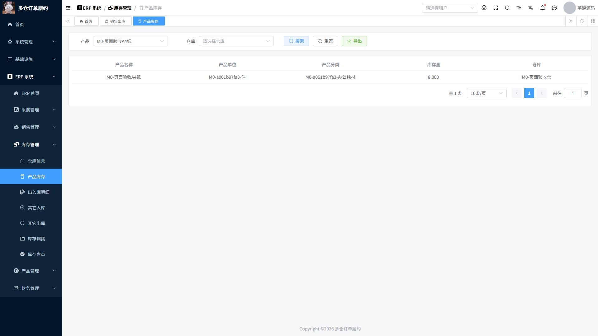

# M0 验收报告

日期：2026-10-16。结论：**M0 已完成，可以开始 M1。**

本阶段证明固定版本的 ERP 能在当前 Windows 环境运行，并能从空库重建、通过真实页面及接口完成基础业务。履约、预占、分仓、可靠消息、仓库权限与压测尚未实现。

## 1. 逐项验收

| 任务 | 实际结果 | 证据 |
| --- | --- | --- |
| M0.1 固定源码导入 | 后端 8924 个、前端 2904 个上游文件完整导入；无缺失文件、无嵌套 Git；许可证保持原样 | [来源和校验值](../../项目代码/docs/baseline.lock.json)、[逐文件对比](M0-import.json) |
| M0.2 ERP 构建 | 启用 ERP 根模块和启动依赖；Maven 所需 21 个模块打包成功；pnpm 冻结安装、Vite 生产构建成功 | [构建结果摘录](M0-build.txt) |
| M0.3 数据库重建 | 上游 48 张通用表 + 本项目 33 张 ERP 表，共 81 张；租户/审计/逻辑删除齐备；主库全字段、业务列类型/精度/可选 ID 默认值核对通过 | [实体清单](M0-erp-schema.md)、[DDL](../../项目代码/deploy/sql/010-erp.sql)、[接口与数据库断言](M0-smoke.json) |
| M0.3 干净库复现 | `Initialize-Database.ps1 -Database fulfillment_m0_clean` 实际成功；独立应用 48081 完成 109 项检查，随后停止 | [空库流程结果](M0-clean-smoke.json) |
| M0.4 HTTP 业务闭环 | 真账号登录、主数据、采购订单/入库、销售订单/出库、盘点/反审核、重复审核、库存不足回滚，19 类 ERP 分页接口；109 项检查通过 | [最终主库结果](M0-smoke.json)、[可执行脚本](../../项目代码/tests/m0_smoke.py) |
| M0.4 浏览器业务闭环 | 浏览器新增仓库、商品、客户、采购订单及入库单、销售订单及出库单；完成各单据审核；库存 10→8 | [草稿库存](M0-ui-draft-stock.json)、[最终 SQL 核对](M0-ui-result.json)、下方截图 |
| M0.4 正常完整重启 | 真实停止并启动 MySQL、Redis、后端、前端；ERP 各表行数、库存行与当天单号计数器重启前后一致；真实登录可用；重启后再跑冒烟通过 | [重启结果](M0-restart.json)、[重启脚本](../../项目代码/tests/m0_restart.py) |

109 是脚本中执行的检查断言数，其中含字段比对和逐笔流水检查，**不是 109 个独立测试用例，也不是压测请求数**。

## 2. 真实业务证据

### 接口案例

每次用唯一 M0 前缀创建一组独立商品/仓库/客户：采购入库 `100.123456`，销售出库 `30.12`，盘亏 `1`，盘点反审核再审核，最终 `69.003456`。测试逐笔计算流水余额并与 erp_stock 比对。

另外建立数量 200 的合法销售单及出库草稿，在现货不足时审核失败，断言审核状态仍为 10、库存和流水未变。

### 浏览器案例

- 商品条码 `M0-UI-001`；商品“`M0-页面验收A4纸`”；仓库“`M0-页面验收仓`”。
- 采购订单 `CGDD20261016000005`，采购入库 `CGRK20261016000005`，入库 10。
- 销售订单 `XSDD20261016000009`，销售出库 `XSCK20261016000007`，出库 2。
- 出库草稿时库存 10；审核后库存 8；实物流水仅两笔：`+10 → 10`、`-2 → 8`。
- 重启后在产品库存页面筛选该商品，仍显示 `8.000`。页面三位小数展示与数据库六位小数存储区分。

## 3. 本阶段改动与排障

1. 两个 POM 开启 ERP，新 profile `fulfillment` 使用独立 MySQL/Redis 和本地地址；未开启商城、WMS、AI 等模块。
2. 从 33 个实体补齐 ERP SQL、字段清单与漂移检查脚本。修复可选关联 ID 缺省值为 NULL，按真实业务语义处理。
3. 加入官方 Maven Wrapper、版本锁和下载 SHA256；前端 pnpm 固定 9.15.9。锁文件的 159 个下载 URL 改为官方 registry，版本/integrity 保留。
4. 收敛前端动态/静态路由，解决未启用 OA 页引用缺失文件导致的构建错误。
5. 使用英文 Junction 解决当前 MySQL Windows 程序在中文路径下的启动问题；运行 Jar 副本避免构建产物被占用。
6. 微信 SDK 仍为 system 社交服务的 Bean 依赖，提供占位配置；外部社交/短信示例禁用，文件主存储切到本地数据库。
7. Redis 开启 AOF 与 RDB，持久化切换时单号序列缺失触发 SQL 唯一号校验；按已有 SQL 单据号上界恢复后，完整重启和业务测试通过。[恢复记录](M0-sequence-repair.json)。正常重启通过不等同于任意崩溃、误删数据后无需恢复。
8. 修复 Windows 验收脚本等待后台子进程管道 EOF 的问题，改为写日志文件并等待启动脚本退出。

设计依据见 [ADR-009](../05-设计决策与复盘/ADR-009-M0-运行环境与基座收敛.md)。

## 4. 已知限制与未执行项目

- 后端打包使用 `-DskipTests`，没有宣称上游全部单元测试通过；本阶段验证由真实 HTTP/MySQL 脚本承担。
- 没有 Docker：Compose YAML 和镜像 digest 已核对，容器运行未验证；已完成本机 MySQL/Redis 替代环境验证。
- Redis 为社区 Windows 构建；当前实际 maxclients 为 3168，尚未进行容量或压测验收。后续压测优先 Linux/容器环境，记录实际条件。
- 前端仍有大 chunk、过期 Browserslist、Vue Router/Element Plus 弃用提示，不影响本次流程；未进行全量 TypeScript 清理和所有无关模块回归。
- 上游单据表单采用固定较大宽度，本次浏览器单据流程在 1920×1080 桌面视口验证；窄屏适配未完成，验证后已恢复浏览器默认视口。
- 普通首页的天气和项目数是上游演示内容，不是实测指标。使用 ERP 页面进行演示。
- 当前库存业务仅完成顺序流程验证。并发首次建库存、旧余额写流水、预占兼容和 SUM 经 double 的精度问题交由 M2；[旧库存入口清单](M0-stock-write-paths.md) 已建立。
- 当前测试使用管理员、一个租户。跨租户和仓库数据权限是后续验收，不由 M0 的登录成功推断。
- 只支持新建演示数据库；不存在历史生产 ERP 数据迁移承诺。

## 5. 继续工作入口

本机保留运行：前端 15173、后端 48080、MySQL 33306、Redis 36379，均为回环地址。48081 空库验证实例已停止；原系统 MySQL80 3306 服务保持运行。

- 使用方法：[根 README](../../项目代码/README.md)。
- 这阶段应理解的原理：[M0 学习讲解](../03-阶段原理讲解/M0-基座与库存调用链.md)。
- 下一阶段：M1.1 创建独立履约模块，随后接管履约迁移历史、销售订单绑定和托管冻结规则。
