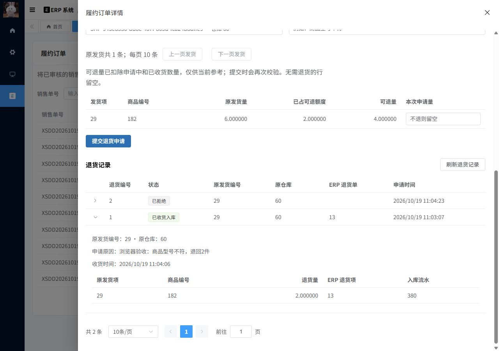

# M4.2 验收报告：退货申请、收货与ERP入库

日期：2026-10-19，Asia/Shanghai。范围M4.2；M4.1已完成，M4.3核对仍未实施，整个M4尚未结束。

## 1. 已实现内容与贡献边界

- 新建 `ful_return`、`ful_return_item`，V4增加原仓、同租户/订单/发货项关联及状态/数量/唯一映射约束。申请和终态不能通过本次API删除。V1—V3、基座提交和MIT保持。
- 新增申请、收货、拒绝、详情、按订单分页、按发货查询可退额度的接口及四个权限。ID和数量使用字符串，数量按DECIMAL(24,6)/BigDecimal；前端校验使用定点BigInt。
- 订单锁内检查 REQUESTED+RECEIVED+本次<=原发货项数量；申请不入库，拒绝释放可退额度。收货/拒绝互斥，重放重新校验权限和归属。
- 新增Java内部MANDATORY退货适配端口，从原已审核出库项读取商品、单位、原仓、单价、税率；复用ERP创建、金额、审核、库存流水和源单累计。原ERP公共写入口仍冻结托管源单，没有HTTP绕过标志。
- H只通过ERP增加一次，R不变；退货项关联ERP退货项和实物流水，returned增加，gross shipped/open/reserved/cancelled保持，不自动重新发货，不产生资金退款。
- 页面在现有工作台中增加“退货与收货”：分页选原发货、可退参考、申请、收货确认、拒绝原因、分页历史与ERP关联。沿用既有Element Plus操作后台，没有重做视觉系统。

基座原有的ERP退货单和库存算法属于复用能力；本部分二开是履约退货建模、额度/锁协议、命令幂等、受控调用、页面和证据，不能描述为全部从零实现。

## 2. 实际执行结果

| 检查 | 实际结果 | 证据 |
| --- | --- | --- |
| 后端打包与指定单测 | 22模块成功，37单测，失败/错误/跳过均0 | `M4.2-build.json`、`M4.2-build.log`、`M4.2-junit/` |
| 新独立库初始化、baseline、迁移、validate | 0/1/2/3/4，命令退出0 | [核心记录](M4.2-return-acceptance.json)中的commands |
| 退货核心、双JVM、两处故障与隔离 | 71项断言通过 | [核心验收](M4.2-return-acceptance.json)，M4.2-m4-return-*日志 |
| 新库M1绑定/冻结/权限回归 | 68项通过 | [新库回归](M4.2-clean-binding.json) |
| 最终产物可退查询与收货验证 | 22项通过 | [最终API](M4.2-final-api.json) |
| 最终产物原ERP流程 | 110项通过 | [ERP回归](M4.2-ERP-regression.json) |
| 主库V3→V4升级 | 25项通过，旧事实保持 | [升级记录](M4.2-upgrade.json) |
| V4数据库负向约束 | 10项通过，探针全部回滚 | [约束验证](M4.2-constraints.json) |
| 实际浏览器操作后的SQL核对 | 21项通过 | [浏览器事实](M4.2-ui-result.json)、[演示初始值](M4.2-ui-fixture.json) |
| 桌面/手机布局 | 两轮完成，修正后390px下表单335px，页面无横向溢出 | [布局数据](M4.2-ui-layout.json)、M4.2-ui-desktop/mobile.jpg |
| 前端定向检查和构建 | ESLint三文件、Stylelint两Vue、Prettier三文件及生产构建退出0 | [前端记录](M4.2-frontend.json) |
| 设计机械检查 | 三个改动前端文件，无检测结果，退出0 | `M4.2-detector.json` |
| 完整依赖重启与命令重放 | 快照一致，12项重放/恒等式断言通过 | [完整重启](M4.2-restart.json)、[重放结果](M4.2-replay-after-restart.json) |
| 最终交付完整性 | 198项通过；35个改动源文件清单，运行/最终受测产物一致，当前主库恒等式成立 | `M4.2-final-qa.json`、`M4.2-changes.json`、`M4.2-runtime.json` |

数量是断言/单测数，不代表独立场景数或性能数据。核心先验证写流程，随后新增只读可退查询，最终产物再完成22项API和110项ERP回归、主库浏览器及完整重启；两个阶段产物摘要保存在最终API记录中，不把所有测试说成只运行过一个构建。

## 3. 关键业务、并发与失败场景

### 3.1 额度、精度与数量含义

独立库订单10.000001、原发6.000001、取消4，初始H=20，出库后H=13.999999。申请2.000001不增加H；收货后H=16、returned=2.000001，gross shipped=6.000001、cancelled=4保持。再收剩余4后H恢复20，订单保持PARTIALLY_CLOSED，重新分配返回NOTHING_TO_ALLOCATE。

已收货2.000001与申请中3合计5.000001，最多再申请1；多0.000001被拒绝。拒绝申请中3后额度释放。重复SKU的两条原发货项分别退1.000001、2.000002，订单项及ERP映射不混用，H精确为16.000003。

### 3.2 双JVM与状态竞争

- 两个JVM的六个同key申请返回同一结果，仅一份申请。
- 不同key并发申请在订单锁内串行，REQUESTED+RECEIVED不超原发货项；额度不足明确返回1080000041。
- 六个同key收货跨JVM返回同一结果，仅一份ERP退货单和实物效果；不同key再收已收货申请也不再次入库。
- 收货与拒绝竞争，只允许一个终态转换；另一个返回1080000042。已拒绝不能收货，已收货不能拒绝。
- 同key不同数量返回1080000005；零、重复项、越界项及超六位小数被拒绝。重放申请返回原REQUESTED响应，查询反映最新状态。

### 3.3 两处ERP故障与恢复

专用 `fulfillment-return-fault-test` profile，先在ERP审核返回后抛错，再切换进程配置，在 `ErpStockRecordServiceImpl.createStockRecords` 执行后、审核尚未返回时抛错。实际日志分别包含 `M4_RETURN_FAILURE_AFTER_ERP` 和 `M4_RETURN_FAILURE_DURING_ERP`。

两处都回滚H/R、ERP单据/流水、ERP源单returnCount、履约returned、退货状态/映射/版本及收货命令。停止故障进程后，正常进程用同一key成功。主profile不加载故障Bean，没有HTTP故障参数。Redis单号允许产生空号，不承诺跨MySQL/Redis回滚。

### 3.4 权限、关联和旧入口

无功能权限、其他订单归属、外租户已分别验证。普通所有者可以收货；撤销收货权限后，原成功key的重放也被拒绝。另一个真实租户能完成自己的退货，租户一不能代收它的订单。可退查询也检查认证、功能、归属和发货关联。

ERP旧创建/反审核/删除托管退货被拒绝，客户端managed/internal字段不能绕过。原ERP未托管流程通过110项回归，保留基座行为。

独立库的FK/CHECK/唯一键探针实际拒绝：跨原发货项、换仓、换租户、已收货缺时间、已拒绝缺原因、数量0、逻辑删除、重复ERP头、重复实物流水映射；所有探针回滚，前后事实一致。

## 4. 主库演示与升级

主库升级前停止应用，执行V4及validate；ERP行数、H/R、预占、订单项、命令、发货/取消/回调与Redis序列等旧事实保持。新增表初始为空，四个退货权限存在。V4已在主库和独立库成功执行，今后不能修改V4，只能新增迁移。

真实浏览器演示销售单 `XSDD20261019000010`，履约228、发货29、商品182、仓库60：

1. 先通过HTTP准备H20、发6、取消4的独立标签样例，不改M3历史演示。
2. 浏览器尝试退7，被前端额度校验阻止；随后申请2，SQL验证H14、returned0、没有ERP退货。
3. 浏览器确认实际收货2，H16、returned2、shipped6、cancelled4、R0，状态仍PARTIALLY_CLOSED；ERP退货单13、退货项13、流水380，refundPrice为0。
4. 浏览器再申请1并拒绝，H16、returned2保持；可退额度恢复4，两份记录分别RECEIVED/REJECTED。

首次打开页面时服务尚未监听而连接失败，服务就绪后重新打开成功。一次状态等待超时后，没有重复提交，而是读取当前页面与SQL确认原申请已成功。初次Stylelint发现15个格式/顺序问题，修正后定向检查退出0。桌面/手机首轮发现网格内表单溢出，统一修正轨道最小宽度、手机展开项宽度及新控件对比度，第二轮确认后停止视觉调整；表格本身可横向滚动。



## 5. 复现入口

```powershell
# backend目录：打包和指定单测
./mvnw.cmd -B -ntp -pl yudao-server -am package '-Dtest=OrderStatusCalculatorTest,AllocationPlannerTest,DatabaseCommandRetryTest,LogisticsSignatureTest,FulExpiryScannerTest' '-Dsurefire.failIfNoSpecifiedTests=false'

# 根目录：独立库验收，每次新建独立库，不重建已有库
$env:M0_PWSH=(Get-Process -Id $PID).Path
C:/veighna_studio/python.exe tests/m4_return_acceptance.py
C:/veighna_studio/python.exe tests/m4_return_read_checks.py
C:/veighna_studio/python.exe tests/m4_return_constraints.py
./tests/m4_return_frontend.ps1
C:/veighna_studio/python.exe tests/m4_return_qa.py

# 一次性的主库V3→V4升级；仅在主应用已停止且历史为0/1/2/3时执行
C:/veighna_studio/python.exe tests/m4_return_upgrade.py

# 当前主库启动与完整重启/重放：先暂停其他写入
./scripts/Start-Local.ps1
C:/veighna_studio/python.exe tests/m4_return_restart.py
```

`m4_return_ui_fixture.py`只准备发货样例，不代替浏览器收货/拒绝。`m4_return_ui_assert.py requested|received|rejected`只读验证对应浏览器阶段；已完成后不再把旧阶段断言当成当前状态。重复完整生成会创建新标签数据，证据中的ID和断言数按当次实际结果更新。

## 6. 当前边界与运行状态

- 主服务15173/48080/33306/36379已恢复；测试48082/48083由脚本停止。独立库 `fulfillment_m4_return_20261019_105244`、Redis DB5保留。系统MySQL80的3306没有改动；本轮开始主服务未监听，先恢复依赖再完成新库验收。
- 最终监听快照的系统3306为PID5996，独立测试48081/48082/48083均无监听。完整性检查将无输出的成功ESLint日志误当成缺失后，改为检查文件存在并结合前端退出码；重新执行198项通过。此交付核对不代替业务验收，也不是压测。
- 退货仍是原仓、原发货项；每份申请一次性收齐，分次退货建多份申请。没有跨仓退回、资金退款、补发订单或撤销已收货事实。
- 权限为功能、租户和订单归属，细粒度仓库权限待M6。查询列表和可退额度存在按行读取，未声称性能优化或已通过压测。
- 没有执行全部上游单测、全仓TypeScript检查、Docker或跨机分布式验证。前端保留上游大chunk/构建提示。原八类库存保护未改，原ERP回归已执行，本轮没有重跑全部M2旧入口专项。
- M4.3核对、M5消息、M6文件任务与细粒度权限、M7压测仍未实现；不自动修正库存事实。
- 源文件保留在工作区，没有本地Git提交、推送或PR；没有修改Codex用户记忆。

设计决策见 [ADR-014](../05-设计决策与复盘/ADR-014-M4.2-退货与ERP入库.md)，讲解见 [M4.2退货额度与ERP入库](../03-阶段原理讲解/M4.2-退货额度与ERP入库.md)。
