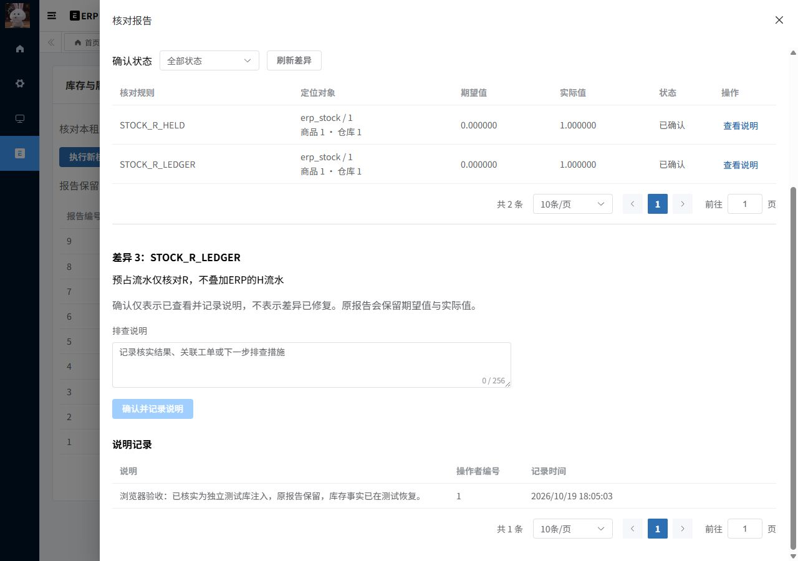

# M4.3 验收报告：一致性快照与差异追溯

日期：2026-10-19，Asia/Shanghai。范围为库存与履约核对；消息、异步文件、仓库细粒度授权与压测仍为后续部分。

## 1. 本次实现

- 新增同步执行全租户核对、报告详情/本人分页、差异筛选分页、人工说明/说明分页，共六条接口。query/run/review三权限，报告查询及人工说明限定本租户、本人报告。审计权限允许观察全租户事实，不自动授给普通订单所有者。
- 外层RC命令事务原子保存报告/差异/命令响应；独立Bean的REQUIRES_NEW只读RR事务建立17表一致性快照。业务写命令仍RC；扫描不改或锁业务事实。首次业务读取前数据库UTC仅作标记，不以时间戳过滤伪造历史快照。
- 本JVM同时最多一个扫描，事务连接外最多等待5秒；忙返回1080000052。每表200条索引游标批次，普通表2000、两类流水10000、差异2000上限；超限返回1080000051，不保存部分报告，失败命令可用原key恢复。
- 核对H/ERP流水、R/held/预占流水、逐笔余额、预占自身、订单汇总/状态、源单投影、发货/取消/退货事实与双向ERP映射。库存键并集可发现缺失汇总行；预占与实物流水不重复叠加。规则版本M4.3-v1。
- V5新建报告/差异/追加说明三表及11张缺少tenant/id索引的业务表扫描索引，其他6表复用既有索引。V1—V4、ERP初始化DDL、固定基座与MIT保持；V5已在独立库和主库执行，后续不能修改。
- 新增现有ERP后台的“库存与履约核对”菜单：新建报告、历史分页、差异定位/筛选、追加排查说明。确认只表示ACKNOWLEDGED，不代表已修复，不覆盖原期望/实际，也不自动改库存。

登录/权限框架和ERP原业务属于基座复用；核对模型、规则、快照协议、准入、报告/说明、页面和本次验证属于二开。

## 2. 执行证据

| 检查 | 实际结果 | 证据 |
| --- | --- | --- |
| 后端打包/指定单测 | 22模块成功，44单测，失败/错误/跳过均0；含新增7个核对规则单测 | `M4.3-build.json`、`M4.3-build.log`、`M4.3-junit/` |
| 新独立库初始化/迁移/validate与核心 | 73项通过，双JVM、故障、快照、隔离与有界扫描 | [核心记录](M4.3-reconcile-acceptance.json) |
| 最终产物新库M1回归 | 68项通过 | [绑定回归](M4.3-clean-binding.json) |
| 最终产物原ERP流程 | 110项通过 | [ERP回归](M4.3-ERP-regression.json) |
| 主库V4→V5升级 | 29项通过，旧业务/Redis事实保持 | [升级记录](M4.3-upgrade.json) |
| 新表FK/CHECK | 8项通过，全部探针回滚 | [约束记录](M4.3-constraints.json) |
| 实际浏览器操作后SQL | 7项通过，新报告与人工说明真实落库、两库业务事实保持 | [浏览器SQL](M4.3-ui-result.json) |
| 桌面/手机检查 | 两轮，修正抽屉颜色变量/局部分页滚动，390px整页无横溢 | [布局证据](M4.3-ui-layout.json)、M4.3-ui-desktop/mobile.jpg |
| 前端 | 两文件ESLint/Prettier、一Vue Stylelint与生产构建退出0；机械检测[] | [前端记录](M4.3-frontend.json)、`M4.3-detector.json` |
| 完整重启与报告重放 | 7项通过，包含报告/说明的新完整快照一致 | `M4.3-restart.json`、`M4.3-replay-after-restart.json` |

数量表示断言/单测数量，不代表独立场景、吞吐量或性能。核心成功运行使用的保留jar与最终主/测试jar摘要由交付核对记录确认；早期失败记录单独归档，不计入通过数量。

## 3. 核心验证细节

独立成功库为 `fulfillment_m4_reconcile_20261019_175618`，Redis DB6，真实JVM48082/48083；成功核心脚本停止所有自己的进程。初始化/baseline/migrate/validate均退出0，历史0/1/2/3/4/5。

### 正确性与污染恢复

HTTP建立发货6.000001、取消4、已收退货2.000001及一份拒绝申请，正常扫描0差异。随后在该独立库分别注入H、R、heldDelta、reservedAfter、returned、源项outCount、ERP出库项数量、退货流水关联、totalCount及删除库存汇总，共10类污染。报告均发现对应规则，并验证扫描不修复/改动污染事实。每次finally恢复整行，包括审计字段，最终业务全表快照恢复相同。

旧脏报告继续保留，确认说明不覆盖expected/actual；恢复后的新扫描为0差异。无权限、匿名、其他审计人员的报告ID、外租户、撤销权限后的原key重放均验证隔离；另一个真实租户的空范围报告只读取0行。客户端附加tenant/actor/warehouse参数不能扩大范围。

### 并发、快照、失败

- 两个JVM、六个同key请求得到同一报告，只持久化一份命令/报告。
- 测试profile在报告插入后抛错，报告/差异/命令全部回滚，业务事实保持；正常实例同key恢复成功。
- 服务器row-limit=1时超限明确失败，无部分报告/命令；恢复服务器上限后同key成功。差异上限的纯规则单测验证抛错而非截断。
- JDBC命名锁暂停扫描：先读库存，再等待；同实例另一次扫描5秒后BUSY且没有claim命令。普通实例通过HTTP完成新的发货/退货，释放屏障后原报告仍0差异；新扫描读取更多行且0差异。
- 专用测试profile记录实际RR快照隔离和恢复的外层RC隔离；没有生产HTTP故障开关。JVM重启后原扫描和原说明key返回原结果。

### 真实浏览器

临时15174前端连接成功独立库48082。浏览器新建报告22，读取123条/0差异；查看历史报告3（R期望0、实际1，两条差异），为差异3保存“浏览器验收：已核实为独立测试库注入，原报告保留，库存事实已在测试恢复。”，一条说明入库，状态已确认，旧值保持。独立库和主库17张业务表摘要与浏览器操作前一致。

首轮发现抽屉组件根节点没有父级scoped属性，局部颜色变量未继承，以及手机分页部分裁切。把变量放到本组件内容容器，并在局部包装共享分页，第二轮验证手机内容335px、抽屉390px、整页390px、分页仅局部滚动，主色#2d6fb3、占位文字#606266。视口切换曾读到宽度动画中间值，稳定后确认实际390px；热更新重置开发页状态后重新打开同一历史报告，没有再次提交说明。临时视口已恢复，不继续视觉微调。

下图为**独立验收库保留的历史差异报告**，主库没有被故意改坏：



## 4. 初次失败与实际修正

初次污染探针只恢复数量，数据库ON UPDATE改动了审计时间，全表恢复断言失败；改为恢复整行后重新新建独立库。第二次把@NotBlank拒绝空说明的预期错误码误写成业务码，实际参数校验返回400；修正测试契约后再次新库完整运行73项通过。两次失败JSON/log保留为M4.3-initial-*，不算通过，也不污染主库。

实现审查将“整个核对使用RR”收敛为外层RC加独立只读RR，避免权限读取或等待同key命令提前建立事实read view。事务外增加扫描准入，防止外层占满连接池后都等待内层连接；该最终方案已通过成功核心验证。

主库启动与独立JVM同时冷启动时，Start-Local的55秒等待曾超时，但随后原后端正常监听且认证成功。确认原进程归属后再次Start-Local复用原后端并启动前端，没有重复启动占端口实例。页面登录的自定义复选框原生uncheck超时后，读取状态并点击可见标签完成，未绕过认证。一次编辑命令相对目录错误未写入文件，改用正确目录后应用修正。

## 5. 复现

```powershell
# backend目录：最终后端与指定单测
./mvnw.cmd -B -ntp -pl yudao-server -am package '-Dtest=OrderStatusCalculatorTest,AllocationPlannerTest,DatabaseCommandRetryTest,LogisticsSignatureTest,FulExpiryScannerTest,ReconcileEngineTest' '-Dsurefire.failIfNoSpecifiedTests=false'
# 根目录：每次核心验收创建新的独立库，保留旧数据
$env:M0_PWSH=(Get-Process -Id $PID).Path
C:/veighna_studio/python.exe tests/m4_reconcile_acceptance.py
C:/veighna_studio/python.exe tests/m4_reconcile_constraints.py
./tests/m4_reconcile_frontend.ps1
# 独立UI运行/ERP回归；最后必须停止自己的进程
C:/veighna_studio/python.exe tests/m4_reconcile_ui_runtime.py start
# 浏览器完成新建报告与说明后，按本次实际ID更新/运行对应只读断言
C:/veighna_studio/python.exe tests/m4_reconcile_ui_assert.py
C:/veighna_studio/python.exe tests/m4_reconcile_ui_runtime.py stop
# 仅在主库历史0..4、主应用停止时执行一次；当前已是V5，禁止重复执行旧升级门禁
C:/veighna_studio/python.exe tests/m4_reconcile_upgrade.py
# 暂停其他写入后验证完整重启；归档阶段报告保持
C:/veighna_studio/python.exe tests/m4_reconcile_restart.py
```

## 6. 边界与下一项

当前是有上限的同步全租户核对，每次同时占用两条连接，每JVM一个扫描；规则仍有重复遍历，没有压测/海量内存或跨机验证。没有持久化失败任务、后台调度核对、自动修复库存、退款、细粒度仓库权限或删除报告API。人工确认不表示已修复。

Spring事务timeout约束数据库操作，不等于纯Java规则计算的强制中断；当前通过有界数据和单名额控制资源，未验证上限负载时延。机械检测在视觉检查前执行一次，变量/分页修正后重新完成最终ESLint/Stylelint/Prettier和生产构建。

已运行当前指定单测、M1与原ERP回归；没有重跑全部上游单测、全部M2旧入口专项或全仓TypeScript清理。保留Flyway对MySQL8.4较新版本和上游前端大chunk提示。M4.2详细学习包保持历史快照，新增核对讲解独立提供，不把历史资料校验当成本轮业务验收。

下一项M5.1是Outbox与领域事件的同事务落库，尚未实施。代码保留工作区，无Git提交、推送或PR；不修改Codex用户记忆。设计见 [ADR-015](../05-设计决策与复盘/ADR-015-M4.3-快照核对与差异追溯.md)，原理与面试见 [M4.3讲解](../03-阶段原理讲解/M4.3-一致性快照与差异核对.md)。

最终主库历史0/1/2/3/4/5，三份主报告均2529条/0差异；主服务15173/48080/33306/36379保持。独立UI15174/48082及核心48082/48083均停止，实际PID/监听见M4.3-runtime.json。完整交付核对与源文件哈希见M4.3-final-qa.json、M4.3-changes.json。

最终交付完整性274项通过，记录31个改动文件哈希；实际JUnit/构建和成功核心保留jar、独立UI、主运行jar与最终构建的SHA一致。检查文档UTF-8/围栏/本地文件链接、真实截图、日志和权限受控的报告读取。它不代替业务验收，也不是性能测试。
