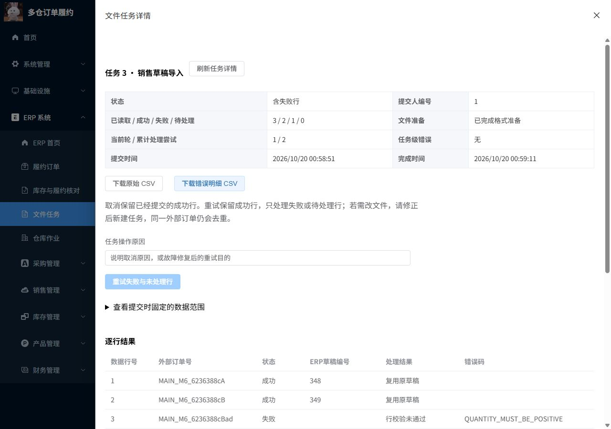
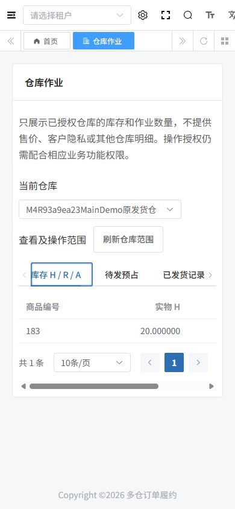

# M6：文件任务、仓库权限与审计验收

状态：M6.1—M6.4全部通过本报告所列验收。2026-10-20，Asia/Shanghai。范围为M6.1—M6.4；M7未开始。

## 1. 实际扩展与基座复用

| 部分 | 本次扩展 | 复用与边界 |
| --- | --- | --- |
| M6.1 | MySQL任务准入、租约版本、有界调度、取消与恢复 | Spring调度/线程池；内存队列不承担持久化职责 |
| M6.2 | CSV准备、行事务、跨任务身份、错误明细和人工重试 | 调用上游ERP创建未审核销售草稿；不自动审核/预占/扣库存 |
| M6.3 | 冻结范围/最大ID、游标XLSX、私有文件、当前授权下载 | FastExcel流式写入；生成时间窗，不是严格时点快照 |
| M6.4 | READ/OPERATE授权、专用字段投影、执行上下文与审计 | 复用上游登录/角色功能权限及V1预留grant；没有改造全部上游ERP数据权限 |

实现取舍见[ADR-017](../05-设计决策与复盘/ADR-017-M6-持久化文件任务与数据授权.md)，逐步原理见[M6讲解](../03-阶段原理讲解/M6-可恢复文件任务与仓库授权.md)。固定基座、MIT、ERP唯一实物库存写入口及RC业务事务保持。

## 2. 执行证据索引

实际数量与执行来源在以下JSON逐项保存。

| 验证 | 实际断言/步骤 | 结果及来源 |
| --- | --- | --- |
| 任务准入/领取后崩溃 | 22 | [通过](M6.1-foundation.json) |
| 导入/导出/权限/线程上下文 | 104 | [通过](M6-acceptance.json) |
| 消息与文件工作者共存 | 8 | [通过](M6-supplement.json) |
| 数据库负向约束 | 10 | [通过](M6-constraints.json) |
| 既有绑定回归 | 68 | [通过](M6-M1-regression.json) |
| 既有ERP回归 | 110 | [通过](M6-ERP-regression.json) |
| 主库V6→V7保留旧事实 | 40 | [通过](M6-upgrade.json) |
| 主演示HTTP | 4 | [通过](M6-main-demo.json) |
| 真实浏览器动作SQL | 8 | [通过](M6-browser-SQL.json) |
| 完整重启/文件/原key | 13 | [通过](M6-replay-after-restart.json) |
| 定向前端检查和构建 | 4 | [通过](M6-frontend.json) |

最终独立库`fulfillment_m6_20261020_004428`，Redis DB8；主/受测/最终构建jar的SHA256由M6-build.json核对。后端22模块、8套选定JUnit共60项；详细源码及归档检查见[M6最终核对](M6-final-qa.json)与[显式改动清单](M6-changes.json)。

## 3. 文件与数据契约

导入仅支持UTF-8 CSV（含BOM/引号转义），五列表头为externalOrderNo/customerCode/productCode/quantity/unitPrice。每行一张单商品草稿，customerCode为内部客户ID，productCode为启用商品条码。BigDecimal校验最多18位整数/6位小数；数量>0、价格>=0。先完成格式和10000行上限准备，才执行业务写入。

输入默认10MiB/10000行，字段256字符、外部单号128字符；输出默认50000行/50MiB，批次100。默认2工作线程/4内存排队槽，每租户运行2/未完成20，全环境未完成100。测试将容量缩小以确定拒绝/恢复行为；这些配置上限不是实测吞吐数字。

数据库保存六张新表：ful_job_gate、ful_private_file、ful_file_job、ful_file_job_row、ful_import_identity、ful_operation_audit。V7启用原grant的READ/OPERATE类型并新增50019—50026八个菜单/权限。V1—V7执行后冻结，不能修改历史迁移修测试。

## 4. 关键业务与故障验证

### 任务准入和进程恢复

数据库门闩负责并发准入，满额拒绝不残留命令；取消后同一先前被拒绝的key可提交。线程池拒绝不会预先占有任务。真实exit80发生在领取后；新JVM等租约过期，以更高version领取。行提交后exit81则已成功草稿保留，新执行跳过成功行。

双JVM导出屏障让旧进程停在发布前，新进程在租约过期后完成；释放旧屏障，旧owner/version不能覆盖新文件或进度。这是持久化任务恢复和迟到写隔离证据，不宣称跨机文件系统或集群高可用。

### 逐行事务与重复导入

正常文件含有效行、零/负数量、精度超限、不存在商品，验证成功/错误数量、未审核状态、精确小数和真实错误CSV。再次上传相同内容可复用原提交；新任务仍由tenant+sourceSystem+externalNo唯一键复用原草稿。改内容却沿用已成功业务键会冲突。

测试profile在ERP创建后抛错，ERP草稿、身份和成功行状态整体回滚；错误另事务记录。健康工作者人工重试后只生成一次。取消保留已经提交的成功行，取消任务不能按失败任务重试。10MiB+1、10001行、无效表头、非法UTF-8、私有输入摘要不匹配均有实际拒绝/失败验证，未用主库注入这些故障。

### 游标导出与授权

实际生成并解压XLSX，核对文本单元格、无公式、范围/起止时间/最大ID元数据。提交后新增发货不进入旧任务最大ID范围；小批次覆盖多轮游标。超行上限不发布半成品。工作中、发布及下载均复核原发起人当前权限；当前下载者还必须有自己的权限。

新增授权不扩大旧导出；撤销旧范围拒绝旧下载与原导出key。任务、行结果、文件按租户和本人/本租户管理员隔离。普通仓库用户默认无范围；专用库存/预占/发货投影不含价格、客户和其他仓库明细。撤销OPERATE后旧分配/释放/发货/取消/退货命令重放也不能绕过授权；保留READ仍可查看。

同一实际池线程跨任务/跨租户后，finally清理TenantContext及SecurityContext；停用发起人后排队任务失败且不创建草稿。未授广泛上游ERP权限的仓库角色不能通过上游整单/客户查询越权。此结论限定于验证的角色与本次履约入口，不能扩大成整个上游ERP都已有仓库ACL。

## 5. 页面与主演示

新页面为ERP系统 → 文件任务、ERP系统 → 仓库作业。文件任务支持CSV上传、异步提交、状态/进度、行结果/审计、原因重试/取消及受权下载；仓库作业提供范围内库存/预占/发货，管理员可授予/撤销仓库权限并查看审计。手机表格和分页局部横向滚动，避免整页被撑宽。

主演示只创建合成测试草稿/任务/演示账号。实际浏览器重新上传演示CSV，复用原两张有效草稿并保留一条行错；重试错误行、创建新范围导出、下载错误/结果，授予再撤销合成用户OPERATE。SQL同时核对17张业务事实摘要保持；权限审计和下载审计会正常增加。

主演示sourceSystem：`MAIN_M6_6236388c`，原导入任务`1`、原导出任务`2`；仓库`61`。CSV见[M6-demo-input.csv](M6-demo-input.csv)，合成仓库账号见[M6-main-demo.json](M6-main-demo.json)。

## 6. 重启与来源

完整停止/启动项目拥有的MySQL33306、Redis36379、RabbitMQ/EPMD和前后端，系统MySQL80的3306不操作。快照包括所有原事实、Redis序列、五张消息表、六张任务相关表和warehouse grant；持久化文件逐一核验字节大小/SHA256。恢复后以原导入/导出key重放并下载既有文件，核对无新业务/任务/身份及原报告稳定。

后端选定8套JUnit覆盖60项，22模块构建。定向前端ESLint/Stylelint/Prettier/生产构建；机械检测一次；桌面1280×900、手机390×844有界批量验收。没有运行全仓TypeScript检查、全部上游测试或M7压测。

## 7. 实施中的失败与修正

- 前端最初Stylelint格式/顺序问题，以及格式化后的内联多语句click解析失败，已改命名handler并重新检查构建；初始失败记录保留。
- 探索核心已过88项后，测试探针比较ERP字符串creator与数字actor时遇到MySQL混合排序规则。探针改为数字比较；没有修改V7或业务实现，最终使用新独立库/最终产物完整重跑。
- CSV构造阶段非法UTF-8异常可能未关闭reader，已补构造失败close及回归单测；选定单测59→60，最终foundation/core改用修复后相同jar。
- 主库升级首次在完整核心结果文件尚未生成时被前置门禁拒绝（0项、未执行迁移），保留guard证据；核心通过后才允许实际升级。

## 8. 剩余边界与下一阶段

没有Excel输入、部门树数据权限、跨机共享存储、孤儿私有文件自动清理、集群HA、严格导出时点快照或性能数字。当前每行单商品草稿；未成功行改文件须新任务，已成功业务键改内容不自动覆盖。后台与API共享数据库资源，M7需要实测查询和库存竞争后再决定优化。

下一阶段M7：部署复现、完整集成复盘、原始压测/EXPLAIN及优化对比、演示和简历追问整理。M6没有提前认领这些工作；没有commit、推送或PR，也不修改Codex用户记忆。

## 9. 最终交付核对

最终312项交付核对通过，显式记录51个源文件/文档哈希；这是交付完整性检查数量，不是新增业务测试或性能指标。主运行、核心受测、最终构建jar相同；源码清单不是Git diff。主服务和系统3306监听正常，独立测试端口已释放。

运行探针第一次误用了本基座未注册的Actuator端点（业务404响应），原记录保留为M6-runtime-initial-actuator-404.json；改用真实登录和受权文件任务runtime验证enabled/线程池，并验证前端HTTP200，没有为检查新增或开放监控端点。
