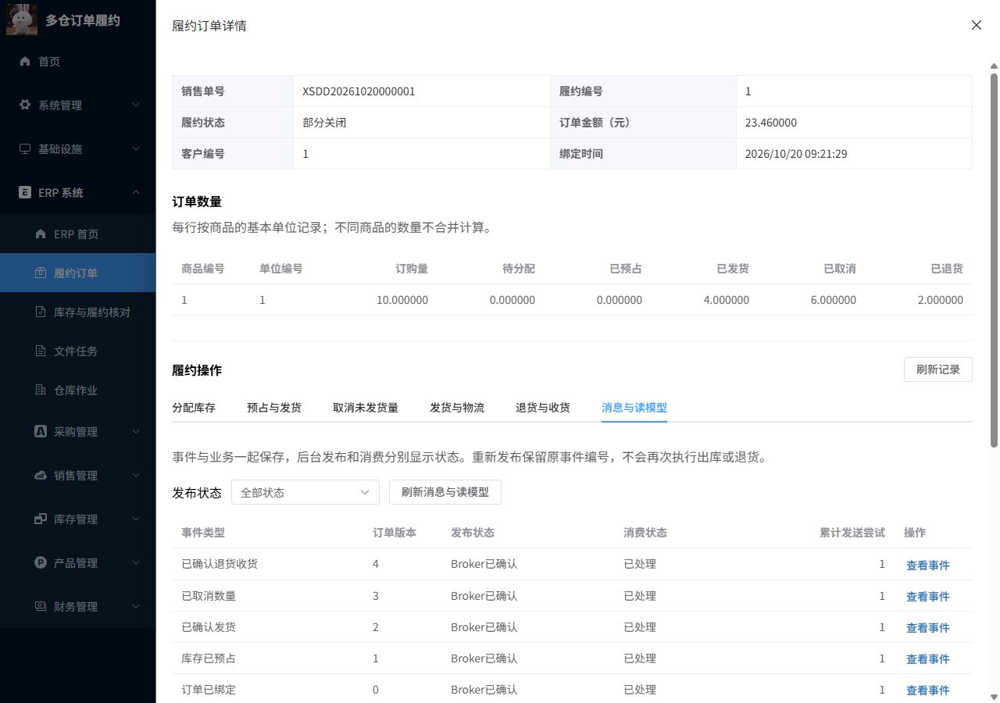

# M7.1：独立交付包、固定演示与正常重启

2026-10-20，Asia/Shanghai。状态：M7.1已完成验收、浏览器确认及ZIP归档。本报告仅覆盖M7.1，不表示整个M7完成。

## 1. 当前范围

自包含应用交付：后端jar、生产前端、SQL、安装/启停和固定演示脚本、逐文件SHA256、上游固定提交/MIT。运行不依赖源码树、node_modules、Maven/pnpm或源码外私有配置；Java/Node及MySQL/Redis/RabbitMQ作为手册中的明确外部依赖。

实际在同一Windows主机的源码外新目录（路径含空格）使用新schema、Redis DB9、独立RabbitMQ vhost、48082/15174和独立私有目录。依赖服务复用，原主库、主vhost、Redis DB0以及系统MySQL3306不改。没有全新OS、容器、Linux、跨机或TLS生产部署证据。

## 2. 执行证据

| 验证 | 实际结果 | 来源 |
| --- | --- | --- |
| 独立交付与演示/重启 | 45项通过 | [场景证据](M7.1-release.json) |
| 浏览器生产模式页面 | 订单1，数量10/0/0/4/6/2，五事件完成 | [DOM证据](M7.1-browser.json) |
| 进程收尾和ZIP | 11项通过，392个归档文件 | [归档证据](M7.1-closeout.json) |
| 最终源码/文档核对 | 以实际JSON为准 | [交付核对](M7.1-final-qa.json)、[源文件清单](M7.1-changes.json) |

本轮schema/vhost：`fulfillment_m7_release_20261020_092029`，复制目录：`C:\Users\Lenovo\fulfillment-delivery-tests\release 20261020_092029`。后端SHA256：`80dd50401f2149ca636f98944eac7f80b2e0cff588c67e17326fe95215d9b32b`。原库17表前后摘要：`13d5143633f63b322c274d47d54dfc627007e3432434badc7fd559b381928e29`。

`M7.1-release.json`保存每条断言、命令退出码、源包/运行目录、隔离库/vhost、固定业务编号、原key及主库摘要。`M7.1-closeout.json`保存ZIP文件清单/CRC/大小/哈希和进程收尾；前端构建日志及独立运行日志一起归档。失败记录分别保留，不会覆写成通过。

后端使用M6相同jar，选定单测60与核心104是同产物历史证据，本轮没有重新运行这两套全部测试。M7.1新增的是打包/新库安装/同源代理/固定全流程/权限/文件/正常应用重启断言；M7.2完整矩阵仍待实施。

## 3. 实际业务数量

| 步骤 | 西安H/R | 上海H/R | 核对 |
| --- | --- | --- | --- |
| 入库 | 6/0 | 8/0 | ERP入库和流水 |
| 分仓预占10 | 6/6 | 8/4 | 西安优先，输入顺序不决定分配 |
| 西安发4 | 2/2 | 8/4 | ERP唯一扣减H |
| 取消剩余6 | 2/0 | 8/0 | 不回滚已发4 |
| 签收 | 2/0 | 8/0 | 签名HTTP回调，不改库存 |
| 实际退回2 | 4/0 | 8/0 | shipped4/cancelled6/returned2，gross不减 |

固定演示还通过同源代理上传CSV（一条合法、一条数量0），两个导入任务均成功1/失败1，第二个复用原草稿，身份只有1条；生成真实库存XLSX/错误CSV，Outbox和Inbox完成，读模型版本对齐。合成仓库账号仅西安READ，不能查上海或整单价格；最终核对0差异。

所有业务数据由包内Node脚本经真实HTTP接口创建，没有用SQL INSERT冒充业务执行。SQL用于只读断言；安装SQL只在新库执行。配置/私有文件不能由静态web服务获取。

## 4. 安装与重启保护

- 构建清单中不含活跃config/data/node_modules；拷贝后逐项核对字节摘要。
- 在独立副本临时篡改serve.cjs，启动在创建进程前拒绝；finally恢复原字节，不修改源码或主环境。
- 新库baseline→migrate→validate为V0—V7；初始17张业务事实表为空。
- 已有库再次运行Install被拒绝，业务与全部ful_表事实保持。
- 正常停止/启动包内前后端，所有业务/ful_表完整快照一致，登记私有文件大小/SHA256相同；演示重跑只读固定编号，原绑定key返回原结果，无新增事实。
- 主环境17表摘要前后相同。测试结束停止归属本包的应用进程，保留隔离库/队列/文件以便复盘，不自动删除数据。

这里只重启独立包应用，未重新停止主依赖服务。M6完整MySQL/Redis/Broker重启证据仍为历史；不要把两种重启重复计数。

## 5. 实施中的失败与修正

1. 最初选缓存子目录作为“源码外”目录，resolve发现它实际通过目录链接落回项目.local。门禁在复制前拒绝；改用独立用户目录，验证真实解析后仍在源码之外。
2. 空Redis密码环境值触发Redisson AUTH失败，启动脚本改为无密码时不设置该属性；不修改Redis服务密码，重新构建并从新库验证。
3. 固定演示和32项检查已完成后，测试快照SQL的LIKE百分号被PyMySQL按参数格式解析。改用LEFT匹配；保留失败证据，后续只在同目录/同schema/相同清单与jar上续验重装拒绝和重启，不假称重新跑过之前的全部步骤。
4. 首次续验的Python默认数据库参数捕获了模块导入时的新名字，查询被数据库权限拒绝；改为调用时读取目标schema。权限门禁没有放宽，原库未改变，仍沿用原独立schema和同产物续验。

## 6. 使用与学习

运行步骤：[交付手册](../06-运行交付与证据/独立交付运行手册.md)。按业务理解：[M7.1原理讲解](../03-阶段原理讲解/M7.1-独立交付与固定演示.md)。设计边界：[ADR-018](../05-设计决策与复盘/ADR-018-M7-交付与性能证据边界.md)。

交付ZIP：[下载本机交付包](../../项目代码/.local/releases/fulfillment-20261020-092017.zip)，153.3 MiB。SHA256：`08099ed6b37b31f75cbee93182db173e48855017182c8ccdd11c2d198ec721fb`。包内manifest与ZIP摘要需由可信渠道核对；不是数字签名发布。

15174沿用过旧阶段的浏览器会话，服务器拒绝过期Token；通过页面重新登录且关闭“记住我”后，确认当前新库的订单1与V7菜单。临时页关闭、视口恢复，验收应用停止，主15173继续运行。

## 7. 下一项

M7.2建立T01—T30当前集成/故障重演矩阵；M7.3采集查询与库存竞争原始性能、执行计划及优化对比；M7.4整理演示、个人贡献、简历和深入追问。当前没有新增性能数字，不把同机多实例正确性等同于生产吞吐，也不提前认领这些后续部分。
